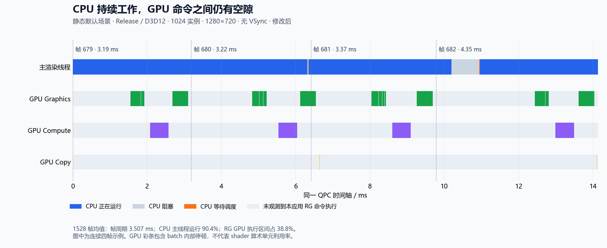

# 默认场景的帧时间、CPU 等待与 GPU 执行区间

后续已针对录制调度、参数绑定和 Job 完成通知实施修改，结果见 [执行路径修改报告](Render-Execution-2026-09-20.md)。下文及时间线图保留当时的测量结果，不代表后续版本的占空率。

本次重新测量显示，RG 修改在受控的静态默认场景中带来了整帧收益：两次基线平均 4.169 ms，两次修改后平均 3.471 ms，下降 16.7%。上一份报告中的单次短对照没有证明提速，也不足以证明没有提速。不能把此前 RG 多线程区间之和约减半，理解为整帧也应该减半。

修改后的主要限制仍在 CPU 侧。同步采集 CPU 调度和 GPU 时间戳的一次低开销运行中，主渲染线程运行占比 90.4%，阻塞占比 9.4%，GPU 上本应用 RG 命令执行区间的并集约占 38.8%。GPU 命令之间仍有较大间隙。

**测量范围**

- CPU：Intel Xeon E5-2698B v3，16 核、32 个逻辑处理器。GPU：NVIDIA RTX 3080，驱动 610.74。
- Release、Direct3D12、默认资产、1024 个实例、1280×720、异步 compute 开启、关闭 VSync、隐藏窗口。
- 基线是 `aa8d22fe`，在隔离检出中生成资产。A/B 只替换 RenderGraph DLL，其他应用代码、RHI、资产和 VSM 修改保持一致。
- 使用 `--static-scene`。基线动态场景在 ECS 嵌套存储访问声明处抛异常；主工作区还存在独立的资产格式迁移。因此这不是动态默认场景的性能结论，也不是主工作区所有未提交修改的整体评估。
- 系统记录由经用户授权的管理员辅助进程启停，应用仍以普通权限运行。用于结论的 CPU 记录没有丢失事件，引擎 trace 完整、无 scope 错误。

**低开销 A/B**

顺序为基线、修改后、修改后、基线。每个进程运行 2048 帧，舍弃前 512 帧，保留 1536 帧。只记录引擎帧边界，同时采集 ETW 上下文切换和 ReadyThread；这些运行没有 GPU 查询探针。

```text
--frames 2048 --hidden-window --no-vsync --static-scene
--trace <独立文件> --trace-frames-only
```

| 顺序 | RG | 平均帧时间 ms | p95 ms | 主线程运行 ms/帧 | 主线程阻塞 ms/帧 | 等待调度 ms/帧 |
|---|---|---:|---:|---:|---:|---:|
| 1 | 基线 | 4.2070 | 5.6005 | 3.7239 | 0.4732 | 0.0108 |
| 2 | 修改后 | 3.5739 | 5.0760 | 3.2610 | 0.3068 | 0.0073 |
| 3 | 修改后 | 3.3689 | 4.8058 | 3.0462 | 0.3170 | 0.0067 |
| 4 | 基线 | 4.1305 | 5.4520 | 3.7214 | 0.4006 | 0.0095 |

两组均值比较：4.1688 → 3.4714 ms。主线程运行时间平均减少约 0.5690 ms，阻塞平均减少约 0.1250 ms。四次样本中存在运行间波动，但两次修改后均快于两次基线；这比此前一对 256 个稳态帧的控制更有说服力，仍不应推广到未测场景。

本次测量 DLL 的 SHA-256：

- 基线：`D8D59592EAFC87556D3ED1A367B21E641025F562DA2453742E3943504FD1C6CD`
- 修改后：`DD2052AB0948C25FFFA382E19FEF69C7603138CFCDBDD86E84D5912D28F5A424`

**同一时间轴上的占空率**

另一次修改后运行在各录制 batch 两端写入 GPU timestamp，使用队列时钟校准转换到 CPU QPC。结果在原有帧资源复用边界读取，没有增加逐帧 GPU 等待。探针先通过 24 帧 D3D12 验证。正式测量不开验证，共 2048 帧；舍弃前 512 帧和最后 8 帧，避免尾部尚未回收的查询，统计连续 1528 帧。

这次仍只记录引擎帧边界。平均帧 span 为 3.5063 ms；包含帧标记之间微小间隔的平均帧周期为 3.5072 ms。下表以连续观测窗口的帧周期为分母，不把并行线程时间累加成帧时。

| 时间区间 | 平均 ms/帧 | 占帧周期 |
|---|---:|---:|
| 主渲染线程正在 CPU 上运行 | 3.1708 | 90.41% |
| 主渲染线程阻塞 | 0.3290 | 9.38% |
| 主渲染线程就绪、等待调度 | 0.0075 | 0.21% |
| GPU Graphics 命令执行区间 | 0.8286 | 23.63% |
| GPU Compute 命令执行区间 | 0.5307 | 15.13% |
| GPU Copy 命令执行区间 | 0.0033 | 0.09% |
| GPU 三队列执行区间的并集 | 1.3625 | 38.85% |
| 未观测到本应用 RG 命令执行的区间 | 2.1447 | 61.15% |

CPU 和 GPU 行不能相加；它们有重叠。三条 GPU 队列在这次样本中几乎没有观测到执行区间重叠，开启 async compute 本身并不保证并发执行。

按主线程与 RG GPU 区间的交集再拆分：

| 同一时刻的状态 | 平均 ms/帧 | 占帧周期 |
|---|---:|---:|
| 主线程运行，GPU 也在执行 RG 命令 | 1.3581 | 38.72% |
| 主线程运行，GPU 没有 RG 命令执行 | 1.8126 | 51.68% |
| 主线程不运行，GPU 执行 RG 命令 | 0.0044 | 0.12% |
| 主线程不运行，GPU 也没有 RG 命令执行 | 0.3321 | 9.47% |

最后一行不代表整个进程或整台机器没有工作，其他 CPU 线程仍可能运行。这个进程全部线程的运行时间之和相当于平均占用 3.89 个逻辑处理器，约为这台 32 逻辑处理器机器的 12.2%。该值包含调度器、驱动、协调和采集工作，不能当作有效场景计算的利用率。



**CPU 在做什么，在哪里等待**

用另一份完整区间 trace 与 ETW 调度区间取交集，并临时细分渲染系统、准备系统和提取应用三个入口。该次平均帧 span 为 3.8633 ms，比仅有帧标记的 GPU 查询运行更慢，故仅用于归因，不用于 A/B 提速比例。下表为主线程独占时间，已经扣除嵌套子区间。

| 阶段 | 区间耗时 ms/帧 | CPU 运行 ms/帧 | 阻塞 ms/帧 |
|---|---:|---:|---:|
| RenderSystems.Update | 0.7110 | 0.3649 | 0.3399 |
| PrepareSystems.Update | 0.4034 | 0.3310 | 0.0712 |
| ApplyExtraction | 0.0026 | 0.0026 | 0 |
| native API 合计 | 1.3815 | 1.3773 | 0.0032 |
| RHI 封装合计 | 0.5896 | 0.5896 | 0 |
| RG 管理合计 | 0.5569 | 0.5373 | 0.0191 |
| 显式 wait 区间合计 | 0.0200 | 0.0063 | 0.0129 |

表中未列出少量应用、pass 回调和帧边界自身成本，也未单列每行很小的等待调度时间。native API 包含命令录制与提交，不等于只调用 ExecuteCommandLists 的时间。

- `Present` 在 native 合计内：CPU 运行约 0.3291 ms，阻塞约 0.0030 ms。这次没有被 Present 等待主导。
- `ExecuteCommandLists` 在 native 合计内：约 0.3282 ms，几乎全部处于 CPU 运行状态，不能把它标记成 GPU 等待。
- `ID3D12CommandQueue.Wait` 调用约 0.0544 ms，是向 GPU 队列提交依赖的 CPU 工作；这里没有测得 CPU 阻塞。
- `TaskCompletion` 约 0.00048 ms，未测得阻塞。代码中 2 ms 消息轮询确实存在，但不能据此声称它拖慢了本次稳态样本。
- 渲染系统和准备系统合计约 0.4111 ms 阻塞，占主线程全部阻塞约 92%。定位已到这两个系统组边界；本次没有足够证据进一步把它全部归到某个锁、某个资源或某个 Job。

因此，后续架构检查应优先针对系统更新期间的同步资源访问与完成条件，以及主线程串行录制、RHI 和 native 提交成本。RG 持久结构的局部更新已经减少工作，但无法同时消除这些其他成本。仅从 GPU shader 或 VSM 页渲染入手，无法消除图中这些 CPU 工作和协调间隙。

**指标含义与限制**

CPU 的“运行”来自上下文切换记录，表示线程占用了处理器；其中可能包含自旋、驱动工作、分配和同步管理，不等于全部是有效计算。“阻塞”与“已就绪等待调度”分开统计，方法参考 [Microsoft CPU analysis](https://learn.microsoft.com/en-us/windows-hardware/test/wpt/cpu-analysis)。

GPU 数字来自引擎录制 batch 的时间戳区间，而不是 nvidia-smi 的整卡采样。区间包含 batch 内 barrier、内存访问和执行停顿，不是 shader 算术单元/SM occupancy。队列等待命令在 batch 之外提交；排队到第一条时间戳之前的时间没有算作 batch 执行。GPU 的批次标签取自首个 pass，不能将整批耗时归到首个 pass 或直接称为“VSM 耗时”。

占空率对同一时间窗口中的全部观测区间取并集，不按 CPU 帧号简单累加；GPU 可以处理其他在途帧，工作线程在仅帧标记模式下也可能没有因果帧号。图中浅色区间仅表示没有观测到本应用 RG batch 执行，不代表其他进程、桌面合成器或显卡其他引擎一定闲置。

自定义 ETW GPU provider 的采集未获得可用 GPU 事件；Windows 内建 GPU 完整配置的试采集丢失了事件，两者都没有用于 GPU 定量结论。最终 GPU 数据使用经过验证的硬件查询。CPU 定量结论只使用无丢事件的轻量记录。

本轮生产代码没有新增性能探针。原始 ETL、引擎 trace、临时分析器、隔离构建和查询探针在完成报告后删除，保留本报告与时间线图。
