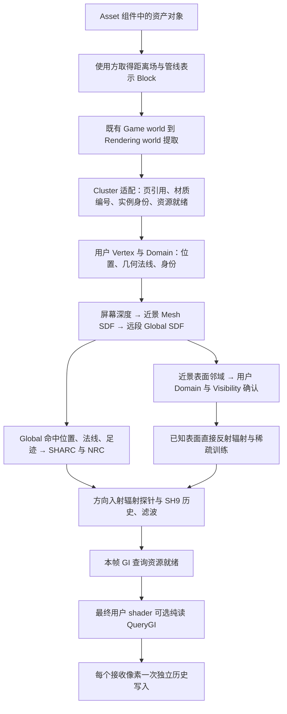

# GI 架构

本页以用户最初确认的迁移任务为准：把软件 GI 原型的整条管线接入引擎，保留其阶段和采样算法；Global SDF 自身确定命中并查询 SHARC／NRC 的完整漫反射辐射。缓存内容、训练目标和消费范围采用同一量纲。

原型入口为 [generic-lod](F:/CodexProjects/2026-10-14/gi-lumen-sharc-nrc-surfal-3d/outputs/gi-validation-demo/generic-lod/AGENTS.md)。实际 `screen_grid_ray` 配置由 `screen_probes.py` 转入 `screen_radiance_cache.py`，该文件的 `encode` 持有本页对应的执行顺序。

## 清理顺序与依赖边界

本节固定重新接入的目标与实施顺序。下文具体类型和执行顺序描述旧接入，完成对应阶段前不能作为目标已实现的证据。顺序为：先清理原型并验证通用几何，再清理引擎错误路径，最后沿同一数据链重新接入。不能用引擎局部测试、计时改善或单个凸体演示替代前一阶段。



| 依赖 | 已核对的旧接入 | 目标职责及处理阶段 |
| --- | --- | --- |
| 表面覆盖与数据持有 | `MeshSurfaceNeighborhood` 保留完整旧距离场、旧格索引，再另建邻域与引用 | 阶段一确定单份距离／指针控制场和完整扩张表面邻域；阶段二删除重复持有与旧查询表示，阶段三由资产 Block 与版本提供 |
| 管线表示与地址重定位 | `MeshDistanceFieldBlock` 解打包页材质；`WriteGpuData` 解析 `ClusterBVHNode` 和页内簇 | 这些属于 Cluster 布局适配，保留必要页身份、材质与重定位；它们不是逐射线 BVH 导航，不因类型名删除 |
| 场景与实例 | `GiSceneData` 查询 `RenderMesh`、`RenderClusterGeometry`，以 RootBvh 与 allocation 建索引 | 阶段二识别并隔离 Cluster 适配；阶段三复用唯一提取通路、实例变换和页流送，GI 算法不依赖 Cluster 类型 |
| 应用公开接缝 | `ApplicationRendering.Geometry`、颜色 feature 的 `Reconcile` 收 `ClusterPipelineOutputs`；`ApplicationGeometryContext.Cluster` 暴露 `ClusterRenderResources` | 名称通用不代表独立于管线。阶段三按实际消费者补齐最小几何就绪接缝，保护其它 feature，避免把 Cluster 布局扩散到 GI 核心 |
| 近景追踪与材质分发 | 距离场后完整格遍历；每材质重扫；新候选路径按全部三角展开，超容量丢弃 | 阶段一验证 SDF 到完整邻域；阶段二删除错误生产入口；阶段三共享收集覆盖区间与材质连续引用段，材质仅确认本地引用，归约最近命中后着色 |
| 用户几何与可见性 | Domain 只以角点三角求交；Visibility 的屏幕输入清零 | 阶段三由实际 Domain 曲面、范围与误差界完成确认，明确射线 Visibility 上下文和深度含义；不能以屏幕零输入宣称兼容 |
| 主表面与帧依赖 | `ScreenProbeFeature.Reconcile` 收 Cluster 管线；GI 在完整主着色后写 `MaterialColor` | 阶段三从主 visibility、depth、motion、HiZ 的真实就绪点开始，先轻量几何，再 GI 已知表面材质工作，再 GI 就绪，最终完整着色一次。阴影等目标分别使用自己的生产依赖 |
| 远段与训练 | 原型 `locate_global_surface` 经 Object Grid 再查三角，缓存仍可保存 indirect irradiance | 阶段一先改为 Global 自行命中并查询完整反射 radiance，近景和稀疏已知表面训练保持同量纲；阶段三迁入相同链路 |
| 探针、像素与历史 | 原始 SH、过滤 SH、RGB 像素历史与颜色写入混在像素 GI pass | 保持方向辐射；纯查询按当前材质法线积分且无写副作用，像素历史由明确接收方写一次，不能把一个法线的旧 RGB 积分供所有法线读取 |
| 工作区与预算 | 候选容量同时决定 80 字节最终表面容量；射线缓冲被全屏发光复用 | 阶段三分别按覆盖段、材质引用段与最终射线定容量，核对共享缓冲实际生命周期；分批处理完整工作，不能以溢出或固定步数耗尽表示未命中 |

空域距离只有在 `d(center) - error - cellHalfDiagonal >= tau > 0` 时可作为保守跳步。否则同一个控制槽指向完整表面邻域。邻域覆盖当前单元向外扩张的域，使用三角与盒相交构建全部选定 GI LOD 的引用；擦过后推进到覆盖域出口，再查询距离场。不能用固定 K 个最近三角、整实例跳过、盒球专用求交或全程 DDA／BVH 回退替代完整覆盖。候选数量由通用网格实测，不能承诺任意网格始终只有固定少数候选。

刚体实例复用 mesh-local 数据；形变必须取得同版本的覆盖与距离，或提供可证明的有限包络。实例 `BoundsExpansion` 仅扩外部范围，不能证明内部距离与指针覆盖有效。资产版本、选定 LOD、材质解释、变换、页驻留及 GPU 完成边界必须沿同一数据链核对。

现有 Vulkan 固定图可以组织计数、前缀、填充、各材质间接工作和最近命中归约。一次共享收集所有有限近景覆盖段会失去跨材质的即时最近命中剪枝，但保持结果完整；若需要逐段确认后续走，必须实际实现对应的分批调度，不能把重复录制或尚未实现的工作图当作现有能力。

探针保留自适应 0–4 布局、64 样本门控、2 帧刷新、4 帧稀疏训练与 SH9；修复不能擅自增加射线预算。正式效果与性能验收使用相同设备、构建、分辨率、VSM、TAA 与采样方式的 1024 小球、Sponza、Amazon Bistro；定位 trace 与普通性能结果分开，使用既有离线参考与 debug view 解释误差。

## 原型参考与验收信号

独立效果验收使用已有 Blender 4.5.3 Cycles 线性数据，保持源几何、材质、纹理、相机、灯光、帧号及接收点一致。`gi-offline-gt-01a171a9/gt` 保留原始积分；`gi-restructure-01a171a9/work/indirect` 保留 GI、发光面直接光、无遮挡直接光和合成的对应分项。后者的 GI 信号是“全部光源的漫反射间接项加直接天空”，直接看到发光面的照明归直接光。比较前先验证接收点位置、实例身份与法线，不能把不同场景的小案例指标相互替代。

旧内置参考只追踪有限次数的反射，并把直接发光混入 GI。`reference_path.py/.wgsl` 的完整漫反射路径及分项修正只用于内部诊断；它复用原型几何和材质函数，不能代替独立 Cycles GT。修正依据是缓存保存完整反射 radiance、发光直接光由独立直接光路径承担；验收目标和在线采样预算保持不变。

默认三级追踪的远段必须覆盖场景边界。固定 24 米截断后返回天空会把范围外场景几何当成可见天空；有意指定的距离上限仅用于诊断。实例运动包络、场景边界、方向参数与实际远段终止点应一起核对。

原型近景实例选择复用已有空间分区：屏幕 tile 的实例掩码，或有限近景线段包围范围涉及的全部对象格。后者一次收集并去重实例，不沿射线逐格 DDA，不导航实例树；实例选出后才进入同一套 Mesh SDF 与完整表面邻域。场景沿用现有扁平实例边界、变换和分区，不为 GI 另建实例层级。

Global 的局部覆盖数据必须来自同一选定 GI LOD 的现有表面，构建时保留开放边界和同格多表面。不能用另行拟合的参数曲面替换这些数据，也不能复制全部三角引用形成另一套世界几何。空间采样尺度、覆盖误差及方向量化须根据查询与已有误差射线说明；缓存 footprint 不能直接等同于获准的几何误差。记录数、索引、静态及运动数据、工作区和构建更新成本必须一起核算。刚体局部表面数据应复用，运动更新空间接线，不能把全场表面重建作为每帧工作。

场页的构建预算以完整选定 GI LOD 的实际使用范围为准，局部射线域通过不能证明全场成本可接受。原型试用的采样尺度不自动成为必要精度。分别核算保留数据、静态与运动索引、变换、构建候选、GPU 原始片段及读回、CPU 排序和最终拼接；单批原始片段上限不能代替总峰值上限。构建数据应写入唯一最终数据流，避免累积完整分块后再复制整份结果。无损压缩须保留全部深度层、边界及材质可见性，并单独核对解码与查询成本；格式节省不能代替完整常驻预算和效果验收。

Global 的距离与法线必须使用同一场定义；三线性场的梯度按各轴世界采样间距求导。梯度数学一致不代表无符号场已经具有可确认的零面。

Global 的有限覆盖包括用户材质的可见性结果。几何上位于源三角平面并不等于有效表面命中：透明裁剪、开放边界和同列多层必须在表面捕获时保留。刚体实例共享局部深度、几何法线和有限覆盖，世界空间只索引这些场页；远端查询不绑定源三角、材质求值或顶点数据。材质可见性或形变变化应更新对应捕获数据及版本，不能只更新实例外部范围。

局部证明与实时验收分开：少量已保存查询域的正确命中，只证明这些域中覆盖与查询一致。构建时的源几何核验不替代独立 Cycles 光照目标；几何参考必须同时执行原材质可见性，不能用不含透明裁剪的交点否定已有参考。索引计数、前缀、填充、资源上传及临时容量都计入实际更新成本；仅 GPU 计数／填充时间不能代替包含 CPU 回读与前缀处理的完整帧成本。

## 追踪与反射辐射

**屏幕空间追踪 → 近景 Mesh SDF → 后续射线段的 Global SDF。**

| 阶段 | 几何与命中数据 | 光照消费 |
| --- | --- | --- |
| 屏幕空间追踪 | 主表面的深度、可见三角编号、用户材质给出的几何法线 | 命中表面的完整反射辐射，结合反射辐射缓存与像素历史复用 |
| 近景 Mesh SDF | 每个网格的距离采样，默认处理射线起点后的 2 米 | SDF 保守跳步后查询局部三角指针，由用户的顶点、域和可见性求值器确认表面 |
| Global SDF | 合成后的距离采样，重建近似位置、距离与法线 | 直接以命中位置、法线和足迹查询 SHARC／NRC 的反射辐射 |

`CollectGiMeshQueries` 把几何任务组织为射线、实例和用户材质。`IntersectGiMaterial` 在用户 Shader 内执行近景距离场查询，三角求交立即更新本次查询和该射线的最近距离，供后续局部遍历剪枝。主视图的近景 tile 候选负责剔除物体。

距离场加载时通过同一份 `MeshPayloadSource` 读取打包页中的三角材质区域，生成原三角指针对应的局部材质编号，并合并原始簇的材质包围范围。近景任务入队前先用该范围裁剪材质。每个终端网格单元的指针按材质连续排列，同材质内保持原有顺序。用户材质查询通过二分定位自己的连续区间，再沿 SDF 跳步和最近命中反馈执行求交；多材质网格共享同一份距离场和页资源。

Gather 和训练续射共同消费 `ResolveGiRayRadiance`。两者的材质几何任务都截在近景区间；远段终点统一为 `TraceGiGlobalScene → QueryGiReflectedRadiance`。天空辐射提供未命中方向的入射边界。

实现：[距离场与局部三角指针](../assets/Shaders/gi_mesh_distance_field.slang)、[用户材质求交](../assets/Shaders/gi_material_entries.slang)、[统一追踪与训练](../assets/Shaders/gi_pipeline.slang)、[Global SDF 命中](../assets/Shaders/gi_scene_tracing.slang)。

## 两个 World 与数据持有

Game world 的网格引用通过既有提取进入 Rendering world。`RenderMesh.DistanceField` 保存该网格共享的距离场对象，`GiSceneData` 使用现有 Cluster root 建立地址索引，并直接写入 RenderGraph 的上传页。三角指针指向既有层级中的页引用；页驻留、请求、搬移和回收沿用 Cluster 的同一份资源。

指针重定位读取网格持有的不可变数据，并向上传页写入最终地址。应用通过 `ApplicationRendering.Lights` 把 Rendering world 的同一份 `RenderLightSet` 交给 GI，其版本驱动辐射历史刷新。GI 批量接入材质 pass 后调用一次 `ReconcileMaterialResources`，由 Cluster 统一清理输入并登记缓冲和纹理。

所有材质编号共用一份持久常量缓冲，各材质 pass 读取自己的对齐区间。容量及 GI 缓冲重置驱动上传，帧内复用既有数据与绑定。

顶点字节、域、可见性和表面属性由用户自己的材质 Shader 解释。`IGiSurfaceEvaluate` 给出法线、几何法线、漫反射率、覆盖率、环境遮蔽与发光。主材质在既有着色阶段输出这些主表面数据及解析直接光，GI 随后完成本帧方向辐射重建与颜色积分。

全局场采用静态场和当前场两份采样。实例运动由同一份 current／previous transform 派生；静态部分在几何、成员或覆盖范围变化时维护，当帧从静态场复制并合成运动部分。

实现：[渲染场景距离数据](../src/SomeEngine.Render.Features/GI/GiSceneData.cs)、[GI 资源与更新](../src/SomeEngine.Render.Features/GI/ScreenProbeFeature.cs)、[两个 World](../wiki/architecture/rendering/GameWorld-and-RenderWorld.md)。

## 屏幕空间探针

本框架的方向辐射探针是屏幕空间探针。它们保存接收表面的方向入射辐射；SHARC／NRC 保存次级表面的反射辐射，两者依次承担光路复用与接收面积分。

布局沿用原型的 16×16 像素 tile，每个 tile 分配 0–4 个探针。几何法线和相对平面分布决定数量，前缀和给出双帧探针区间，误差最大的表面点补充后续锚点。覆盖请求选择下一帧 tile 的最后一个探针。

重投影使用引擎的 previous／current transform、视图和运动向量，核对实例、位置、表面朝向与 tile。静态探针累计到 64 个样本后保存已有 SH；辐射变化时历史上限为 8，刷新按原型的 2 帧节奏分散。每个活动探针发射一条 R2 方向射线。

原始 SH9 先累计本帧入射样本，再读取 3×3 tile 中最多 36 个邻近锚点做几何匹配与空间滤波。有效样本数决定高阶方向系数向低频先验的混合。像素从相邻四个 tile 的全部锚点中选择权重最高的四个，使用本帧过滤 SH 和用户材质法线完成漫反射积分。

实现：[布局与分配](../assets/Shaders/gi_probe_layout.slang)、[重投影与 SH 滤波](../assets/Shaders/gi_probe_history.slang)、[射线与 SH 累计](../assets/Shaders/gi_screen_probes.slang)、[本帧像素积分](../assets/Shaders/gi_pixel_radiance.slang)。

## 缓存与训练目标

缓存保存表面向外反射的漫反射辐射。直接光、环境和后续反射传播共同形成该值；发光表面的自发光通过直接光采样处理。 漫反射率为零的有效已知表面仍是有效训练样本，其完整反射漫反射辐射目标为零；已知表面的查询及训练求值应直接返回这个零值。不能沿用 irradiance 阶段以反射率非零筛选训练表面的规则。

训练每四帧从活动探针的分层区间旋转选样，单批最多 128 个样本。接收面样本与已知次级表面样本的选择独立于该方向落入哪一级追踪，以保持接收面半球估计的采样分布。

- 已知主表面和已知近景／屏幕次级表面使用同一目标：`DirectReflected(Y) + Diffuse(Y) × ContinuationIncoming(Y)`。直接光求值必须带可见性，不能复用主画面中的无遮挡直接光历史。已知发光面的提案单独估计直接发光，不能依赖 Global 命中给出对象或三角身份；反射分量和天空由余弦提案估计。继续射线遵守同一三级路径，远景直接查询完整反射 radiance 缓存；仍保持每四帧最多 128 个训练样本。

有效训练批次驱动 GPU 间接派发和神经更新次数。Probe shading 消费更新前的缓存；本帧探针累计与滤波完成后再更新训练缓存。

SHARC 使用 65,536 个条目、八个空间尺度和六轴法线分组，查询成熟单元及邻近成熟单元；静态与变化历史分别采用原型的 8 和 2。NRC 保留原型的 24→32 ReLU→3 网络、899 个权重、相对辐射误差与 Adam 更新。两者消费相同的完整反射目标。

实现：[训练与查询](../assets/Shaders/gi_pipeline.slang)、[SHARC／NRC](../assets/Shaders/gi_radiance_cache.slang)。

## 发光几何体直接光

用户 Shader 计算发光范围、三角位置和采样点发光。发光物体树与物体内三角树使用包围范围、通量和接收面的方向关系选择候选。三角采样沿用原型的球面三角采样与面积采样切换。

每个 8×8 像素区域共享两个物体候选；像素汇集邻区候选并重采样物体，再为该像素采样三角上的光点。对应用户材质解释光点的实际覆盖与发光。静态与运动光照分开滤波和累计，像素几何历史由 `GiPixelSurfaces` 统一持有。

发光拓扑持久保存；实例、材料发光或几何页可用性变化触发相应维护。发光分布在探针与训练消费之前准备。

实现：[重要性树与三角采样](../assets/Shaders/gi_emissive_sampling.slang)、[候选、材质光点与重建](../assets/Shaders/gi_emissive_lights.slang)、[资源与拓扑](../src/SomeEngine.Render.Features/GI/ScreenProbeFeature.Emissive.cs)。

## 本帧执行顺序

```text
主几何与直接光表面输出
  → 静态／当前 Global SDF 与发光分布维护
  → 探针布局、锚点重投影、刷新预算
  → Screen Trace、近景 Mesh SDF、Global SDF 缓存查询
  → 原始 SH 累计、空间滤波
  → 活动探针训练选样、续射、SHARC／NRC 更新
  → 发光直接光候选、像素重采样、用户材质光点求值、空间滤波
  → 本帧 SH 的像素积分与三类光照历史累计
  → 材质颜色、TAA、呈现
```

主体图保持持久拓扑。网格、材质及容量变化通过显式编辑维护；帧内更新常量、资源内容、启用区域和间接工作量。DefaultGame 通过 `ExperimentalGi` 选择资产并安装引擎功能。

探针过滤完成是主线的阶段边界。训练支链持续保留，每四帧生成一批有效样本，其余帧由空工作量贯穿；有效训练样本决定 SHARC／NRC 的间接派发和网络更新次数。发光直接光等待该支链完成，随后复用同一份射线与材质几何工作区。

## Linux 与测量入口

Linux 使用 Xlib 窗口和 Vulkan Surface，窗口句柄与 display 通过现有 `SurfaceDesc` 传递。开发资产在 Linux 构建 SPIRV，发布沿用 Release NativeAOT。

Linux 窗口与呈现复用引擎优化树的 `97277eb9` 适配，图形后端复用该树的 `5535b59f`，包含紧凑绑定坐标、管线编译数据复用与时间戳队列选择。Shader 特化使用 `8199bba8` 的驻留输入恢复方式。`--measure` 自动启动统一场景平台并在结果完成后退出；`tools/Measure-Scenes.ps1` 沿用该树的 Python 执行器与 Xorg 入口，为队列选择的 GPU 创建普通呈现窗口。性能运行通过共享队列在服务器执行 1024 小球、Sponza 和 Amazon Bistro。比较使用相同分辨率、场景行为、渲染选项、NativeAOT 和采样窗口。

`--gpu-times` 按平台实际采样的帧归档 GPU 命令时间与包含屏障、等待和提交间隙的整帧跨度。定位运行与普通性能运行分别记录。


距离场构建必须直接使用源位置与边向量计算点到三角形的距离。通过平面和重心方程反求顶点会放大细长三角形的误差，旧缓存格式不能因此被视为可靠；距离源改变后更新缓存版本，保留正确覆盖数据并重新生成距离值。正距离控制格必须满足本页的保守空域条件。原型的 Global 场在构建阶段从选定 LOD 源几何生成中心距离，逐射线远景路径只读取场与 radiance 缓存。三线性插值的距离误差界只用于证明空域安全步长；进入该误差带表示尚不能判定空域，不能直接作为 Global 表面命中的依据。Global 的表面表示和停止条件必须共同支持自身确定命中，远端仍不得回查实例或三角形。

既有 Bistro Cycles 分项采用历史场景输入：每第 8 个实例的位移向量为 `(0.35, 0.18, 0.1)`，静态状态仍包含各实例相位的初始位移。比较前要复现该输入，并核对全部有效接收点。`combined = gt + direct_emission`，不含主表面的解析太阳光及接收面反射率，GI 分项比较直接使用余弦加权入射光；`direct_unoccluded` 为无遮挡发光直接光，不能拿它代替有遮挡的 `direct_emission` 目标。

直接光可见性属于阴影功能。不能以粗 Global SDF 的有限表面带替代已知表面的直接光遮挡，从而把阴影误差写入 radiance 缓存。原型复用既有源几何阴影缓存后端用于已知表面的直接光与已知光源可见性；这是直接光后端，不能当作 GI 远景命中后的三角确认或训练回退。引擎接入使用现有 VSM／对应光源阴影资源，GI 继续射线与远景缓存查询保持独立。


方向查询与像素历史发布分开。原型 `query_pixel_radiance(pixel, shading_normal)` 对本帧方向 SH 做纯读积分，可用不同法线重复调用；`integrate_pixel_radiance` 为明确的默认接收方调用一次查询，并独立发布覆盖请求及其 RGB 历史。引擎中的最终材质查询须使用显式接收点与几何法线输入，Cluster 身份及其几何读取保留在适配层，不能让纯查询依赖 Cluster 类型。
