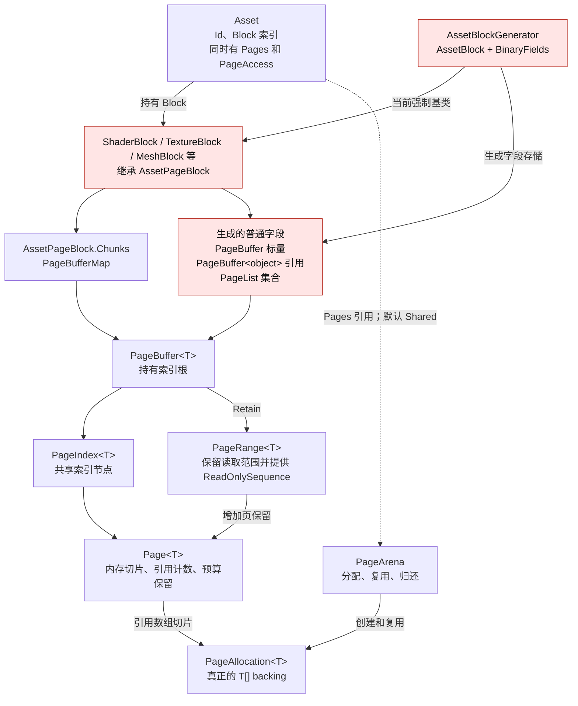
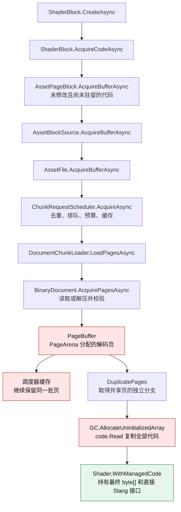
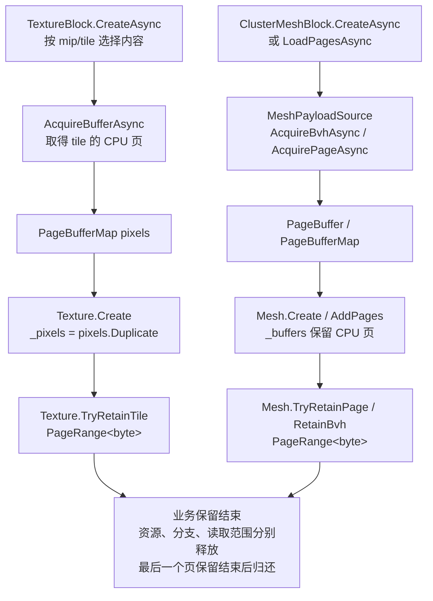
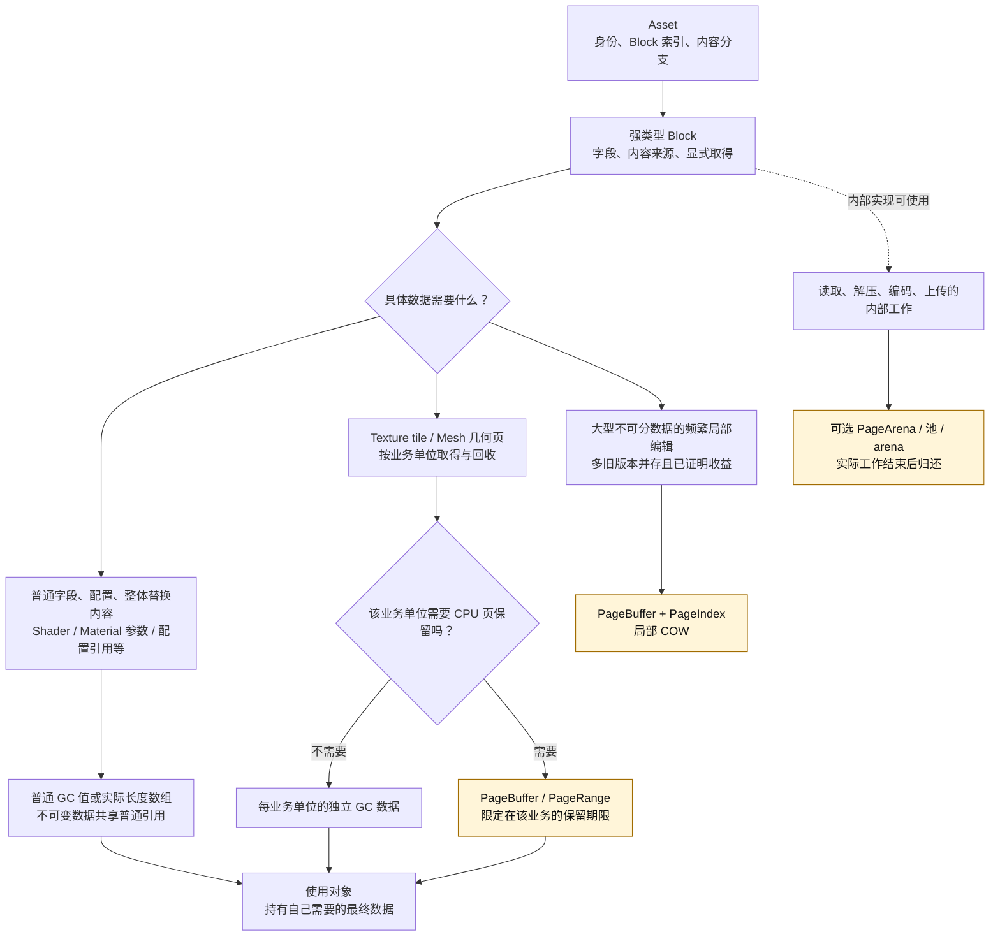
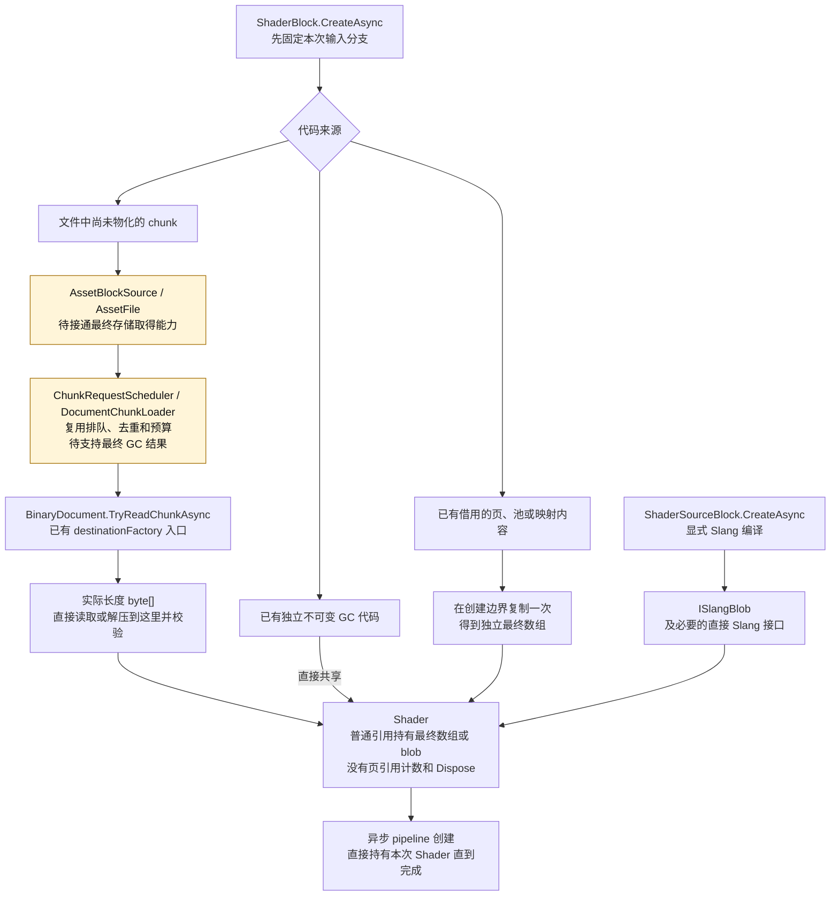
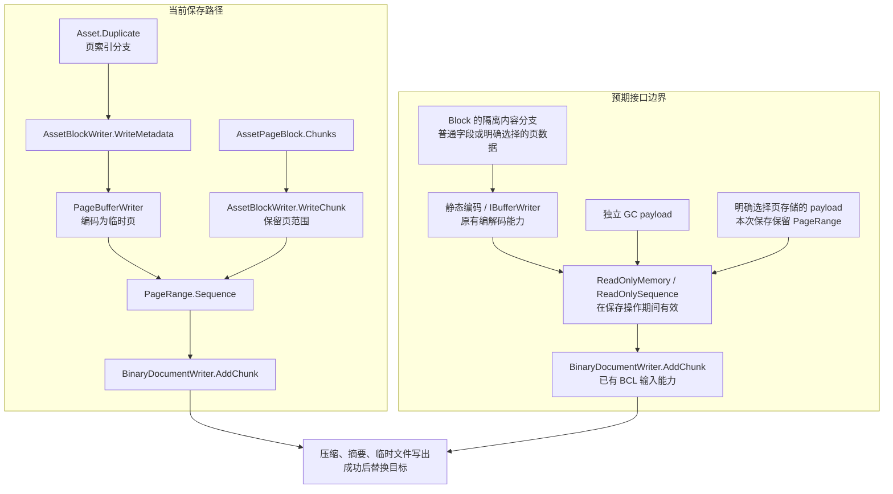

# CPU 内存页：当前架构与规范预期

> 本文记录 2026-09-29 重构前的代码与讨论。2026-09-30 的当前数据共享设计见 [Asset 数据共享与修改](../wiki/architecture/Assets/Asset-Sharing-and-Writes.md)，执行结果见 [本次验证](../wiki/architecture/Assets/Asset-Verification-2026-09-30.md)；下文保留旧 PageArena 的取舍和流程图已被取代。

2026-09-29。以下图按当前工作区源码绘制，用于解释现有实现与 spec 的差异；本文件不修改规范或产品代码。图中使用已有类型和方法名；“待改造”表示该职责尚未按图中的方式接通，不代表已经存在相应 API。

## 1. spec 对 CPU 内存页的态度

CPU 内存页是有条件使用的存储工具。普通不可变发布值默认使用独立 GC 对象/数组；Shader 的长期内容明确禁止依赖页、页级 COW 或页释放协议。页可以用于有明确结束边界的内部 I/O、解压、编码和上传，也可以服务具体业务确实需要的范围保留或局部编辑。

| 情况 | spec 要求 | 依据 |
|---|---|---|
| 普通不可变数据，整体生成和替换 | 默认实际长度 GC 数组或普通 GC 对象 | [Shader 总规范 §3.5](../wiki/architecture/shader/Shader-Block-Residency-Refactor.md)、[F06](../wiki/architecture/Assets/Asset-Rebuild-Principles.md) |
| 已有独立、不可变且大小匹配的 GC 数据 | 直接共享引用 | 总规范 §3.4、§3.5 |
| 发布值来自池、页、映射等可关闭或复用来源 | 在逃逸前取得独立最终存储；不能把临时来源的期限带到普通对象中 | 总规范 §3.4、F07 |
| Shader 已保存代码 | 直接物化为最终数组；Shader 不保留 PageRange、不承担 Dispose | 总规范 §3.4、§6、§7 |
| Slang 新生成代码 | Shader 直接保留 ISlangBlob 及必要 Slang 接口 | 总规范 §3.4、§7 |
| Texture tile、Mesh 几何范围等业务分页 | 按业务单位取得、保留和回收；实际需要时可以使用 CPU 页 | 总规范 §3.5、[取得和生命周期](../wiki/architecture/Assets/Asset-Loading-and-Lifetime.md) |
| 有结束边界的临时处理 | 可以使用页、池或 arena，工作真实结束后归还 | 总规范 §3.4、F06 |
| 通用局部 COW | 大型、不能按业务拆分、频繁局部修改、多个旧版本并存，并有该结构的实测收益，才采用 | 总规范 §3.5 |

“按 tile/几何页流送”只确定业务边界，不自动决定 CPU 分配方式；“分成多个数组”也不自动需要页池或 COW。Texture/Mesh 的明确业务保留可以有自己的关闭期限，普通 Shader 的 GC 数据不采用这个期限。

spec 没有规定 `AssetPageBlock` 这个具体类名必须保留，也没有要求把整个页工具库删除。必须改变的是页工具在通用 Asset/Block 流程中的强制地位。把它改成可选实现基类，是一种落地方式，不能把这个选择冒充 spec 的原文要求。

## 2. 当前：页进入 Asset、Block 和普通字段

这是一套 CPU 页实现，而不是 PageBuffer、PageList、PageRange 各有一套页池。PageAccess 只协调访问与写入边界，不存放另一份业务内容。Asset 的 Pages 是对 arena 的引用，关闭 Asset 不等于关闭借入的 arena。

当前限制有三个落点：

1. [Asset.cs:19、75](../src/SomeEngine.Assets/Asset.cs) 直接把 PageArena 放在共同构造和公开属性中。
2. [AssetBlockGenerator.cs:59–67](../src/SomeEngine.Generators/AssetBlockGenerator.cs) 将 BinaryFields 的生成路径限定为 AssetPageBlock；第 124 行以后把标量、引用、列表都生成到页容器。
3. [AssetBlock.cs:68](../src/SomeEngine.Assets/AssetBlock.cs) 将来源保留与 PageBufferMap 内容存储结合在 AssetPageBlock；取得负载的共同接口返回 PageBuffer。

这使少量材质参数、几个资源引用和整体替换的 Shader 代码也进入同一种页分支结构。spec 允许页工具存在，但没有要求这些普通数据采用它。

当前 Duplicate 主要共享 PageIndex 索引根；局部首写时按共享状态分离必要索引路径和页。PageRange 直接保留所需页，结束后释放自己的保留。所有分支、缓存和读取范围都释放后，页才归还 PageArena；底层 T[] 仍可能留在 arena 中用于复用。

## 3. 当前：从文件取得已保存 Shader 代码

以下只画目标代码的冷读路径。恢复 Slang 反射所需 IR 是另一份必要数据，不把 IR 与目标代码视为同一份内容的重复副本。

调用入口与实现位置：

- [AssetFile.cs:130](../src/SomeEngine.Assets/AssetFile.cs) 为每份文件创建带 PageArena 的调度器。
- 当时的 `ChunkRequestScheduler.cs:203、569` 选择页加载路径；该文件已随后续重构移除。
- 当时的 `BinaryDocument.Pages.cs:10` 把文件数据或 Brotli 解码结果写入 PageBuffer；该文件已随后续重构移除。
- [ShaderBlock.cs:239](../src/SomeEngine.Assets/Schema/ShaderBlock.cs) 再分配最终数组并复制。

`DuplicatePages` 共享页，不复制 payload。真正的整份代码复制发生在 `code.Read(0, result)`。该操作的 PageBuffer 关闭后，缓存仍可能保留那些解码页，因此不能把全部页占用都描述成 CreateAsync 返回前已经结束的临时占用。

若代码是当前进程刚编译并写入的，则跳过文件读取：`SlangShaderImporter.CompileDefinition → ShaderBlock.SetTargetCode/SetEntryCode → PageBuffer → Chunks.Set`。随后 CreateAsync 从这些页复制到最终数组。这里的 Block 页是编辑对象的长期存储，和一次 I/O 的工作缓冲不同。

Shader 最终对象已经符合部分要求：[Shader.Slang.cs](../src/SomeEngine.Resources/Shader.Slang.cs) 持有 byte[] 或 ISlangBlob，不持有 PageRange，也不实现 IDisposable。差异集中在上游的统一页存储、取得和缓存表示。

## 4. 当前：Texture 和 Mesh 的页保留

源码：[TextureBlock.cs:56](../src/SomeEngine.Assets/Schema/TextureBlock.cs)、[Texture.cs:69](../src/SomeEngine.Resources/Texture.cs)、[ClusterMeshBlock.cs:114](../src/SomeEngine.Assets/Schema/ClusterMeshBlock.cs)、[Mesh.cs:99](../src/SomeEngine.Resources/Mesh.cs)。

这里存在真实的业务保留：某些 tile、某些几何页可用，其他内容尚未取得。spec 允许为这种需求保留相应 CPU 页。它并未要求把 Texture 和 Mesh 的全部像素/几何保留强制改成 GC 数组，也没有规定业务页必须采用 CPU 页。

普通描述字段与 payload 需要分别选择存储。例如“宽高、格式、几何页描述使用普通值”与“像素或几何范围使用明确期限的页容器”可以同时成立。业务分页也不自动证明内部页级 COW 有收益。

## 5. spec 预期：先看数据语义，再选择存储

这张图的要求是存储与身份、类型、编码能力分开。AssetBlockGenerator 应允许普通字段直接成为普通 C# 数据；需要页容器的具体数据再显式选择。AssetBlockSource、AssetFile 和 AssetBlockWriter 的公共取得/编码能力也不能以 PageBuffer 为唯一输入输出。

图中 PageBuffer 支路与临时 arena 支路复用既有能力，不另建第二套页池、读取调度器或预算账本。临时缓冲只属于本次操作；不可变发布值归普通 GC 引用；业务页归具体流送和资源期限。

## 6. spec 预期：Shader 直接取得最终表示

底层能力已经存在：[BinaryDocument.cs:459](../src/SomeEngine.Serialization/Containers/BinaryDocument.cs) 的 `TryReadChunkAsync` 接受 `Func<int, Memory<byte>>`，直接读取或解压到目标内存并校验。还存在创建独立数组的 `CopyChunkAsync`。

但不能据此直接绕过调度和预算就宣称改造完成。缺口在 AssetFile/AssetBlockSource 与调度结果的连接：当前资产路径选定页结果，Shader 再从页复制；目标是把既有直接目标读取能力接入原有调度流程，并正确统计仍在使用的数据。没有必要建立新的通用内容包装或第二套加载器。

源码编译也应由 ShaderSourceBlock 的显式异步行为承担，Importer 复用它。当前 Block 只接入 IR 编译，原生源码分支仍待统一；该问题与是否使用 CPU 页是两项不同的连接处。

新 Shader 完整建立后，由已有消费方交换引用。旧 Shader 由旧消费者继续引用；最后一个普通引用消失后，代码数组由 GC 回收，Slang native 接口由绑定层处理。旧 GPU 资源仍按既有队列完成规则回收。

## 7. 保存流程的区别

保存期间使用 PageBufferWriter 作为内部临时实现本身可以保留。需要去掉的是“Block 必须长期存入页，才能参加保存”的接口条件。普通 GC 数据也应直接进入相同的静态编码和文档写入器。未取得且未修改的 chunk 继续原编码复制，两种架构都无需先解压它。

源码：[AssetBlockStorage.cs:102](../src/SomeEngine.Assets/AssetBlockStorage.cs)、[BinaryDocumentWriter.cs:104](../src/SomeEngine.Serialization/Containers/BinaryDocumentWriter.cs)、[Asset.Blocks.cs:273](../src/SomeEngine.Assets/Asset.Blocks.cs)。

## 8. 具名差异与去留

| 位置 | 当前实现 | spec 预期 / 改动边界 |
|---|---|---|
| Asset.Pages / Asset.PageAccess | 共同 Asset 带页配置与页访问边界 | 身份和内容分支不能要求某种页存储；使用页的具体操作再取得相应配置 |
| AssetBlockGenerator | BinaryFields 路径要求 AssetPageBlock，普通字段生成到页容器 | 普通字段采用普通值/集合；页存储由具体数据显式选择 |
| AssetPageBlock | 来源保留与 PageBufferMap 存储结合，主要内置 Block 采用它 | 退出共同前提；是否保留为可选实现工具是实现取舍 |
| AssetBlockSource / AssetFile | 共同负载读取返回 PageBuffer | 支持直接取得最终 GC 数据，同时保留确有需要的页取得路径 |
| ChunkRequestScheduler | 资产调用固定选择页加载结果 | 保留同一队列、去重、取消和预算；结果存储不被 PageBuffer 固定 |
| ShaderBlock / ShaderSourceBlock | IR 和目标代码长期进入 Chunks 页存储 | 移除 Shader 的长期页/COW 依赖；按来源取得最终数组或直接 Slang 数据 |
| Shader | 已经持有 byte[] / ISlangBlob，无 Dispose | 这部分保持；继续保证 Slang 接口和异步消费者的持有关系 |
| Texture / Mesh | 当前以 PageBufferMap 持有已取得业务内容 | 允许按业务期限继续保留页；普通元数据与 payload 分开选择，不能从业务分页推导全字段分页 |
| PageArena / PageBuffer / PageRange / PageIndex | 一套分配、保留、分段与局部写入工具 | 保留有具体用途的能力；不再承担所有 Asset 的基础生命周期 |
| AssetBlockWriter | 编码和 raw chunk 接口围绕页类型 | 接受普通最终数据与按需页数据；内部临时页允许保留 |
| 文件 chunk 与 GPU 页堆/区间 | 各自决定文件组织和设备位置 | 保留，不随 CPU 页存储调整而重写业务协议或 GPU 生命周期 |

## 9. spec 原文仍有一处需要收紧的措辞

总规范 §3.4 的表格明确要求冷的压缩 chunk 直接解码到最终数组，并禁止“解码到池或 arena 后再复制到另一份长期存储”。§6 同时允许底层 Asset I/O 仍使用 PageBuffer，随后直接解码或一次复制到最终 GC 数据。

两条共同确定的底线是：页不得逃逸到普通 Shader，不能长期保留两份等价代码。对于“是否主动建立页中转再复制”，两句的许可范围仍不够一致。不能不加说明地把 §6 当作强制页中转的永久豁免。

本文件的预期图采用 §3.4 的明确目标：冷输入直接到最终数组；已经存在的借用输入允许一次安全物化。若要把两条文字完全收敛，应将 §6 的一次复制限定于已经存在的借用输入，并明确它不要求为本次冷读先创建完整页副本。这是需要明确的规范措辞，不在本次解释中静默改写。
