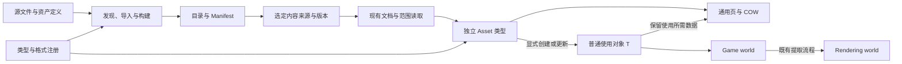

# 资产架构导航

资产重构于 2026-09-12 明确范围：**只修改已讨论的设计及必要接入，未讨论的架构保持。** 现有序列化、范围来源、读取调度和资产包继续使用。

用户已将独立序列化审查及成熟实现对比中确认的全部不足纳入同一次重构。有效实现继续复用，认证、预算、写入边界、职责、公开 API、根描述、字段排列和视图访问必须完成修正。

**全部现有资产及其消费者必须接入新体系。** 通用能力可以复用，已确认缺陷需要修正；任何现有资产都不能以“保持旧架构”为由留在旧流程。执行任务包含按资产家族登记的完整接入清单。

## 当前有效的设计与执行依据

- [序列化能力审查](Assets/Asset-Serialization-Review.md)：现有能力、149 个既有测试结果、四项探针证据，以及 D01–D10 的问题与对应任务。
- [冻结概念与原则](Assets/Asset-Rebuild-Principles.md)：21 组原则，覆盖资产与序列化职责、API、数据、使用保证和渲染边界。
- [统一执行任务](Assets/Asset-Rebuild-Tasks.md)：A00–A33 与 B00–B08 共 43 个任务，包含全部现有资产及全部审查不足的覆盖与验收。

本次已修正文档范围和任务拆分，本文对应的生产实现任务尚未执行。实现前先核查现有能力，只有明确冲突才修改；新增概念或扩大范围必须先补充依据并更新原则。

## 整体关系

目录不持有内容页或业务对象。Asset 的普通引用不承诺全部内容驻留；T 在有效期间持有所需数据。字段写入不隐藏读盘，渲染不增加资产旁路。

## 原主题页的状态

Assets 中的其他主题页及 docs/AssetSystem.md 记录现有设计和历史验证。与上述明确变化冲突的段落需要更新，未涉及的架构继续适用；历史验证记录仅表示当时实际检查的结果。

A32 按实际变更逐段更新说明，不整页宣布失效。嵌套资产、字段镜像和明确修正的序列化行为不作为兼容要求；有效编码、范围读取、包及未涉及业务能力继续使用。必要协议调整明确版本与消费者范围。

## 与其他架构的关系

[[DRY]]、[[SRP]] 约束主要数据持有者及共同流程；[[ECS-Architecture]] 规定实际 World 和组件拓扑；[[Render-Boundaries]]、[[Render-Graph]] 规定 Game world 到 Rendering world 的既有路径及资源使用期限；[[Product-Boundary]] 规定工具和产品边界。

所有新资产架构定义和任务继续集中在结构化 wiki。其他目录只放必要的导航，不再复制一套设计正文。
