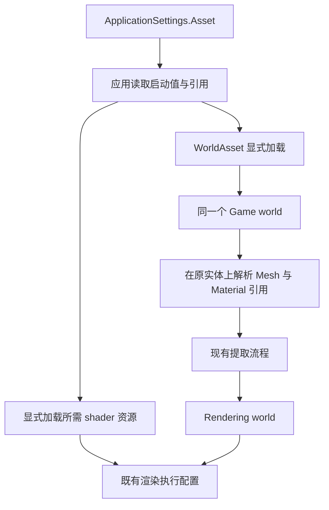

# 启动配置与渲染接入

> **重构范围说明（2026-09-12）。** [冻结原则](Asset-Rebuild-Principles.md)与[执行任务](Asset-Rebuild-Tasks.md)只替换本次明确讨论的设计。本页中与之冲突的段落待更新，未涉及的架构继续适用；历史验证仅代表当时结果。现有序列化与存储能力的保持依据见[源码审查](Asset-Serialization-Review.md)。

资产系统提供可编辑内容和显式加载能力；应用负责选择、持有和使用实际对象。渲染只沿 Game world 到 Rendering world 的既有提取流程运行，遵守 [[Render-Boundaries]] 与 [[Render-Graph]]。

## 启动配置

当前 `ApplicationSettings` 通过单一声明生成 `.Asset`，文件后缀为 `.runtime.asset`。内容包括场景、Cluster shader 资源组、虚拟阴影 shader 资源组、UI 与各渲染功能使用的 Shader 引用及入口，以及窗口尺寸和名称。

这些 GUID 在声明中标记资产引用，使当前依赖可枚举；配置对象本身不自动创建所有资源。应用显式打开被选择的文件并创建所需对象。这是 [[Asset-Code-Generation]] 与 [[Asset-Identity-and-Dependencies]] 的一个具体用法。

当前示例应用要求目录中有一个启动配置。它是当前应用入口的要求，不是所有引擎使用者或所有 World 都必须遵守的资产模型限制。

## 接入流程

World 存档如何保存组件、通过注册表恢复，以及示例来源组件怎样消费，由 [[Asset-Worlds]] 说明。场景内可明确复用已创建的 Mesh 与 Material；这种局部资源持有不变成 Loader 的全局唯一对象缓存。

Game world 与 Rendering world 中使用实际 Mesh、Material、Texture、Shader 对象及已有组件。资产文件不是渲染系统额外接收的一套场景提交数据。

## 更新与旧帧保护

应用在明确的 World 或资源更新边界调用对象更新。打开新资产来源、更新对象内容和释放旧 GPU 分配是不同阶段。

Texture 的设备关联、Mesh 页来源、材质引用和 Shader 后端代码分别由对应对象处理；RenderDevice、Cluster 和图形队列继续保留实际被旧帧使用的资源。资产迁移不得用一个全局版本或全局等待替换既有资源生命周期。

文件监听、属性 getter 和 Dispose 不触发自动磁盘同步。渲染准备使用已取得的内容，不能隐藏文件读取。通用更新行为见 [[Asset-Loading-and-Lifetime]]，具体资源见 [[Asset-Textures]]、[[Asset-Meshes]]、[[Asset-Shaders]]。

## shader 解释权

管线依赖用户 shader 解释数据，不默认顶点属性布局，也不在运行路径记录并读取字段元数据进行动态多态。默认资产生成工具使用的某种顶点编码或材质，只是那组内容的选择，不扩大为引擎通用数据限制。

资产依赖、材质语义和 ShaderRef 也不授权资产层组装 PSO、描述符布局或图形执行调度；这些边界继续由既有渲染与图形层负责。

## 工具与当前状态

默认资产生成工具创建实际 ECS World，再保存 WorldAsset 和启动配置；场景工具通过同样的组件与资产入口调整内容。完整生成与导入验证仍受 [[Asset-Open-Questions]] 中的嵌套元数据问题阻塞，历史检查范围见 [[Asset-Verification-2026-09-10]]。

代码入口：[启动配置声明](../../../src/SomeEngine.Assets/Schema/ApplicationSettings.cs)、[应用打开与创建](../../../src/SomeEngine.Runtime/RuntimeApplication.cs)、[同一 World 的场景接入](../../../src/SomeEngine.Runtime/RuntimeScene.cs)、[默认资产生成](../../../tools/GenerateDefaultAssets/Program.cs)、[场景工具](../../../tools/SomeEngine.RenderScenarios/Scenarios.cs)。

返回 [[Asset-Files]]；关联 [[Asset-Materials]]、[[Asset-Import-and-Storage]]、[[ECS-Architecture]]。
