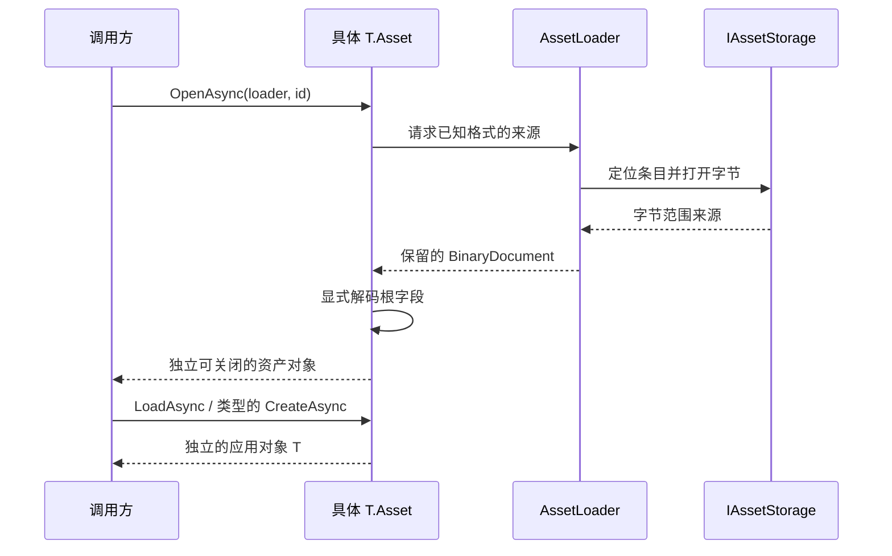

# 资产加载、更新与生命周期

> **重构范围说明（2026-09-12）。** [冻结原则](Asset-Rebuild-Principles.md)与[执行任务](Asset-Rebuild-Tasks.md)只替换本次明确讨论的设计。本页中与之冲突的段落待更新，未涉及的架构继续适用；历史验证仅代表当时结果。现有序列化与存储能力的保持依据见[源码审查](Asset-Serialization-Review.md)。

打开文件、创建应用对象和更新已有对象是三个明确操作。Loader 合并文件读取，不决定应用对象的唯一性。对象身份见 [[Asset-Objects]]，文件操作见 [[Asset-File-IO]]。

## 打开到使用

带路径的 `T.Asset.OpenAsync(path)` 通过基类共同文件流程直接打开。需要按 ID 查找时使用 Loader 与存储；两种入口最终都返回具体资产，不返回泛型字段包装。

## Loader 持有的内容

同一 ID 和存储版本的并发请求共享一次文件读取。每个成功调用者取得独立保留的来源，之后分别解码和关闭自己的资产。缓存保留根编码及字节访问，不保留唯一应用对象或一套唯一编辑字段。

当前 Loader 限制并行读取数量、排队与执行中的请求总数、缓存文件数及根编码字节量。这些不是 decoded chunk 或 GPU 显存预算；块驻留属于具体资源的流式系统。

存储读取可能执行外部 I/O，不能在 Loader 缓存锁下调用它。关闭来源也可能进入调用方存储代码，需要在共同锁外完成。

## 取消与关闭

| 事件 | 应保留的行为 |
| --- | --- |
| 一个等待者取消打开 | 取消该等待，不取消其他等待同一读取的调用者 |
| 一次文件读取失败 | 失败请求可观察，释放本次持有的来源，后续修复后可再打开 |
| Loader 缓存淘汰 | 释放 Loader 自己的访问，不让已返回资产或应用对象失效 |
| Loader 关闭 | 取消其读取，拒绝新请求，汇集清理结果；不关闭借入存储或应用对象 |
| `.Asset` 关闭 | 释放该资产的字段与来源访问；其他分支及已保留读取者继续持有各自访问 |
| 应用对象关闭 | 释放该对象拥有的内容与关联，不销毁另一个独立创建的对象 |

保留、借用与独立写入的区别见 [[Asset-Sharing-and-Writes]]。关闭不是保存，也不是撤销已提交的对象内容。

## 已有对象的内容更新

需要更新时，调用方显式打开新的资产并调用对应类型的 `UpdateAsync`。普通文件变化、属性 getter 和 Dispose 不自动触发同步。打开新版本不等待旧渲染资源完全消失。

更新保留同一个 `T` 的身份。失败或取消在内容提交前应保留旧内容；内容已经提交后，观察者通知或旧内容清理失败需要按该类型的公开行为报告，不能把“通知失败”误写成“新内容从未生效”。材质与 Shader 的现有行为测试覆盖这种区别。

Mesh 的页来源、Texture 的设备分配、Material 拥有的加载资源和 Shader 的后端代码，各自按类型处理。它们与旧帧保留的衔接见 [[Asset-Application-and-Rendering]]，不能在资产加载层另造全局 GPU 等待策略。

代码入口：[AssetLoader](../../../src/SomeEngine.Assets/AssetLoader.cs)、[Texture 加载](../../../src/SomeEngine.Assets/Schema/Texture.Loading.cs)、[Mesh 加载](../../../src/SomeEngine.Assets/Schema/Mesh.Loading.cs)、[Shader 加载](../../../src/SomeEngine.Assets/Schema/Shader.Loading.cs)。

返回 [[Asset-Files]]；关联 [[Asset-Import-and-Storage]]、[[Asset-Materials]]、[[Asset-Validation]]。
