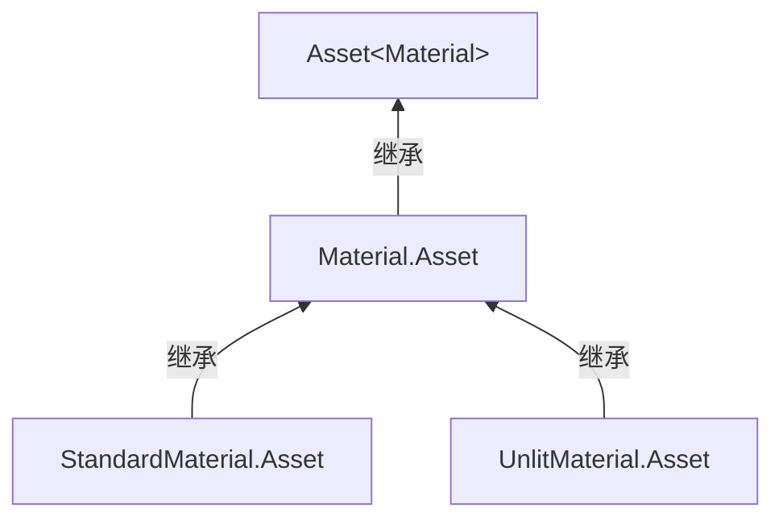

# 材质资产与父级继承

> **重构范围说明（2026-09-12）。** [冻结原则](Asset-Rebuild-Principles.md)与[执行任务](Asset-Rebuild-Tasks.md)只替换本次明确讨论的设计。本页中与之冲突的段落待更新，未涉及的架构继续适用；历史验证仅代表当时结果。现有序列化与存储能力的保持依据见[源码审查](Asset-Serialization-Review.md)。

材质是资产系统中的类型家族。应用使用实际 `Material` 对象，编辑使用具体材质的 `.Asset` 属性；所有材质资产共用 `AssetId<Material>`。通用对象原则见 [[Asset-Objects]]。

## 类型关系



具体材质声明是属性知识的来源。`MaterialGen` 生成具体资产属性和应用属性映射，例如应用中的 `Texture? AlbedoMap` 对应资产中的纹理 ID。普通编辑不使用键值 builder、回调编辑或 `EditStandardMaterial` 作为主要 API，见 [[Asset-Code-Generation]]。

## 默认值与覆盖是两个事实

| 子资产状态 | 含义 |
| --- | --- |
| 未填写某属性 | 不覆盖父级；无父级时使用具体类型声明的默认值 |
| 显式填写零值 | 零就是覆盖内容，不等于缺省 |
| 显式填写空纹理引用 | 明确清除继承纹理，不等于没有覆盖 |
| `Reset(property)` | 移除该属性的覆盖，重新遵循继承或默认值 |
| `HasOverride(property)` | 查询是否明确写入了覆盖，而不是比较数值是否等于默认值 |

因此，不能只保存最终数值而丢失“有没有覆盖”的信息。当前 `StandardMaterial.Roughness` 的声明默认值是 0.5；子资产未填值时，直接读取该资产属性不等于已经加载并合并了父级值。父级合并发生在显式加载过程。

```csharp
using var child = new StandardMaterial.Asset
{
    Parent = parentId,
    Roughness = 0,
    AlbedoMap = AssetId<Texture>.Empty,
};
child.Reset(nameof(StandardMaterial.Roughness));
```

`parentId` 由调用方提供。此例移除了粗糙度覆盖，保留显式空纹理覆盖；没有隐式加载父资产。

## 加载父级与资源

显式加载时先沿父级链取得继承内容，再合并当前子资产的覆盖，最后创建对应具体材质并解析所需 Shader / Texture。循环父级引用必须失败；子资产不能改成不同于父级的具体材质类型。

父级 ID、shader ID 和显式纹理引用组成当前资产的直接依赖；加载后继承得到的资源集合是另一个结果，见 [[Asset-Identity-and-Dependencies]]。打开文件、查看覆盖和查询依赖不会自动创建资源对象。

当前文件读入会按外部内容中的材质类型选择具体 `.Asset`。这种输入类型识别不能扩散成逐字段动态操作注册，边界由 [[Asset-Code-Generation]] 规定。

## 内容更新与资源释放

`Material.UpdateAsync` 更新同一个应用对象。解析或提交前失败保留旧内容；提交后即使某个观察者抛错，也不能让临时替换对象的清理误释放已提交的新纹理。其他观察者和旧内容清理仍须按公开更新行为处理。

材质创建过程中加载的资源由材质自身的生命周期管理。不能因为 Loader 关闭就销毁材质，也不能让一个独立材质的释放破坏另一个独立实例。GPU 旧帧保护仍通过 [[Asset-Application-and-Rendering]] 的既有机制完成。

字节与根字段分支已可单独验证，但任意嵌套元数据写法仍见 [[Asset-Open-Questions]]，不能由材质具体标量属性推导它已经定稿。

代码入口：[材质声明](../../../src/SomeEngine.Assets/Schema/StandardMaterial.cs)、[Unlit 声明](../../../src/SomeEngine.Assets/Schema/UnlitMaterial.cs)、[材质资产](../../../src/SomeEngine.Assets/Schema/Material.Asset.cs)、[材质加载与更新](../../../src/SomeEngine.Assets/Schema/Material.cs)、[生成器](../../../src/SomeEngine.Generators/MaterialGen.cs)。

返回 [[Asset-Files]]；关联 [[Asset-Textures]]、[[Asset-Shaders]]、[[Asset-Loading-and-Lifetime]]。
