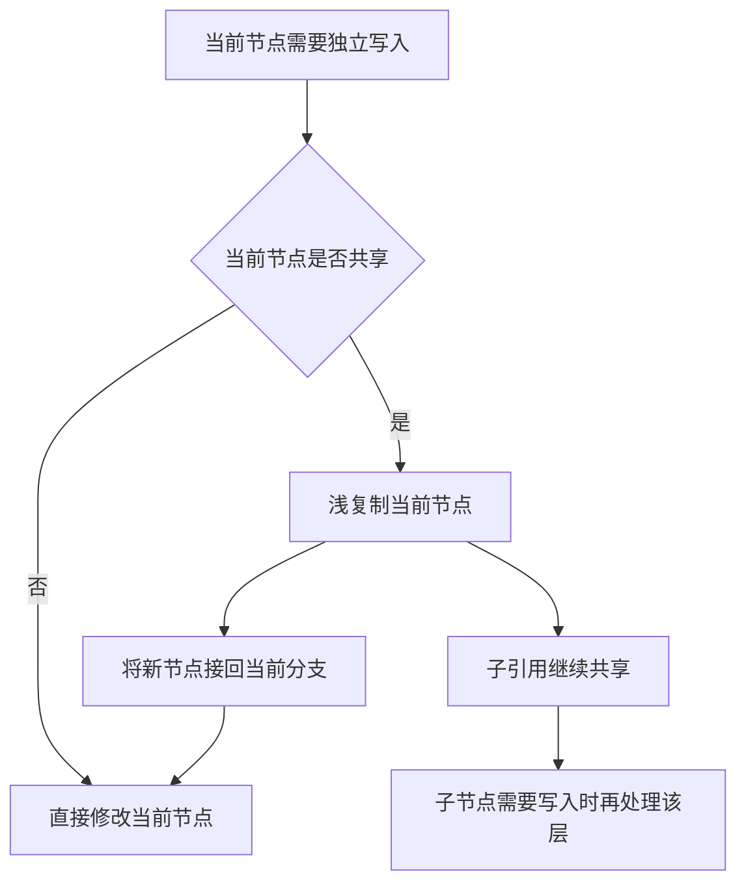

# 数据共享与独立写入

> **重构范围说明（2026-09-12）。** [冻结原则](Asset-Rebuild-Principles.md)与[执行任务](Asset-Rebuild-Tasks.md)只替换本次明确讨论的设计。本页中与之冲突的段落待更新，未涉及的架构继续适用；历史验证仅代表当时结果。现有序列化与存储能力的保持依据见[源码审查](Asset-Serialization-Review.md)。

独立写入以当前数据节点为单位。已经独占就直接写；仍被共享就浅复制当前节点，接回当前分支，然后修改。这个原则已经确认，**嵌套元数据的公开写入形式尚未确认**，见 [[Asset-Open-Questions]]。

## 分离规则



值字段复制值，引用字段继续引用下层内容。不能默认深拷贝、用序列化往返实现复制，或遍历对象图判断共享与修改状态。分支根、共享存储和应用对象身份的关系见 [[Asset-Objects]]。

数组和连续缓冲区在分离时仍可能复制整个当前存储，成本可以是 O(n)。逐层浅复制不等于复制大数组中的单个元素只花一个元素的成本。增长、排序、增删继续复用现有集合算法，不另造一套集合库。

## 共同能力与具体复制

公共共享能力只承担保留、释放和独立写入所需的基础能力，具体节点怎样浅复制由生成代码负责。当前 `SharedData<T>` 只做引用计数与共享状态，不接收复制、编码或释放字段的回调；具体存储的复制和子数据释放由直接代码执行。

共享字节使用 `SharedBytes`。只读借入的内存即使当前只有一个保留者，也不能擅自原地改写；独立写入需要先取得可写存储。`BufferRead` 保留读取访问，资产字节编辑入口提供有明确结束点的 `ByteEdit`。这些是当前字节能力，不是已定稿的嵌套对象 API。

## 读取者也参与隔离

读取者包括其他 `.Asset` 分支、显式保留的字节读取，以及已经创建且仍在使用这些数据的 `T`。只有编辑分支计数而忽略应用对象读取，会使编辑意外改变已有对象内容。

小型应用值与 `T` 自身状态不参与整体对象复制。事件、设备关联和 GPU 对象也不参与 COW。渲染旧帧仍在使用的数据如何保留，由 [[Asset-Application-and-Rendering]] 和既有图形资源生命周期共同决定。

## 当前字节编辑入口

```csharp
using var mesh = new Mesh.Asset { Payload = new byte[] { 1, 2, 3 } };
using var branch = mesh.Duplicate();
using var reader = mesh.ReadPayload()!;
using (var edit = branch.WritePayload())
    edit.Span[0] = 9;
// reader 和 mesh 仍读取原来的内容。
```

文件中的负载未读取时，应通过明确的异步读取或写入入口取得字节，而不是由属性 getter 发起 I/O。字节编辑未结束时，当前资产实现拒绝继续保留、分支、保存或加载，避免这些操作与正在写入的内存并行。调用方也不能把可写 Span 带出约定的编辑边界继续使用。

## 尚未具备的保证

不能泄露共享的裸可变子对象、集合或可写内存，又声称任意嵌套赋值自动隔离。写入必须能定位当前分支；具体入口怎样表达仍待确认。第三方可变对象也需要明确适配，不能假设其任意写入可被接管。

先前自行引入的整片不可变记录与不可变集合方案未得到确认，不能作为上述原则的替代。当前的部分通过测试也不能证明任意嵌套写入已经正确，证据范围见 [[Asset-Verification-2026-09-10]]。

代码入口：[SharedData](../../../src/SomeEngine.Serialization/Containers/SharedData.cs)、[SharedBytes](../../../src/SomeEngine.Serialization/Containers/SharedBytes.cs)、[BufferRead](../../../src/SomeEngine.Serialization/Containers/BufferRead.cs)、[资产字节编辑](../../../src/SomeEngine.Assets/Asset.cs)。

返回 [[Asset-Files]]；关联 [[Asset-File-IO]]、[[Asset-Code-Generation]]。
