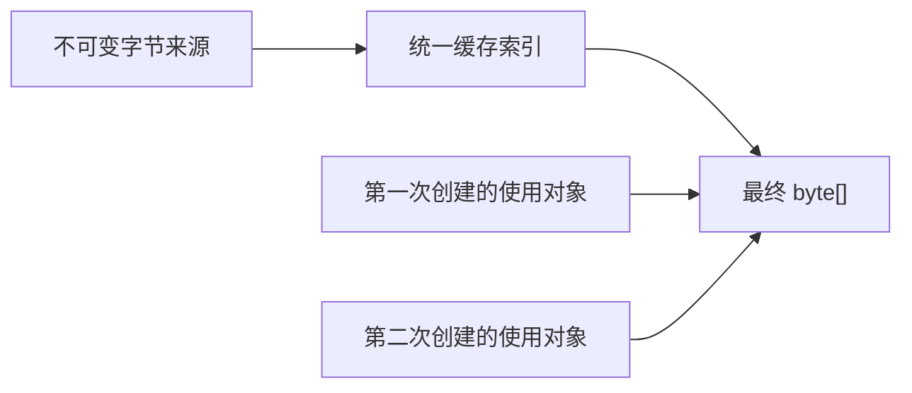

# Asset 数据共享与修改

2026-10-01。载入字节采用 [统一 CPU 字节缓存](Asset-Byte-Cache.md)：数组中的整数链接 LRU、统一预算和普通消费者强引用。本页按该决定更新，不再采用每个业务节点的弱引用结果模型。

本页定义业务数据取得和复用。它取代通用 CPU 页、页级 COW、每文件解码缓存以及由使用方释放托管数据的模型。

## 数据与共同引用

Asset 表达身份，Block 表达具体内容及其异步取得边界。Texture tile、Mesh 几何页、BVH、Shader 代码项是业务数据单位；文件 chunk 和范围是存储单位，两者不要求一一对应。普通字段使用 C# 值、对象和集合；已发布字节使用实际长度的不可变托管数组。

一个 Asset 的 GetBlockAsync 返回已取得的同一 Block，其分支共享未修改的不可变数据。多个访问指向同一份选定不可变文件来源和字节单元时，可以复用统一缓存结果；仅有相同 AssetId、路径或页号不构成相同数据键。不同文件版本及被替换的新值相互隔离，不建立唯一 Asset 对象或业务语义去重服务。

业务单元描述只记录数据来源。取得通过缓存键定位数组中的 LRU 记录；未命中则在临时任务表中合并读取。缓存记录是载入字节额外保留的主要持有者，不给所有声明数据分配弱引用节点或持久 Task 字段。

## 读取与生命周期

1. 在第一次等待之前固定输入内容和来源。读取操作保持来源有效，直到实际 I/O 结束。
2. 已有独立不可变 GC 数据直接共享；文件输入直接读入或解压到最终实际长度数组。
3. 完成后，统一缓存按预算强引用结果，使用对象持有自己的普通强引用。共同任务在成功或失败后从任务表清除，不通过已完成任务长期保活字节。
4. 单个等待者取消，只结束该等待者的等待，不取消其他等待者共用的读取。失败结果不缓存，下次可以重新读取。
5. 数据视图只使用 ReadOnlyMemory、ReadOnlySequence 等标准类型。使用对象不需要为了托管字节引用计数或 Dispose，也不为了字节保活而引用 Asset、Block 或文件。
6. 缓存淘汰只撤销缓存引用；已有消费者继续使用原数组，新的未命中取得可以重新读取。文件和设备资源的实际关闭职责不等同于托管数组的生命周期。

显式赋给 Chunks 的内容由 Block 作为主要数据强引用；只有可以重新取得的载入结果参加缓存淘汰。整 chunk 和几何范围使用同一个 AssetByteCache；返回值仍是普通 ReadOnlyMemory，来源仅由实际读取保留。

不设置通用 CPU 页池、页引用计数、页 COW 或每文件 ChunkRequestScheduler。文件读取不保存解码结果；既有文件访问、范围 I/O、压缩和格式校验继续使用。GPU 上传及完成信号仍属于 Rendering world，数据沿 Game world 到 Rendering world 的既有路径传递。

## 修改与版本

普通字段直接赋值；可编辑集合使用普通集合。Duplicate 复制需要独立修改的字段和集合结构，直接共享不可变元素与未变的数据定义。它不承诺与集合长度无关的复制成本，不复制任意第三方可变对象，也不通过序列化制造副本。

修改一个已发布业务单元时建立完整新值。Shader 代码整体生成、整体替换，不进行页级 COW。Texture 和 Mesh 的流送是在明确内容版本下补充业务单元；来源版本改变时，旧加载结果不得写入新版本对象。公开的数据视图不会因另一个对象关闭或更新而变成可复用缓冲区。

## 预算边界

读取限制约束单次输入大小、并发和在途工作，业务流送决定取得哪些单元。统一缓存预算约束额外保留及动态索引，不按数据语义预分份额。移除普通引用不代表 GC 已立即释放内存，也不通过预算要求消费者释放数据视图。

## 行为验收

- 同一字节来源在缓存保留期间的多次创建共享最终数据；并发等待只执行一次读取。
- 一个等待者取消不影响其他等待者，失败后可以重试。
- 使用对象保留的数据在 Asset、Block、文件关闭之后仍可读。
- 没有使用方引用后，缓存可以继续保留以减少重读；预算淘汰和清空后，定义和已完成任务不继续保活这些数组。
- 不同内容版本不复用错误数据；更新过程中返回的旧视图仍保持原值。
- 文件保存、重开、业务流送和 GPU 上传使用真实公共行为验证，不检查私有字段或内部容器形状。
