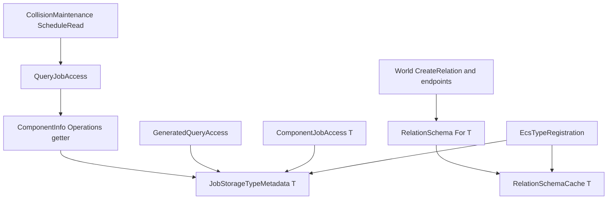

# 关系包与 NativeAOT

关系查询通过 `SomeEngine.ECS.Relations` 提供固定泛型执行体，空间来源由 `SomeEngine.Physics` 提供，Job 借用与资源声明由 `SomeEngine.ECS.Systems` 接入。`SomeEngine.ECS.SourceGen` 随使用方编译生成语义薄入口、Job 描述和程序集级类型登记。

## 包依赖与使用方

| 包 | SomeEngine 包依赖 | 提供的数据或行为 |
| --- | --- | --- |
| SomeEngine.Diagnostics | — | 统一检查支持 |
| SomeEngine.Job.Contracts | — | Job 公共数据类型 |
| SomeEngine.Job | Diagnostics、Job.Contracts | Scheduler、依赖和资源执行 |
| SomeEngine.ECS | Job.Contracts | World、组件、查询、显式边、类型元数据；WithOptionalRead、TryReadRef、ReadRows与ComponentReference |
| SomeEngine.ECS.Relations | ECS | 固定 1–8 元语义、绑定、筛选与积 |
| SomeEngine.ECS.Systems | ECS、Job.Contracts、Job | typed/generated Job 访问和查询读取范围 |
| SomeEngine.Physics | ECS.Relations、ECS.Systems | 空间树、维护、串行和并行输出 |
| SomeEngine.ECS.SourceGen | — | analyzer DLL 与构建时生成入口 |

`tools/SomeEngine.ECS.Relations.AotSmoke` 是业务使用方例子，直接 PackageReference ECS、Relations、Systems、Job、Physics 和 SourceGen，传递取得另外两个包。它定义自己的 `Number<int>`、八个参与位置、带 schema 的泛型边、Body/Hair 语义、键实现、bitmap 实现和结果输出。

`Build-Consumer.ps1` 通过公共队列依次构建、打包、恢复、JIT 运行、NativeAOT 发布和原生运行。包版本保存在使用方 csproj，feed/cache 位于仓库的 `artifacts/ecs-relations`，原生产物位于使用方 `bin/Release/net10.0/win-x64/native-publish`。再次刷新同一版本时，脚本先更新八个包，再替换该目录内对应版本的包缓存，随后恢复使用方。

脚本的 `QueueScript` 参数指定公共队列脚本，默认按当前仓库的tools定位。本次实际执行显式传入 `F:\SomeEngine.Next\tools\Invoke-Benchmark.ps1`，与性能测量使用同一公共队列。

```powershell
& tools/SomeEngine.ECS.Relations.AotSmoke/Build-Consumer.ps1
```

## 元数据的主要持有处

`EcsTypeGenerator` 收集声明、泛型类型和泛型方法实参中已知的可访问封闭组件类型，读取 schema attribute，并用 `JobStorageTypeAnalysis` 分析实际实例字段。字段分析与 `JobEntityGenerator` 共用，包含自动属性 backing field 及引用程序集的私有字段。带 schema 的封闭 payload 同时登记构造后的 directed/undirected endpoints 类型。

每个程序集生成一个 `EcsTypeRegistration` 静态初始化类；标准初始化方法调用 `GeneratedEcsTypes.RegisterJobStorage<T>` 和 `RegisterRelationSchema<T>`。初始化登记数据，普通 API 读取既有类型级持有处：



`JobStorageTypeMetadata<T>` 的一个整数保存未知、可直接访问、含别名三种状态。生成的布尔分类写入该处；普通 typed access 与生成工厂读取它。`ComponentMetadata<T>` 创建的操作表保存该 getter 的函数指针，按组件 ID 收集资源的 `QueryJobAccess` 因而读取相同分类。可直接访问的表组件随后沿既有 WorldStorageResourceKey 映射为 Scheduler 读写资源。

`RelationSchemaCache<T>` 持有一个 Lazy schema。生成登记把已知方向、基数和 self-edge 数据写入这个 Lazy，首次 `RelationSchema.For<T>` 执行原有 `ValidateFor`。私有封闭类型等按需路径继续由该持有处取得字段分类或 attribute 数据。

## 生成物归属

Relations 库构建生成八组固定族：每组包含 `IRelation`、`ComponentRelation`、`ComponentWhere`、`ComponentExcept` 和 Product 描述，另有一个 `RelationQueryViews`。固定生成类型共 41 个；它们按 arity 与行为参数化。

使用方的普通语义、边、键、bitmap 和空间重载都返回这些库中共享的具体泛型类型。组件绑定通过 `QueryRow.TryReadRef<T>` 借用实际只读引用，二元Within通过 `ReadRows<TFirst,TSecond>` 在块边界绑定可选列并沿原成员枚举读取。`ComponentReference<T>` 仅借用原组件引用，HasValue表达可选存在性，Value返回同一 `ref readonly T`；其有效期为World查询回调。身份行、语义描述和输出状态按值传递。第八位置使用 C# 八元 tuple 的 `Item8`，IL 对应 `Rest.Item1`。

程序集初始化类集中保存生成登记。Job 专属描述类型对应用户的 `IJobEntity`。业务组件专属生成类型数量为 0。

当次实际包、生成清单、行为结果、IL 和原生代码摘录见 [2026-10-19 包与 AOT 证据](../../../docs/ECS-Relations-Packages-AOT-2026-10-19.md)。空间读取范围和结果 token 的完整调用见 [空间关系分区执行](Spatial-Parallel-Queries.md)。
