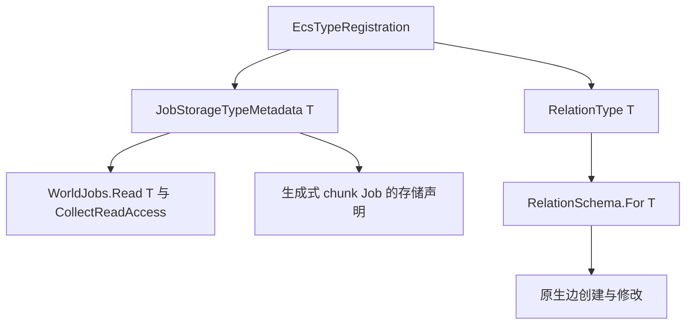

# 关系包与 NativeAOT

配对、均匀网格、BVH、空间条件和分区输出由 `SomeEngine.ECS.Relationships` 提供。配对命名空间为 `SomeEngine.ECS.Relations`，空间命名空间为 `SomeEngine.ECS.Spatial`。World、Query 与原生列读取由 Core 持有，Job 执行与资源声明分别接入 Job 和 Systems。

## 项目与包边界

| 项目 | 直接 SomeEngine 引用 | 主要内容 |
| --- | --- | --- |
| Job.Resources | — | 资源身份、共享线程标记；namespace SomeEngine.Job |
| Job | Job.Resources、Diagnostics | Scheduler、依赖、范围执行、事件日志 |
| ECS | Job.Resources、Job、Diagnostics | World、Query/QueryScope/QueryChunk、组件存储、成员事实、类型元数据 |
| ECS.Relationships | ECS | 原生边、Hierarchy、Pairing、通用 Spatial |
| ECS.Systems | ECS、Relationships、Job.Resources、Job、Diagnostics | 生成式 Job、资源准备、系统版本与调度 |
| ECS.SourceGen | — | 构建时 analyzer 与类型/关系/Job 生成 |
| Physics | Relationships、Systems | 碰撞表面、查询及碰撞专用组织 |

关系及通用空间使用方直接引用 Relationships。SourceGen 作为 analyzer 参与调用方编译。实际引用分别见 [Relationships.csproj](../../../src/SomeEngine.ECS.Relationships/SomeEngine.ECS.Relationships.csproj)、[Systems.csproj](../../../src/SomeEngine.ECS.Systems/SomeEngine.ECS.Systems.csproj) 与 [Physics.csproj](../../../src/SomeEngine.Physics/SomeEngine.Physics.csproj)。

## 类型数据的主要持有者

[EcsTypeGenerator](../../../src/SomeEngine.ECS.SourceGen/EcsTypeGenerator.cs) 从声明、封闭泛型类型与方法实参收集可访问类型，并与 [JobStorageTypeAnalysis](../../../src/SomeEngine.ECS.SourceGen/JobStorageTypeAnalysis.cs) 分析实际实例字段。该分析覆盖 backing field、引用程序集的私有字段及递归值成员。带关系 schema 的封闭 payload 同时登记 `RelationEndpoints<T>`。

每个使用方程序集生成一个带初始化方法的 `EcsTypeRegistration`，分别调用 `GeneratedEcsTypes.RegisterJobStorage<T>(isAliasFree)` 与 `RelationSchema.Register<T>(schema)`。前者写入 Core 的 [JobStorageTypeMetadata<T>](../../../src/SomeEngine.ECS/Registry/JobStorageTypeMetadata.cs)，后者写入 Relationships 的 [RelationType<T>](../../../src/SomeEngine.ECS.Relationships/Relations/RelationSchema.cs)。普通入口和生成入口读取同一份类型数据。



存储分类以一个整数表示未知、可直接使用或包含外部别名。分析要求字段组成满足直接 Job 存储的条件；托管引用、byref、指针、native-sized handle、fixed buffer 及包含这些字段的递归值需要对应的实际资源描述。普通 `WorldJobs.Read<T>()`、`CollectReadAccess(query)` 与生成式入口复用这一分类。`IJobComponentResources<T>` 的显式特化沿真实 chunk 范围收集实际对象或 native 资源，保持类型分类和具体资源登记各自的职责。

关系 schema 由类型级的 `SchemaValue` 保存，首次初始化与显式生成登记通过同一 `RelationType<T>` 形成。`RelationSchema.For<T>()` 校验方向/基数组合，端点创建、重定向与维护继续沿原生关系内核检查事实。

Buffer、Removed、Parent、Children 和关系端点提供其具体值操作、引用操作与初始化入口，`EntityFields<T>` 复用该类型的引用操作。真正保留旧值的类型通过 `ComponentValues.RegisterRemoved<T>()` 绑定一个 `IRemovedValues` 动作；普通移除沿此动作捕获旧值并取得 Removed 类型。生成式登记和内建拓扑使用同一元数据持有者。实现见 [值操作](../../../src/SomeEngine.ECS/Storage/ComponentOperations.cs)、[引用操作](../../../src/SomeEngine.ECS/Copy/EntityReferenceOperations.cs) 与 [旧值捕获](../../../src/SomeEngine.ECS/Changes/RemovedValueOperations.cs)。

## 泛型执行与列绑定

[RelationFamilyGenerator](../../../src/SomeEngine.ECS.SourceGen/RelationFamilyGenerator.cs) 在 Relationships 构建时生成一至八元语义、组件绑定、Where/Except、位置积与 `RelationQueryViews`，共 41 个固定类型。业务语义、键、bitmap、边与空间生成器形成薄重载，返回这些具体泛型执行体。

一、二元来源在 chunk 对边界调用 `Bind(QueryChunk,QueryChunk)`，之后传递行号和身份换位事实；绑定保存实际 `ReadOnlySpan<T>` 并检查 `Has<T>(row)`。仅有身份或更多元数的来源通过类型化 `ReadLookup<T>` 读取。两条路径都借用真实 `QueryScope`，端点、值和成员继续来自原 World 存储。输出采用普通实体或实体 ValueTuple，第八位置沿 C# 的 `Item8` 读取。

## 独立使用方

[SomeEngine.ECS.Relations.AotSmoke](../../../tools/SomeEngine.ECS.Relations.AotSmoke/) 使用 PackageReference 引入 ECS、Relationships、Systems、Job 与 SourceGen。它定义自己的封闭泛型 Number、八个位置、关系 payload/schema、Body/Hair、键与 bitmap 实现，以及 Span 输出。

消费者覆盖一至八元、八元提前结束、原生点读取、生成式 Job、普通类型化访问、native handle 分类拒绝、平行边身份、Deferred/Maintain、键与 bitmap、空间树维护、串行与并行结果及接触消费。通用空间调用沿 `SpatialQueries` 和 `SpatialPairBuffer<BoundsNodePair>` 进入 Relationships。

[Build-Consumer.ps1](../../../tools/SomeEngine.ECS.Relations.AotSmoke/Build-Consumer.ps1) 顺序提交源码增量构建、七包打包、消费者 restore/build、JIT 运行、NativeAOT 发布与原生运行。包版本由使用方 csproj 持有，每个源码版本使用对应包版本。当前 feed/cache 复用 `artifacts/ecs-relations`，原生输出复用项目的 `native-publish`。每步 stdout、stderr、退出码与配置由同一公共队列结果持有。

```powershell
& tools/SomeEngine.ECS.Relations.AotSmoke/Build-Consumer.ps1 `
    -QueueScript F:/SomeEngine.Next/tools/Invoke-Benchmark.ps1 `
    -Session ecs-physics-integration
```

[2026-10-19 包与 AOT 记录](../../../docs/ECS-Relations-Packages-AOT-2026-10-19.md) 对应当时提交的包和 IL。当前接口、依赖与生成物以本页链接的源码和消费者实际构建为准。空间资源及结果范围见 [空间并行查询](Spatial-Parallel-Queries.md)。
