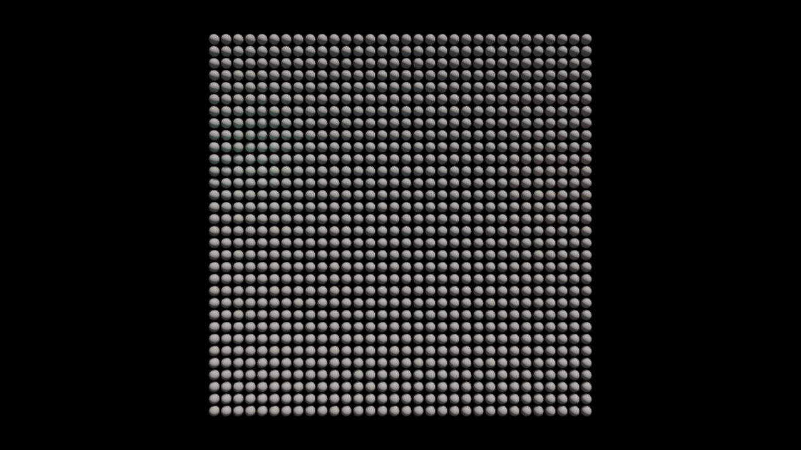
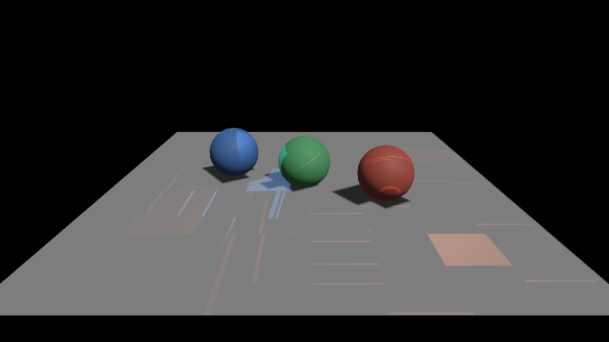
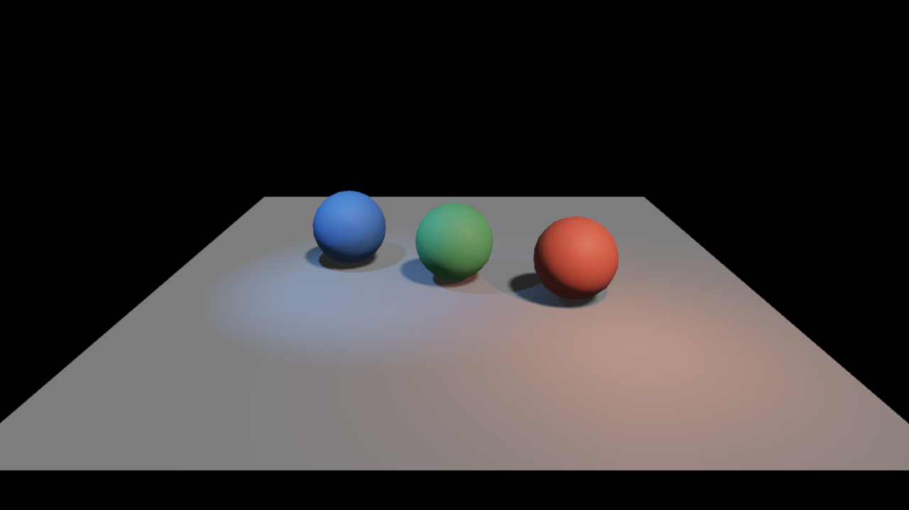
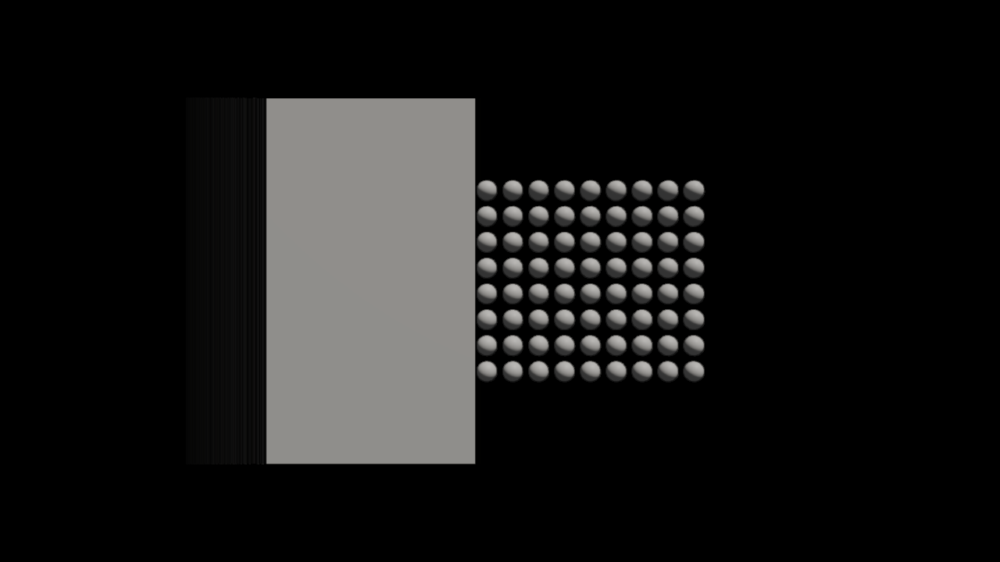
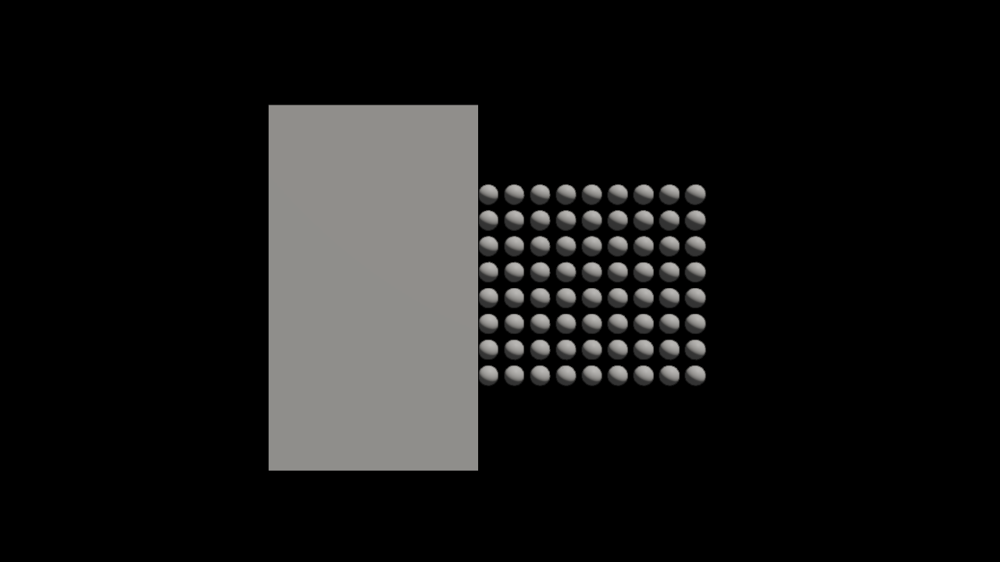

# 默认场景、阴影、TAA 与性能验证 — 2026-09-12

工作树：`F:/SomeEngine.Next-render-enhancement`，分支 `codex/render-enhancement`。测试环境为 Windows、RTX 3080、驱动 32.0.16.1074、.NET SDK 10.0.112，窗口场景使用 D3D12、1280×720。

默认资产仍是 1024 个球体的场景。静态默认场景与固定步长的相机、灯光、材质播放均通过实际 GPU 输出验证；静态运行有 6/6 个网格页面驻留，6572 个候选、4148 个软件光栅簇、49585 个着色工作项。合并重置后，图保持 132 个声明 pass，静态执行 108 个、使用 3 个队列。普通图仍按变化维护依赖和同步，验证运行的 `analysisReused` 为 0，不能把固定声明拓扑解释为完全免除每帧分析。



## 修复与责任边界

- **VSM 粗页覆盖。** 原实现只申请地图中心的少数粗页，细页池耗尽后，其他区域没有回退页，被采样成黑色。粗页申请现覆盖每个视图的全部有效区域，包含负坐标滚动新增的边界页。GPU 测试覆盖方向光、点光和聚光灯。
- **局部灯光页密度。** 点光和聚光灯原来固定使用 16K 虚拟分辨率，小型接收地面也会造成约 3.8 万次细页申请失败。现在按接收画面尺寸选择二次幂分辨率，并由 `LocalResolutionLodBias` 调整；方向光继续使用自身的 clipmap 策略。页表分配跨度与各视图实际页坐标分别处理，仍使用同一张页表和同一条 Cluster 工作通路。验证场景的粗页、细页申请失败均降为 0。
- **无阴影视图。** 关闭 VSM 或没有阴影视图时，同时停用对应的区域构建、遍历、分桶、细分、光栅和复位链，避免读取未生成的数据，或由无消费者的复位覆盖主视图共享工作数据。主视图继续正常输出。
- **TAA 背景显露。** 移动物体离开后，旧颜色曾在空背景中留下长尾。现在检查当前深度邻域；完全空背景使用当前颜色，轮廓邻域仍保留重投影覆盖。无历史帧直接返回当前色。GPU 测试覆盖正常混合、取消帧、关闭、相机切换、视图切换、主动失效、远处物体离开与轮廓覆盖。
- **局部灯光边界。** 距离衰减在光源范围内平滑降到零，消除范围边缘的亮度突变；背向表面、范围外及锥体外的灯光在阴影采样前退出。
- **CPU 状态存储。** RenderGraph 仅复用状态推导内部的 Before、After 和 Completions 数组；已发布的边界数组继续独立持有，避免图行复用时修改旧资源缓存。提交成功后才发布边界的时序保持不变。
- **GPU 清零。** VSM 工作网格、请求表和计数器改为一个 compute pass 清零，代替 CPU 填充上传内存后逐块复制。完整容量、页池大小与清零范围保持不变；默认配置每帧避免约 3.06 MiB 的 CPU 填充及上传。`VirtualShadowMapShaders.ResetFrame` 显式指定新 shader，默认资产生成器提供 `--virtual-shadow-only` 更新入口。
- **灯光分配并行度。** 每个灯的覆盖单元仍按原规则计算。根据灯数和已有深度分片数推导 `GroupsPerLight`，让少数大灯的单元循环分散到多个线程组；灯多时维持每灯一个组。单组循环保留固定步长，避免可变步长增加大范围循环成本。未增加场景名称、模型名称、输入数据特征或基准识别分支。
- **验证入口。** `--frame-output image.bmp` 导出真实呈现像素；`--no-debug-ui`、`--no-taa`、`--no-vsm` 用于对照。验证模式隐藏面板，结合真实 Cluster 工作和场景颜色判断输出，不再用固定屏幕覆盖率拒绝小物体。

所有场景变更仍经 Game World → Render World 提取。通用管线没有增加顶点布局假设或逐帧元数据反射。位移验证场景的着色也已改正：高度上下界纹理仅供位移域使用，表面不再把它当作法线贴图。

修复前的阴影验证场景：



最终阴影与灯光输出：



移动遮挡物的 TAA 对照，输入步长均为 1/60 秒：





## 功能证据

| 范围 | 实际结果 |
|---|---|
| 默认静态 / 材质播放 | 120 帧静态、180 帧材质播放通过 GPU 验证；全部 6 个网格页驻留，无加载失败 |
| LOD / 按需流送 | 同源模型近处 82 候选、42 可见簇、3/6 页驻留；远处 3 候选、2 可见簇、2/6 页驻留。未用到的非驻留页不等于加载失败 |
| 遮挡剔除 | 129 实体的移动遮挡场景通过 180 帧验证；最终复跑第二阶段最多恢复 48 个可见簇 |
| Phong 细分 | 20480 个最终 patch，丢弃与质量限制均为 0 |
| 多材质细分 / 透明裁切 | 4 个材质，1280 个 patch，丢弃与质量限制均为 0；Mesh、VS/PS 和动态阴影路径通过 |
| 位移细分 | 最终 VS/PS 路径 120 帧验证为 16740 个 patch，丢弃 0，质量限制 207；先前动态用例质量限制 200。固定条件的 Mesh 与 VS/PS 对照覆盖均为 28219 像素，10 个像素的颜色差超过 3/255；未声称逐像素等价 |
| WPO / alpha | 混合路径实际产生 8 SW + 20 HW 簇，全硬件为 28 HW；关闭 TAA/VSM 的固定静态图片逐字节一致，动态 VSM 路径通过 |
| VSM | 缺粗页条带、自阴影断裂、方块化投影已在接收地面场景中复现并对照修复；混合分辨率页坐标有实际 GPU 回归 |
| TAA | 公共功能接口测试与移动遮挡图片对照通过；轮廓覆盖与空背景拒绝分别断言 |

位移的 `tessLimited` 是明确的质量预算限制，仍然存在；`tessDropped=0` 只说明没有容量丢失。当前测试范围不能推出任意高度纹理、任意视距与所有后端都满足同一误差目标。

## 性能

通用优化的控制版本保留同样的画质修复，使用原来的灯光单组循环、CPU 上传清零和状态数组分配。帧计时与像素验证分开执行。动态光照场景的相机、一个物体和一个点光源按相同步长播放；计时参数为 `--hidden-window --no-vsync --no-debug-ui --synchronous-frames --scene-playback motion --fixed-step 0.016666667 --trace-frames-only`，900 帧剔除前 256 帧。默认静态场景为 1200 帧剔除前 256 帧，使用正常异步帧循环。计时运行关闭 GPU 验证和像素回读。

最终构建核对 shader 资产哈希一致，并移除全部临时 GPU 探针后，同一轮交错执行得到：

| 输入 / 版本 | 平均帧时 | P50 | P95 |
|---|---:|---:|---:|
| 默认场景，控制 | 4.4999 ms | 4.3268 ms | 6.3902 ms |
| 默认场景，优化 | 4.1195 ms | 3.8509 ms | 6.3264 ms |
| 动态光照，控制 | 6.0498 ms | 5.7441 ms | 7.6279 ms |
| 动态光照，优化 | 5.4251 ms | 5.3260 ms | 6.5698 ms |

本轮平均帧时分别降低约 8.5% 和 10.3%。动态光照 P95 降低约 13.9%，默认场景 P95 变化很小，不能宣称它的尾延迟明显改善。四份采集都完整，无丢失事件、无 scope 错误。帧时间包含 CPU、GPU 等待与呈现；工作站上的其他任务和驱动调度仍会影响结果，不把单轮百分比外推到任意场景或硬件。

在同样的动态灯光输入、600 帧并剔除前 256 帧的详细采集中，`StateUpdateConstruction` 自身分配从 31610 B/帧降到 16522 B/帧，减少约 47.7%，阶段 CPU 时间为 0.0790 → 0.0666 ms。`RhiCommandsAndOther` 自身 CPU 时间为 0.2921 → 0.1482 ms，包含移除每帧清零上传的收益。这些是阶段成本，不是整帧成本；详细采集有额外开销，不与仅帧计时混算。

为检查灯多、灯少、范围大、范围小时的通用性，在 RTX 3080 的同一条 GPU 命令序列中交替执行新旧灯光分配 shader。每组 96 对执行，剔除前 32 对，使用实际 GPU 时间戳；每次赋灯前都清空网格。网格为 80×45×16，每单元容量 64，所有输入均走同一份最终 shader。此表是单独赋灯 pass 的时间：

| 输入 | 原算法 | 最终算法 |
|---|---:|---:|
| 1 个大范围灯 | 0.387144 ms | 0.024432 ms |
| 3 个大范围灯 | 0.372000 ms | 0.083760 ms |
| 80 个大范围灯 | 0.433840 ms | 0.435488 ms |
| 80 个小范围灯 | 0.003808 ms | 0.003328 ms |
| 4096 个小范围灯 | 0.011152 ms | 0.010768 ms |

大范围灯改善来自分配工作并行化；大量灯的差异接近测量波动。曾尝试无条件展开全部深度分片，但大量小灯出现明显退化，未保留该版本。

VSM 帧重置的初步 pass 时间戳约为 0.27 → 0.01 ms，同时合并了请求表清零。该数字包含 pass 自身的屏障，不能与异步队列上其他 pass 的时间简单相加。测量期间发现其他 GPU 工作造成多个未修改 pass 同时波动；最终说明保留这项限制，不据单次跨进程 GPU 时间宣称整个管线获得同等比例加速。

默认场景关闭 TAA/VSM 的控制与优化图片逐字节一致。开启 VSM 时，独立运行的细页分配顺序会影响少量阴影像素；同一控制版本重复运行的差异也存在，因此不使用整图哈希相等作为阴影正确性的唯一判据。

## 测试与复现

最终 Release 全解决方案测试完成且退出码为 0：D3D12 259 通过、1 个 Intel 专用用例跳过；Vulkan 43；RenderGraph 59；Render 65；Cluster 10；Assets 147；应用参数 12；Diagnostics 20。Debug 额外复验 RenderGraph 65、Cluster 10 和应用参数 12，全部通过。早期完整运行曾触发一次 Diagnostics 既有零分配断言，隔离复测及最终完整运行均通过，未修改其代码或阈值。

窗口场景的证据来自 D3D12/RTX 3080。Vulkan 窗口启动被现有后端主动拒绝：`VulkanDevice.GetSupportedFeatures` 未开放 `Presentation`，仓库的 `VulkanPresentationTests.RequestingPresentationIsRejected` 明确覆盖这一限制；系统也缺少 `VK_LAYER_KHRONOS_validation`。本轮没有改变后端能力约定，Vulkan 的原生与无窗口集成测试通过不代表窗口呈现已跑通。

```powershell
dotnet build src/SomeEngine.Runtime -c Release
dotnet run --no-build --project src/SomeEngine.Runtime -c Release -- --frames 180 --hidden-window --no-vsync --gpu-validation --verify-frame-output --synchronous-frames --scene-playback materials --fixed-step 0.016666667
dotnet run --project tools/SomeEngine.RenderScenarios -c Release -- F:/SomeEngine.Next-render-enhancement/src/SomeEngine.Runtime/bin/Release/net10.0 F:/render-scenes/lighting lighting
```

场景模式、截图与功能对照开关见 [RenderScenarios](../../tools/SomeEngine.RenderScenarios/README.md)。临时探针、原始 trace、临时图片和生成的应用副本在检查后删除；本目录只保留交付说明和少量对照图片。
