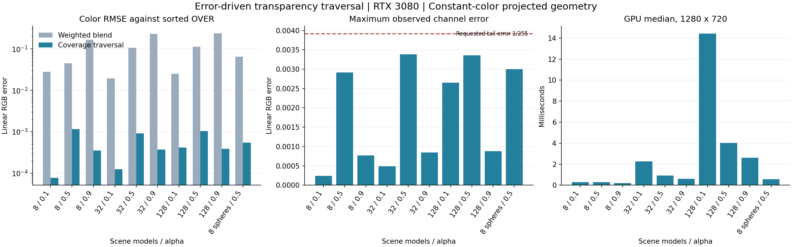
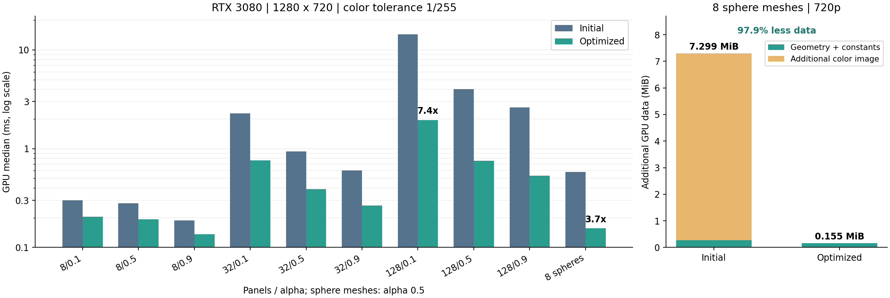
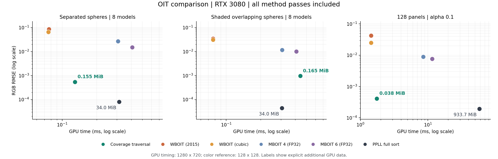

# 透明覆盖遍历 OIT

本页记录 2026-10-14 至 2026-10-15 的研发原型与对应验证范围。源实现位于 `tools/SomeEngine.Transparency.Research`，公共启动验证使用 DefaultGame。

通用材质的主要评价条件采用模型内部颜色随光照变化的输入。模型常色的整块合并作为专项优化独立记录，性能结论沿对应的颜色条件与几何条件读取。

## 算法

每个像素维护已合成颜色 `C`、剩余透射率 `T`、最近已处理的 `(depth, triangleId)` 和一个几何遍历位置。三角形身份来自源几何，等深度时按身份确定先后。几何节点覆盖全部模型及其实际三角形。

对最近的一个覆盖点，用户 shader 给出颜色 `c` 与 alpha `a`，执行：

\[
C \leftarrow C + T a c,\qquad T \leftarrow T(1-a).
\]

遍历完成时加入 `T * background`。剩余贡献已经满足颜色容差时，加入 `T * midpoint` 并结束。工作量由片元 alpha 的连乘与实际剩余几何决定；精度参数是颜色容差。

全部模型和三角形形成一棵连续几何树。每个像素保留已经排除的几何前缀，后续查询从剩余数组区间开始。树节点以子树结束下标跳过已经证明完成的范围。

构建过程用三角形投影的分离轴与子树相交查询，证明一个几何区间在任一像素至多覆盖一次。该区间内部重新按屏幕 XY 组织三角形树；找到实际交点后，整段搜索立即完成。区间记录后续全部几何的最小深度，最近候选位于此前时直接结束本次查询。这些证明只依赖几何，颜色由实际命中表面给出。

覆盖区间的数量来自完整几何。所有区间都存储在 GPU 几何数据中；一个 uint 缓存前 32 个区间的完成状态，并单独保存前一次命中区间。缓存命中省去已经证明完成的查询，其余区间继续通过完整几何查询处理。最终颜色和终止位置由实际覆盖、透射率与颜色容差决定。

全部覆盖区间的最大深度小于后续几何的最小深度时，shader 直接推进实际区间记录，每段取得唯一命中表面的颜色。深度交叠时使用最近覆盖查询。draw 提交顺序任意，几何证明与覆盖查询给出合成次序。

这种执行方式属于按深度推进的 OIT。GPU 执行普通 compute，覆盖测试使用投影三角形的边方程。每个像素的状态占常量空间；几何存储随输入模型和三角形数量增长。

## 误差上界

设剩余合成颜色的逐通道范围为 `[L,U]`。它由剩余表面的颜色与背景颜色形成凸组合。已经处理的部分为 `C`，剩余透射率为 `T`，最终颜色可写为：

\[
C_{true}=C+T C_{tail},\qquad C_{tail}\in[L,U].
\]

取 `midpoint=(L+U)/2`，得到：

\[
\|C_{approx}-C_{true}\|_\infty
\le {T\over2}\|U-L\|_\infty.
\]

停止条件使用这个上界与颜色容差 `epsilon` 的比较。原型的表面 RGB 属于 `[0,1]`，背景来自输入图像，因而 `L=0`、`U=max(1, background.rgb)`。验证采用 `epsilon=1/255`，GPU 输出为 RGBA16F；读回误差另包含浮点计算与输出舍入。

算法为确定性计算，采样方差为零。RGB 辐亮度范围由用户材质的求值方式决定；完整材质接入时，shader 提供相应的颜色范围，继续使用同一停止条件。

## 实现与数据

- `ProjectedTriangle` 是研究材质的投影几何与三角形身份。
- `TriangleCoverage` 以 56 字节存储三个边方程、对顶点深度、三角形身份与颜色下标。颜色由共享表持有。
- `TriangleHierarchy` 持有完整源三角形、连续几何树、覆盖区间与共享颜色表。
- `TriangleBounds` 为 32 字节，持有浮点包围盒、三角形或子树结束下标、覆盖区间下标。`CoverageRange` 为 16 字节，持有节点区间、后续最小深度与自身最大深度。
- `TransparencyGeometry` 将覆盖方程、树节点、覆盖区间和颜色表形成一块 GPU 数据。shader 使用该研究材质的字节布局读取。
- `Shaders/resolve.slang` 执行覆盖查询、颜色求值与合成。
- `TransparencyColorFeature` 持有 DeviceLocal 几何缓冲、常量缓冲和持久 compute pass，消费渲染器交付的深度，并原位读写场景颜色。
- `IApplicationColorFeature` 将颜色 pass 接在 opaque 着色与 TAA 之间；每帧通过 RenderGraph 输入连接现有渲染结果。

正式材质与动画几何沿 GameWorld extraction → RenderWorld → 用户几何和材质 shader 交付。研究材质的字段布局由该材质持有；管线通过 shader 输出使用投影几何。当前实测材质为常色、标量 alpha 的投影面和球体网格，几何树和边方程在样例初始化时构建。动态几何的投影、树更新和完整材质光照属于其帧内交付与求值工作。

场景颜色由既有 RGBA16F 图持有，透明 pass 在原图逐像素合成。8 个研究球体对应 1,344 个三角形、2,687 个几何树节点与 16 个一次覆盖区间。inspection 的逐像素统计由测量工具持有。资源配置和图拓扑在初始化时形成，Record 交付当帧既有颜色与深度。

## 初版验证：2026-10-14

颜色对照以逐像素收集全部覆盖点、按深度与三角形身份排序后合成为参考。GPU 算子的质量图为 128×128，背景 RGB 为 0.125；几何包含 8、32、128 个面，alpha 为 0.1、0.5、0.9，并增加 8 个有前后表面的球体网格，alpha 为 0.5。颜色使用固定随机种子 314159。GPU 时间采用 1280×720、8 帧预热、24 帧 GPU timestamp 采样。GPU shader 使用 Slang 2026.17.1 与 maximal optimization。

加权混合对照采用 `w(z)=(1-z)^3`，累加 `alpha * w * color` 和 `alpha * w`，并以全部 alpha 的乘积计算背景透射率。该对照的权函数由本次实验固定，比较结果属于上述输入分布。

初版的颜色、重复帧差异与 GPU 时间由 [初版测量数据](Transparency-Research-2026-10-14.json) 持有。当前实现的十一组质量与时间数据由 [优化测量数据](Transparency-Optimization-2026-10-14.json) 持有，额外包含模型深度间隔 0.025 的交叠球体。行为检查覆盖指定颜色容差与输入顺序变化，命令执行仓库的自动测试规则检查。

DefaultGame 对照采用 Release NativeAOT，分别启动默认模式和 `--transparency-research`。两轮都使用 `tools/Measure-Scenes.ps1`，每轮完成 1024 小球、Sponza、Amazon Bistro。对照增加相同的 8 个研究球体，三个原场景保留各自的动画和内容。完整配置与帧时间由 [统一场景对照](Transparency-Scenes-2026-10-14.json) 持有。

RTX 3080 上，十组 GPU 颜色验证的最大通道误差为 0.003386。8 个球体的 RMSE 为 0.000543，GPU 中位时间为 0.580 ms，P95 为 0.888 ms。32 面、alpha 0.5 的同输入重复帧像素差异为 0。

统一场景每轮分别用时 30.18 秒、31.28 秒。最终球体对照的帧均值约为：

| 场景 | 基准 ms | 加入研究球体 ms | 变化 ms |
| --- | ---: | ---: | ---: |
| 1024 小球 | 3.89 | 3.86 | -0.03 |
| Sponza | 3.13 | 3.23 | +0.10 |
| Amazon Bistro | 6.60 | 6.51 | -0.09 |

这组帧均值变化包含运行波动。独立 GPU 计时给出覆盖查询与合成的直接成本。128 面、alpha 0.1 的 GPU 中位时间为 14.45 ms，体现大量低 alpha 重叠下的实际交点工作量。

这些场景结果是 presented frame elapsed time 和 CPU 阶段时间。GPU 算子时间单独由 timestamp 测量给出。初始化几何与 shader 编译由启动过程承担。大量低 alpha 重叠会增加实际查询量；对应的 128 面、alpha 0.1 数据单独列在算子测量中。

## 常色版本的开销优化：2026-10-14

优化保持颜色容差 1/255、相同几何与颜色、1280×720 GPU 计时、8 帧预热和 24 帧采样。质量图保持 128×128，并继续使用全部覆盖点排序合成的参考。

| 负载 | 初版 GPU ms | 当前 GPU ms | 开销减少 |
| --- | ---: | ---: | ---: |
| 32 面，alpha 0.1 | 2.274 | 0.764 | 66.4% |
| 32 面，alpha 0.5 | 0.934 | 0.388 | 58.4% |
| 128 面，alpha 0.1 | 14.446 | 1.949 | 86.5% |
| 128 面，alpha 0.5 | 4.017 | 0.752 | 81.3% |
| 8 个球体，alpha 0.5 | 0.580 | 0.156 | 73.1% |

128 面、alpha 0.1 的模型节点访问总量按覆盖像素归一化，从 874.85 次降到 103.17 次。当前十一组最大通道误差为 0.003386；8 个球体的 RMSE 为 0.000543；交叠球体的最大误差为 0.002965，GPU 时间为 0.520 ms。几何范围与相同颜色证明负责批量合成，交叠部分继续执行最近覆盖查询。

8 个球体的几何有效数据从 280,000 字节缩为 161,792 字节，减少 42.2%。原位颜色合成节省 1280×720×8 = 7,372,800 字节的颜色图数据。计入 256 字节常量数据，该透明功能的新增 GPU 有效数据由 7,653,056 字节降到 162,048 字节，减少 97.9%。这里按缓冲有效数据与纹理像素数据计量；后端分配对齐由其资源分配器处理。

同负载的 DefaultGame 优化前后对照使用 Release NativeAOT、相同的研究球体、三个原场景、渲染选项与采样方式。完整配置与结果由 [优化场景对照](Transparency-Optimization-Scenes-2026-10-14.json) 持有。

两轮工具总用时分别为 31.02 秒与 31.57 秒，三个场景均为 Measured，Complete 为 true；渲染尺寸均为 1280×720。TAA、VirtualShadows、AsyncCompute、场景行为、JIT 配置及采样方式一致。

| 场景 | 优化前帧均值 ms | 优化后帧均值 ms | 变化 ms |
| --- | ---: | ---: | ---: |
| 1024 小球 | 4.584 | 4.505 | -0.078 |
| Sponza | 3.870 | 4.047 | +0.177 |
| Amazon Bistro | 8.024 | 7.968 | -0.056 |

该表记录 presented frame elapsed time；上方算子表记录独立 GPU timestamp 时间。性能评价分别沿这两种计时范围读取。4 项公共行为检查通过，GPU 的十一组完整颜色对照通过。

## 同负载方法对照：2026-10-15

[十二种负载、六种实现的完整测量](Transparency-Comparison-2026-10-15.json) 包含 72 组结果。GPU 时间为 RTX 3080、1280×720；误差以 128×128 全部覆盖点的标准排序合成为参考。所有输出为 RGBA16F，背景 RGB 为 0.125。新增 GPU 数据包含方法几何、常量和中间资源的有效字节，共同的输入颜色与深度由既有路径提供。

各方法连续提交 32 帧预热、24 帧采样。每组方法计时前累计至少 250 ms GPU 预热，记录的 GPU 核心时钟为 1950–1980 MHz，显存时钟为 9501 MHz。背景通过相同 compute 写入后进入计时；GPU timestamp 覆盖方法所需清空、光栅绘制、屏障与最终合成。固定投影几何、树构建、shader 编译与排序容量统计在初始化交付。

WBOIT 2015 使用 [作者公布的通用权函数](https://casual-effects.blogspot.com/2015/03/implemented-weighted-blended-order.html)，统一除以 3000 保持 FP16 累加范围，加权平均的数学比例保持一致。WBOIT cubic 使用 `max(1e-5,(1-z)^3)`。二者采用 RGBA16F accumulation 与 R16F revealage。MBOIT 使用四阶或六阶 power moments、FP32 moment 累加、RGBA16F 颜色累加；深度映射为 `2*z_ndc-1`，bias 分别为 5e-7、5e-6，overestimation 为 0.25。重建函数来自 [2018 年论文作者的 CC0 代码](https://momentsingraphics.de/I3D2018.html)。

逐像素排序对照为 PPLL：硬件光栅完整统计覆盖量，节点池按实际总量分配；每个节点存储深度、三角形身份、颜色下标和后继，共 16 字节。峰值覆盖数至多 32 时使用按实际峰值形成的局部数组与插入排序；更大覆盖量使用完整链表归并排序。该配置表达完整片元排序的质量与成本，合成使用全部覆盖点。

| 方法 | 8 个常色、深度分离球体 GPU ms | RGB RMSE | 最大通道误差 | 新增 GPU 数据 MiB |
| --- | ---: | ---: | ---: | ---: |
| 覆盖遍历 | 0.129 | 0.000543 | 0.003001 | 0.155 |
| WBOIT 2015 | 0.077 | 0.086355 | 0.368682 | 8.861 |
| WBOIT cubic | 0.076 | 0.065351 | 0.252471 | 8.861 |
| MBOIT 4 FP32 | 0.307 | 0.026773 | 0.114776 | 24.682 |
| MBOIT 6 FP32 | 0.409 | 0.015129 | 0.065477 | 31.713 |
| PPLL 完整排序 | 0.313 | 0.000080 | 0.000482 | 33.965 |

异色交叠负载的球体模型深度间隔为 0.025，颜色按三角形法线与同一方向光形成。模型内部颜色变化使覆盖遍历执行逐次最近查询。

| 方法 | 异色交叠 GPU ms | RGB RMSE | 新增 GPU 数据 MiB | 128 面 alpha 0.1 GPU ms | RGB RMSE |
| --- | ---: | ---: | ---: | ---: | ---: |
| 覆盖遍历 | 0.442 | 0.000959 | 0.165 | 1.745 | 0.000413 |
| WBOIT 2015 | 0.077 | 0.034856 | 8.871 | 1.444 | 0.042320 |
| WBOIT cubic | 0.077 | 0.030961 | 8.871 | 1.444 | 0.024945 |
| MBOIT 4 FP32 | 0.307 | 0.011737 | 24.692 | 8.545 | 0.008863 |
| MBOIT 6 FP32 | 0.409 | 0.010112 | 31.723 | 11.622 | 0.007663 |
| PPLL 完整排序 | 0.306 | 0.000044 | 33.975 | 58.250 | 0.000194 |

GPU 时间的方向变化对应实际几何条件与算法路径。8 个常色球体的深度间隔从 0.075 改为 0.025 后，模型深度范围发生交叠，覆盖遍历由整模型透射率合并转入逐次最近覆盖查询，时间从 0.129 ms 升为 0.442 ms。同色交叠时 PPLL 为 0.321 ms；增加三角形光照颜色变化后，覆盖遍历仍为 0.442 ms，PPLL 为 0.306 ms。这三组 PPLL 的实际片元数均为 1,990,820，单像素峰值均为 16，排序路径均为局部插入排序。

128 面的实际片元数为 60,957,873，单像素峰值为 128，本次 PPLL 转入链表归并排序；alpha 0.1 时排序与合成 pass 为 51.389 ms，总时间为 58.250 ms。覆盖遍历仍使用深度分离模型的合并路径，并由实际剩余透射率与颜色容差决定终止位置。alpha 0.5 时，在连续覆盖区域处理 7 个面后，尾部颜色上界降至 `0.5 * 0.5^7 = 0.00390625`，满足 `1/255` 的颜色容差；整组时间为 0.709 ms。这个面数由每个像素的实际透射率形成。58.250 ms 表达本次 PPLL 实现的长链归并成本。

当前方法在这组实测中提供受颜色容差控制的偏差与很小的新增存储；同色、深度分离的负载获得批量合成收益。WBOIT 在轻负载和深度交叠时保有更低 GPU 开销。异色交叠球体上，PPLL 同时取得更低时间和更小误差，代价体现为完整片元存储。128 面、alpha 0.1 的 PPLL 数据为 933.675 MiB；覆盖遍历为 0.038 MiB。

72 组输出均为有限值；覆盖遍历的最大通道误差为 0.003541，完整排序为 0.000488。排序误差落在输出舍入量级，覆盖遍历误差包含尾部近似。signed RGB bias、平均绝对误差、RMSE、最大误差、分 pass GPU 时间和容量信息由测量 JSON 持有。

四项公共行为检查通过。当前覆盖遍历实现经 DefaultGame 统一平台完成 1024 小球、Sponza、Amazon Bistro，工具用时 29.95 秒，三个场景均为 Measured、Complete 为 true，Release NativeAOT、1280×720。该集成记录的帧均值分别为 3.75、3.33、6.38 ms；六种方法的同负载比较沿上方独立 GPU 算子测量读取。[当前实现的三场景集成记录](Transparency-Comparison-Scenes-2026-10-15.json)

## 材质颜色变化对照：2026-10-15

[同一轮的常色与异色材质对照](Transparency-Material-Comparison-2026-10-15.json) 保持 8 个球体、1,344 个三角形、模型深度间隔 0.075 与 alpha 0.5。异色组根据三角形法线和同一方向光改变 RGB；几何和 alpha 与常色组一致。两组实际片元数均为 1,990,820，单像素峰值均为 16。

RTX 3080 上使用同一测量入口，GPU 时间为 1280×720、32 帧预热、24 帧采样；记录的核心时钟为 1965–1980 MHz，显存时钟为 9501 MHz。十二组颜色与时间对照完成，覆盖遍历的异色最大通道误差为 0.003531，RMSE 为 0.000968。

| 方法 | 常色 GPU ms | 异色 GPU ms |
| --- | ---: | ---: |
| 覆盖遍历 | 0.130 | 0.316 |
| WBOIT 2015 | 0.077 | 0.077 |
| WBOIT cubic | 0.077 | 0.076 |
| MBOIT 4 FP32 | 0.309 | 0.309 |
| MBOIT 6 FP32 | 0.411 | 0.412 |
| PPLL 完整排序 | 0.313 | 0.329 |

异色路径用时为常色路径的 2.43 倍，体现整模型常色合并的专项收益。异色组中，覆盖遍历、四阶 MBOIT 和 PPLL 的时间位于相近量级；覆盖遍历的新增 GPU 数据为 0.164 MiB，四阶 MBOIT 为 24.691 MiB，PPLL 为 33.975 MiB。相应 RMSE 为 0.000968、0.013025 和 0.000041。

模型内部颜色变化与深度交叠共同作为主要评估条件时，前一轮异色交叠球体的覆盖遍历时间为 0.442 ms，PPLL 为 0.306 ms。当前原型在该条件下的贡献体现为受颜色容差控制的偏差与很小的新增存储，主要计算成本来自逐表面的后继覆盖查询。

## 异色路径的几何证明优化：2026-10-15

[当前实现的完整测量](Transparency-Progress-Comparison-2026-10-15.json) 包含十三种负载、六种方法的 78 组结果。交叠路径使用一次覆盖证明、屏幕 XY 查询树、已完成覆盖缓存与后续最小深度；深度分离路径直接推进实际覆盖区间。两条路径的颜色来自命中三角形，覆盖证明独立于颜色。

| 负载 | 前一版 GPU ms | 当前 GPU ms | 时间减少 |
| --- | ---: | ---: | ---: |
| 异色交叠球体，alpha 0.5 | 0.442 | 0.359 | 18.8% |
| 异色、深度分离球体，alpha 0.5 | 0.316 | 0.248 | 21.7% |
| 128 面，alpha 0.1 | 1.745 | 1.235 | 29.2% |
| 128 面，alpha 0.5 | 0.709 | 0.504 | 28.9% |
| 128 面，alpha 0.9 | 0.500 | 0.366 | 26.8% |

异色交叠负载的 RMSE 保持 0.000959，最大通道误差保持 0.003541。当前新增 GPU 有效数据为 172,384 字节，即 0.164 MiB；PPLL 为 33.975 MiB。当前时间为 0.359 ms，PPLL 为 0.312 ms；六阶 MBOIT 为 0.411 ms、RMSE 0.010112、新增数据 31.723 MiB。该输入下，覆盖遍历相对六阶 MBOIT 时间减少约 12.5%，RMSE 降低约 10.5 倍。

完整矩阵采用相同 RTX 3080、1280×720 GPU 时间、128×128 质量图、32 帧方法预热和 24 帧采样。背景、几何、alpha、颜色和各对照算法保持相同；本次修改后的深度分离分支单独测量面板负载，其余球体负载沿同次完整矩阵读取。JSON 的 MeasurementGroups 保存两组测量时间。78 组颜色对照通过，四项公共行为检查通过。

DefaultGame 的统一场景透明输入采用同一组异色交叠球体。前后版本保持该输入、分辨率、场景行为、渲染选项、Release NativeAOT 和采样方式；对应结果由 [异色输入的三场景记录](Transparency-Progress-Scenes-2026-10-15.json) 持有。

| 场景 | 前一版帧均值 ms | 当前帧均值 ms |
| --- | ---: | ---: |
| 1024 小球 | 3.893 | 3.700 |
| Sponza | 3.798 | 3.137 |
| Amazon Bistro | 7.875 | 6.621 |

两轮工具分别用时 33.95 秒与 29.78 秒，三个场景均为 Measured、Complete 为 true，配置一致。该表是 presented frame elapsed time，包含整帧执行与运行波动；覆盖查询的直接收益沿上方 GPU timestamp 对照读取。

## 研究来源

[Weighted Blended OIT](https://jcgt.org/published/0002/02/09/paper.pdf) 提供加权颜色与背景覆盖的对照路线。[GPU 常量状态的层次遍历研究](https://research.nvidia.com/publication/2016-06_efficient-stackless-hierarchy-traversal-gpus-backtracking-constant-time) 提供软件层次遍历的研究背景。本次原型把几何覆盖查询、遍历进度和颜色误差上界组合，用实际剩余贡献控制执行。
# Tile 版本入口

2026-10-15 的后续实现与同机对照见 [Tile visibility OIT](Transparency-Tile-Visibility.md)。该版本通过共享图元缓存与寄存器交点队列提供硬件、软件两种光栅入口。本文保留覆盖树实现及其日期型验证记录。

