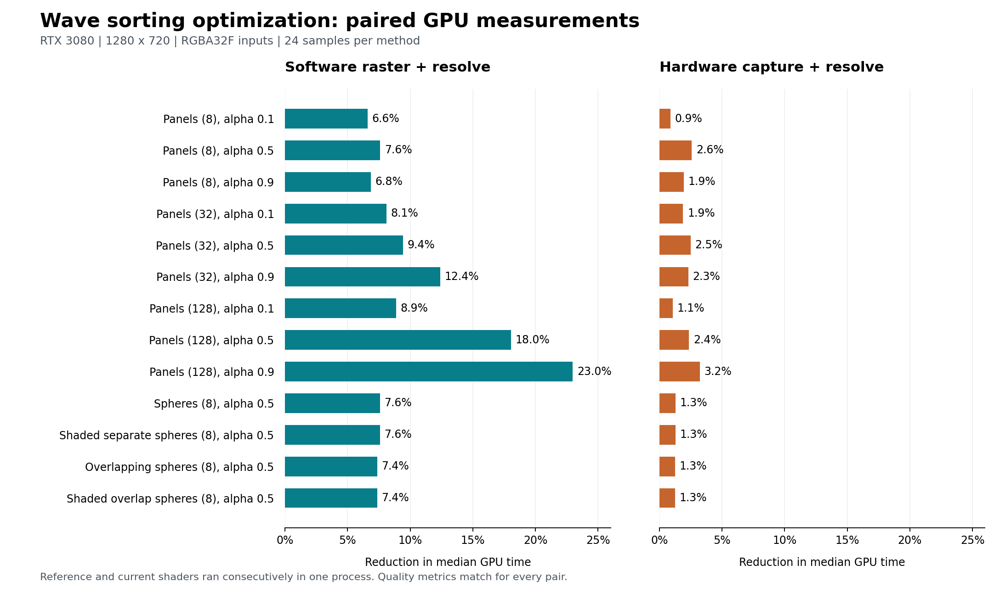
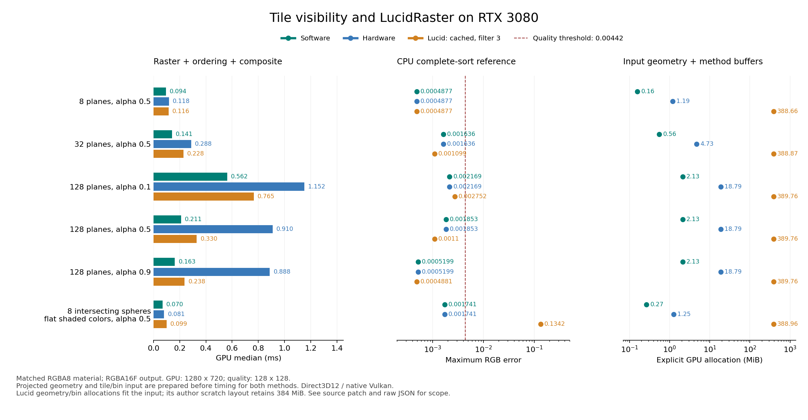
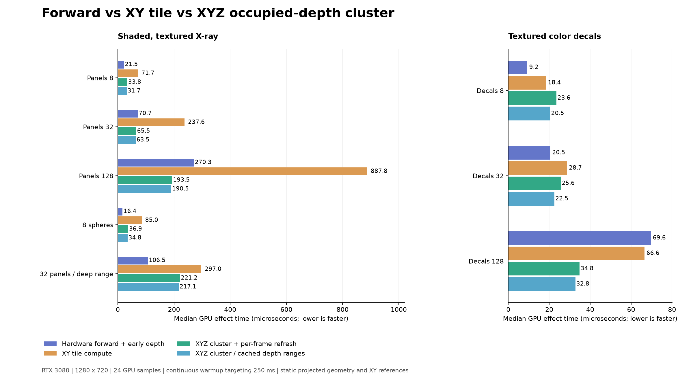
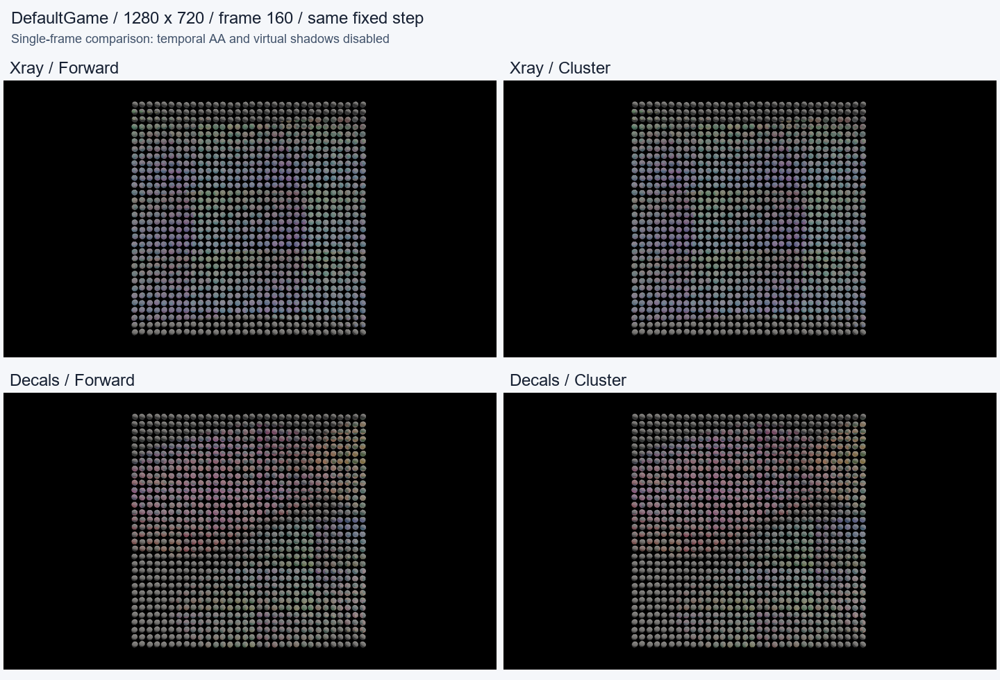
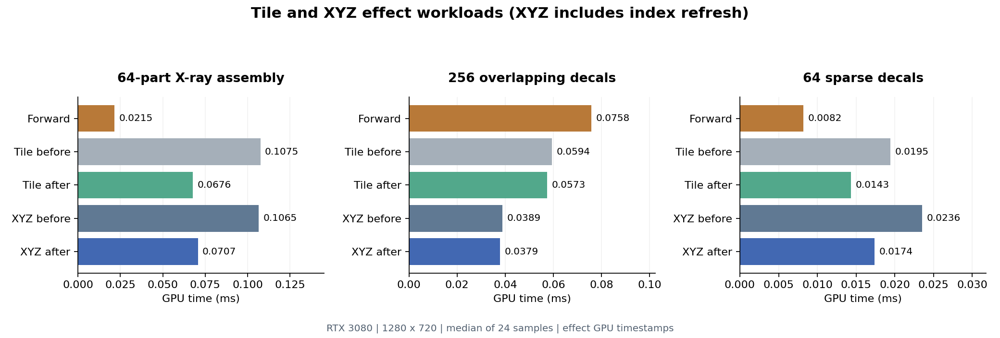
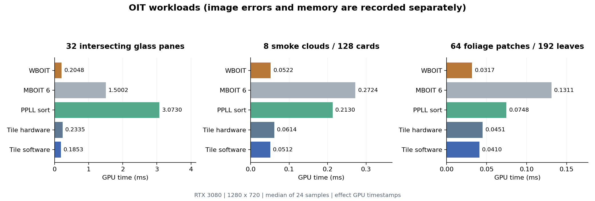

# Tile visibility OIT

2026-10-15 的实现把透明图元引用保存在连续 tile 数组中，像素在寄存器中提取最近交点，工作组通过 shared memory 共享覆盖与深度数据。排序通过 wave shuffle 交换同一 wave 内的键与引用，跨 wave 交换使用 shared memory。硬件光栅和软件光栅共用数据与合成器。处理终点由剩余几何和颜色误差阈值决定。

当前可执行输入是研究材质生成的投影三角形、每三角形颜色和 alpha。模型内部异色、相交表面与多种 alpha 均进入比较。DefaultGame 在已有 opaque visibility 着色之后、TAA 之前安装持久透明 pass，直接合成当前场景颜色，读取已有 opaque 深度。

## 数据与片上执行

每个 tile 为 16×16 像素。本次 RTX 3080 上，一个 256 线程工作组包含 8 个 32-lane warp。线程加载连续图元引用；工作组共享图元缓存与深度下界排序；每像素通过寄存器合成。

| 数据 | 存储 | 大小与用途 |
| --- | --- | --- |
| 图元深度平面、标识、颜色引用、tile 矩形 | 全局连续数组 | 每三角形 32 B；供两种光栅路径读取 |
| tile 图元引用 | 全局连续数组 | 每引用 4 B；共享原始图元 |
| tile 起点与实际引用数 | 全局连续数组 | 每 tile 8 B |
| 硬件覆盖 | 全局连续数组 | 每图元与 tile 的关联 256 bit；按 wave 合并 atomic OR |
| 软件覆盖方程 | 全局只读数组 | 每三角形 56 B；一次加载后供工作组共享 |
| 最近交点 | 每线程局部标量向量 | 四组 depth、triangle ID、color index、输入位置，共 16 个标量，另加合成与扫描状态 |
| 硬件共享缓存 | groupshared | 声明 15,360 B：256 份图元数据、覆盖掩码与排序引用 |
| 软件共享缓存 | groupshared | 声明 16,384 B：256 份图元数据、紧凑边方程与排序引用 |

寄存器队列宽度 4 决定一轮提取与合成的粒度。缓存容量 256 决定共享缓存路径的适用范围。更长的 tile 输入通过全局数组的完整扫描继续提取。每轮记录最早的递延输入位置，后续轮次从该位置继续；全部实际交点均参与终止条件的判断。

硬件路径执行清空掩码、一次透明几何绘制、一次 compute 合成。像素 shader 使用 early depth test；同一 wave 对相同掩码字的覆盖先做 OR 归约，再写原子操作。掩码保留覆盖，颜色按合成所需的交点读取。

软件路径把边方程覆盖与合成融合到一个 compute pass。工作组加载边方程，按整个 tile 的保守边界筛选输入，像素在需要候选交点时计算覆盖。候选图元和材质引用可由相邻像素共享，最终颜色写入已有场景图。

设三角形数为 N，tile 引用数为 A，tile 数为 K，颜色数为 C；当前额外显存的字节数为：

```
软件：88 N +  4 A + 8 K + 16 C + 256
硬件：88 N + 36 A + 8 K + 16 C + 256
```

数值包含源几何、tile 数据、颜色表与 uniform。opaque 颜色、opaque 深度作为共同输入。GPU 驱动分配粒度与编译器的寄存器分配由设备实现决定，表中 shared 数值来自 shader 声明。

## 深度顺序与误差

三角形深度在屏幕上写为 `z(x,y)=a*x+b*y+c`。先按图元在整个 tile 上的深度下界排序。每像素扫描候选，维护按 `(depth, triangle ID)` 排列的最近 4 个交点。当下一个图元的深度下界超过队列最远深度时，这四个交点构成当前剩余输入的最近前缀。

被队列挤出的候选、较远候选和尚待扫描的图元共同确定下一轮起点。合成当前前缀后继续同一过程，覆盖交叉与像素间顺序变化仍由各像素的真实深度处理。实数运算下，下界证书足以保证该前缀的顺序；浮点实现为下界增加 `1e-5` 的保守余量，本次图像检查覆盖对应实现。

当前研究材质的 RGB、alpha 均处于 `[0,1]`。设已合成前缀后的透射率为 T，背景与材质颜色上界为 U，则完整尾部颜色处于 `[0,U]`。用 `U/2` 代表剩余尾部时：

```
每通道绝对误差 ≤ T * U / 2
```

每次先合成完整寄存器批次，再检查 `T*max(U)/2 ≤ 1/255`。几何耗尽时加入实际背景。图像输出为 RGBA16F，验收容差为 `1/255 + 0.0005`。固定输入的执行是确定性的；交叠异色球体重复帧及倒序输入的输出差异均为 0。一般 HDR 材质的误差证明对应其实际颜色上界；这里的质量结论对应已执行的有界研究材质。

## Wave 优化与实验选择

本轮记录 11 个实验配置，包括原版控制组。最终采用 wave 内排序、常量展开、合并计数原子操作与共享存储复用。两个光栅入口保留相同的覆盖表示，每像素继续持有完整的 16 标量交点队列。

排序时，每个线程在局部变量中持有深度下界和图元引用。距离小于 wave 宽度的比较交换通过 `WaveReadLaneAt` 完成；跨 wave 的阶段通过共享引用数组交换，再从共享图元缓存读取深度。以 256 个键、32-lane wave 为例，36 个比较阶段中，30 个在 wave 内完成，6 个跨 wave；包含排序初始化或最终写回的工作组同步从原版 37 次降至 14 次。加载阶段的同步另计。

每个 wave 通过一次原子加取得可见图元的紧凑写入位置及自身的排序区间：同一 32 位字的低 16 位累计可见数，高 16 位累计 wave 宽度。排序区间由实际 wave 分配，部分 wave 通过共享内存执行排序。排序引用数组的前两个字先保存计数与部分 wave 标记，加载完成后复用为排序引用。硬件、软件的 groupshared 声明分别从 15,364/16,388 B 降至 15,360/16,384 B。本轮主要减少共享访问、同步和计数操作，显存公式沿用上节。

wave 的 lane 交换语义见 [Microsoft WaveReadLaneAt 文档](https://learn.microsoft.com/en-us/windows/win32/direct3dhlsl/wavereadlaneat)，工作组索引与 wave 分配的关系见 [HLSL group wave index 提案](https://microsoft.github.io/hlsl-specs/proposals/0048-group-wave-index/)。实际硬件寄存器数和 spill 由编译器结果决定；这里的 16 标量队列与 shared 字节数按源代码声明计量。

实验筛选结果如下。中间实验按顺序独立运行，各组的 GPU 时钟随数据保存；最终收益采用随后同一进程中相邻执行的原版与当前版对照。

| 尝试 | 观察与选择 |
| --- | --- |
| wave shuffle 排序 | 软件 128 平面、alpha 0.9 从初始 0.164864 ms 降至 0.130048 ms；纳入最终组合 |
| 常量展开排序循环、计数存储复用 | 降低动态循环与加载计数成本；纳入最终组合 |
| 可见数与 wave 区间合并为一次原子加 | 两个数据由同一次分配产生；纳入最终组合 |
| 队列仅保存深度与输入位置 | 同一负载为 0.139264 ms，间接查找提高成本；最终保留四类交点数据 |
| 延后查找颜色引用 | 同一负载为 0.138240 ms；最终保留队列中的颜色引用 |
| 64 位覆盖字与 wave 归约 | 硬件同一负载为 1.171456 ms，覆盖阶段占 1.055744 ms；最终采用 32 位覆盖字 |
| 8×4 覆盖字布局、逐地址 OR 循环、统一地址快路径 | 硬件同一负载分别为 0.978944、1.054720、0.989184 ms；最终采用原覆盖布局和 `WaveMatch` 归约 |
| 软件覆盖之前提前拒绝深度 | 软件同一负载为 0.140288 ms，alpha 0.1 为 0.618496 ms；最终保留覆盖后深度判断 |

最终对照共 52 条结果：13 组输入 × 两个光栅入口 × 原版/当前版。RGBA32F 输入、分辨率、预热与采样沿用下节口径。软件 13 组耗时降低 6.59%～22.98%，硬件 13 组降低 0.88%～3.23%。各组 RMSE、平均绝对误差、最大误差、平均有符号误差与有限值检查结果逐项一致；异色相交球体的重复帧及倒序提交差异均为 0。

| 输入 | 软件原版 ms | 软件当前 ms | 硬件原版 ms | 硬件当前 ms | 当前最大颜色误差 |
| --- | ---: | ---: | ---: | ---: | ---: |
| 128 平面，alpha 0.1 | 0.566272 | 0.516096 | 1.150976 | 1.138688 | 0.002450 |
| 128 平面，alpha 0.5 | 0.209920 | 0.172032 | 0.910336 | 0.888832 | 0.001971 |
| 128 平面，alpha 0.9 | 0.164864 | 0.126976 | 0.888832 | 0.860160 | 0.000530 |
| 8 个内部异色相交球体，alpha 0.5 | 0.069632 | 0.064512 | 0.080896 | 0.079872 | 0.001797 |



完整实验与最终原版 shader 源码见 [本轮优化证据](Transparency-Tile-Optimization-2026-10-15.json)。原版源码保存在最终结果的 `ReferenceShaderSource` 中，可通过测量入口的 `--tile-reference` 复现配对比较。下方八种方法与 Lucid 对照保留首轮时间，分别对应各自测量时的实现和输入颜色格式。

## 首轮同机比较

设备为 NVIDIA GeForce RTX 3080，驱动 `32.0.16.1074`。计时分辨率 1280×720，质量分辨率 128×128。每组累计至少 250 ms GPU 预热，每个方法随后执行 32 帧预热、24 帧采样。GPU 应用按完成边界串行运行。计时包含方法自身的清空、光栅、排序、屏障与合成；输入投影、静态 tile 构建和共同背景初始化位于计时区间之前。

本实现通过 Direct3D12 提交，原生 Lucid 通过 Vulkan 提交。对照图使用共同 RGBA8 输入：



[八种方法的原始证据](Transparency-Tile-Comparison-2026-10-15.json) 包含 13 组几何、alpha、内部异色组合，共 104 条结果。以下采用每三角形 RGBA32F 输入，时间为 GPU 中位数，显存包含源几何和中间存储。

| 8 个内部异色、相交球体，alpha 0.5 | GPU ms | 额外 MiB | 最大颜色误差 |
| --- | ---: | ---: | ---: |
| Tile visibility 软件 | 0.0686 | 0.274 | 0.001797 |
| Tile visibility 硬件 | 0.0809 | 1.260 | 0.001797 |
| WBOIT 2015 | 0.0768 | 8.871 | 0.323615 |
| MBOIT 4 FP32 | 0.3092 | 24.692 | 0.102677 |
| MBOIT 6 FP32 | 0.4127 | 31.723 | 0.082429 |
| PPLL 完整片元排序 | 0.3144 | 33.975 | 0.000487 |
| 前一版覆盖树遍历 | 0.3594 | 0.164 | 0.003541 |

PPLL 的池容量来自完整硬件覆盖统计，峰值覆盖 32 以内使用局部插入排序，更高覆盖使用链表归并排序。Moment 重建使用作者的四阶、六阶 FP32 代码；偏置、权函数和原始结果随测量保存。

## LucidRaster 对照

原生参考来自 [LucidRaster 作者源码](https://github.com/nadult/lucid)。[复现入口](../../../tools/SomeEngine.Transparency.Research/References/MeasureLucid.py)、[独立驱动](../../../tools/SomeEngine.Transparency.Research/References/LucidComparison.cpp) 和 [源码补丁](../../../tools/SomeEngine.Transparency.Research/References/LucidVisibility.patch) 保存了来源、固定版本和适配内容，原生参考适配遵循作者 GPL v3 许可。

双方使用同一 RGBA8 三角形颜色与 alpha、RGBA16F 输出及 CPU 完整排序参考。Lucid 侧保留原生两级排序和光栅，提供相同平面材质、逐样本重心覆盖、零 alpha 归约、离屏输出与时间戳。有效 quad 按几何和属性相容性组合，其余源三角形按退化 quad 提交。原生硬件 alpha 合成对平面与球体分别得到最大误差 0.000604、0.000577，交叉检查了输入变换与材质。

Lucid 分别测量完整 GPU 几何设置与缓存几何两种路径，depth filter 分别为 3、8、16。下表采用与本算法静态输入口径对应的缓存几何路径、filter 3。双方每帧执行各自的覆盖、排序及合成。13 组负载中，该 Lucid 配置的 GPU 耗时为软件路径的 1.23～1.61 倍。

| 输入 | 软件 ms | 硬件 ms | Lucid 缓存 ms | 软件最大误差 | Lucid 最大误差 |
| --- | ---: | ---: | ---: | ---: | ---: |
| 8 平面，alpha 0.5 | 0.0942 | 0.1178 | 0.1156 | 0.000488 | 0.000488 |
| 32 平面，alpha 0.5 | 0.1413 | 0.2877 | 0.2282 | 0.001636 | 0.001099 |
| 128 平面，alpha 0.1 | 0.5622 | 1.1520 | 0.7652 | 0.002169 | 0.002752 |
| 128 平面，alpha 0.5 | 0.2109 | 0.9103 | 0.3300 | 0.001853 | 0.001100 |
| 128 平面，alpha 0.9 | 0.1628 | 0.8878 | 0.2375 | 0.000520 | 0.000488 |
| 内部异色相交球体，alpha 0.5 | 0.0696 | 0.0809 | 0.0992 | 0.001741 | 0.134248 |

该表同时保留较低与较高的实际偏差；本算法的质量性质是受阈值约束的尾部近似。Lucid 的球体误差在 filter 16 下仍然出现，因此这部分结果表示当前原生适配执行的完整覆盖、排序与合成误差。单独研究其排序误差可使用表中的平面组与对应原始像素参考。

Lucid 的几何与 bin 引用分配按实际输入收紧，scratch 保留作者布局与并行 worker 配置。其显式 GPU 分配为约 388.7～389.8 MiB，其中 scratch 占 384 MiB。对应本算法软件路径为 0.158～2.134 MiB，硬件路径为 1.191～18.793 MiB。这里比较的是源码配置的实际分配，Lucid scratch 的进一步压缩属于独立实现优化空间。

硬件路径在 128 平面、alpha 0.9 时，覆盖收集约 0.744 ms、合成约 0.144 ms；软件路径合计约 0.164 ms。该负载中深层透明片元的掩码原子写入主导硬件成本，软件路径通过有证书的前缀提取提前完成像素。两条路径共同保留，以便依据材质、几何尺寸和已有硬件绘制选择入口。

完整数据分别见 [同输入 tile 测量](Transparency-Lucid-Tile-2026-10-15.json) 与 [原生 Lucid 测量](Transparency-Lucid-Reference-2026-10-15.json)。跨平台、动态几何构建、通用材质着色与图元密度变化的结论，采用各自完整输入准备和整帧测量作为验收范围。

## Visibility 与持久图接入

`TileVisibilityColorFeature` 使用现有 `IApplicationColorFeature`，在 opaque 着色完成后排序，在透明合成完成后交付当前颜色给 TAA。颜色和深度通过已有帧输入绑定，源数据、pass 与资源由持久图维护。硬件路径使用只读深度附件；RenderGraph 增加了从 `GraphTextureInput` 创建 depth-stencil view 的入口，访问声明随绑定输入解析。

研究材质持有投影、覆盖方程与颜色解释。合成器按命中顺序获取图元和材质引用，当前材质在该位置读取共享颜色表。引擎仍沿 GameWorld、提取、RenderWorld 的路径组织渲染数据。该实现的时序与显存收益主要来自图元共享、覆盖压缩、按需颜色读取及对已有场景颜色的就地合成。

首轮 DefaultGame 的三次统一场景运行均完成全部场景，单次命令含启动分别耗时 28.35、29.32、29.14 秒。以下为 presented frame elapsed 的中位数，单位 ms；GPU 算子时长由上述时间戳实验单独记录。

| 场景 | 覆盖树 | Tile 硬件 | Tile 软件 |
| --- | ---: | ---: | ---: |
| 1024 小球 | 3.6562 | 3.8017 | 3.7824 |
| Sponza | 3.1072 | 3.0336 | 3.1605 |
| Amazon Bistro | 6.5487 | 6.4126 | 6.5467 |

三次运行使用同一 NativeAOT 发布、1280×720 分辨率、相同场景行为与渲染选项，trace 关闭。整帧结果保留 CPU 提交、流送与呈现的共同成本，收益判断分别沿整帧与算子两组指标读取。原始证据见 [统一场景结果](Transparency-Tile-Scenes-2026-10-15.json)。

## 本轮统一场景验证

最终 shader 已随 DefaultGame 发布。通过 `tools/Measure-Scenes.ps1` 串行运行软件优化前、软件优化后及最终硬件路径，单次含启动耗时分别为 28.81、29.59、29.22 秒。三次结果均为 `Complete`，1024 小球、Sponza、Amazon Bistro 均为 `Measured`。分辨率为 1280×720，采用 NativeAOT；场景行为、渲染选项与采样方式一致，trace 关闭。各场景在 opaque visibility 着色之后、TAA 之前合成同一组 8 个内部异色相交透明球体。

以下为完整呈现帧的统计，单位 ms；软件列按优化前 → 优化后排列：

| 场景 | 软件中位数 | 软件平均值 | 软件 P95 | 最终硬件中位数 |
| --- | ---: | ---: | ---: | ---: |
| 1024 小球 | 3.8627 → 3.8430 | 3.8914 → 3.8917 | 4.3393 → 4.2955 | 3.7333 |
| Sponza | 3.1347 → 3.1136 | 3.4421 → 3.5035 | 3.5302 → 3.5669 | 3.0586 |
| Amazon Bistro | 6.4852 → 6.4440 | 6.5385 → 6.5245 | 7.0530 → 6.9419 | 6.3813 |

软件整帧中位数下降约 0.51%～0.67%；Sponza 平均值和 P95 分别上升约 0.0614、0.0367 ms。完整帧包含 CPU 提交、流送和呈现的变化；本轮算法优化的主要证据是同进程配对的透明 GPU 算子时长。硬件列记录最终配置的整帧表现。

四项透明合成行为检查通过，测量入口完成 52 条 GPU 颜色与性能对照。原始场景统计和共同渲染设置见 [本轮场景结果](Transparency-Tile-Optimization-Scenes-2026-10-15.json)。

## 手动混合与 X-ray 的扩展目标

用户于 2026-10-15 提出：完成 OIT 优化后，将 tile 工作方式扩展到手动半透明混合、完整材质着色的 X-ray，以及 stencil 控制的混合。以下记录扩展目标与接口调整；上文测量对应已经执行的 OIT 实现。

共用部分是连续图元引用、覆盖、像素命中提取、材质重建与 tile 内状态。效果分别声明处理顺序、深度条件、stencil 状态变化和颜色混合。GameWorld 的效果与材质设置沿既有提取路径进入 RenderWorld，持久图持有对应资源与阶段依赖。

| 效果 | 覆盖与处理顺序 | 像素状态与着色 |
| --- | --- | --- |
| Alpha OIT | 按真实深度提取最近前缀 | 颜色、透射率；使用对应颜色上界与误差阈值 |
| 完整材质 X-ray | 收集效果所需的可见及遮挡覆盖，按场景深度分类；效果声明自身叠加顺序 | 对命中重建表面并执行材质着色，再根据遮挡状态调整 alpha、色调或混合公式 |
| 只读 stencil 遮罩 | 根据读取掩码和比较结果选择覆盖 | 通过后求材质颜色并混合 |
| 写入 stencil 的手动混合 | 按效果阶段、显式绘制次序、图元次序处理 | 在寄存器中执行 stencil 读取、比较、更新与颜色混合 |
| 可交换的加法或乘法 | 按效果规定的参与条件完整处理贡献 | 使用与该混合公式匹配的累积；wave 归约按相同像素分组 |

### 材质求色与颜色写出

当前 [ISurfaceEvaluate](../../../assets/Shaders/material_interfaces.slang) 的 `evaluateSurface` 接收 `RWTexture2DArray<float4>` 并写出颜色。[StandardMaterial](../../../assets/Shaders/standard_material.slang) 在其中完成纹理、法线、光照与阴影计算。扩展先把求色改成返回颜色与 alpha 的材质行为，由 opaque 调用方或 tile 合成器负责写出。材质继续通过自己的 vertex、domain 与 surface shader 解释数据；tile 层传递图元身份、像素位置、重心坐标及重建所需导数。

首个完整材质验证使用同一 StandardMaterial 着色实现、不同贴图与参数的模型。材质代码与效果混合代码在 shader 组合时专门化，逐像素数据负责选择实例参数和资源。通用材质之间的调度与交错深度处理作为后续接入项，沿现有材质提交组织确定执行方式。

### X-ray 的覆盖和着色

当前硬件路径通过只读 opaque 深度附件执行 `GreaterOrEqual`，软件路径按 opaque 深度筛选命中。X-ray 入口改为收集该效果所需的遮挡覆盖，并把场景深度作为命中分类的输入；软件缓存中的深度下界筛选也按效果的深度条件专门化。

首个效果采用“遮挡部分完整着色后半透明叠加，可见部分按指定普通材质规则合成”的呈现方式。每个命中使用自身的纹理、法线、光照和阴影，X-ray 参数控制其后续混合。收集到的同一份覆盖可由相容的效果阶段复用。硬件绘制次数由材质与效果阶段定义，输入的实际覆盖量决定后续处理量。

### Stencil 顺序与状态

现有 [MaterialState](../../../src/SomeEngine.Render/Materials/MaterialState.cs) 保存 `OverlayLayer`、`StencilRef`、`StencilCompare`、`StencilPass`；[RHI DepthStencilState](../../../src/SomeEngine.Graphics/Pipelines/Descriptions.cs) 提供读写掩码、正反面比较及 fail、depth-fail、pass 操作。接入时由材质状态统一持有设置，再供硬件和 tile 执行入口读取。

每个像素线程按指定次序执行操作，stencil 值驻留寄存器；图元记录提供正反面与绘制次序所需的信息。只读遮罩在条件固定时可使用硬件 stencil 测试筛选覆盖。涉及 stencil 更新的阶段保留相应覆盖事件，再按 stencil 测试和深度测试结果选择更新操作；三类操作的含义沿用 [D3D12 stencil 定义](https://learn.microsoft.com/en-us/windows/win32/api/d3d12/ns-d3d12-d3d12_depth_stencilop_desc)。跨阶段保存的 stencil 由单层整数图持有，tile 阶段加载和写回该图；与硬件 depth-stencil 附件的交接由显式转换阶段完成。

颜色提前结束的证明同时考虑后续颜色运算与状态变化。纯 alpha 尾部使用透射率误差界；一般手动混合完整执行规定的操作序列。具有独立误差界的效果可分别启用近似。效果阶段的数量来自呈现语义，寄存器批次与共享缓存容量决定执行粒度，实际输入决定总工作量。

### 验证顺序

1. 用贴图、法线和光照随表面变化的模型完成 X-ray，在同一场景比较硬件光栅与软件光栅输出。
2. 接入只读 stencil 遮罩，再覆盖具有明确绘制顺序的 stencil 写入和手动混合；参考采用相同顺序的硬件光栅呈现。
3. 沿 DefaultGame 统一平台测量 1024 小球、Sponza、Amazon Bistro，分别保存覆盖收集、材质着色、混合阶段的 GPU 时间与额外显存，并沿用每次至多 60 秒的完整场景反馈。

## Cluster 细分的接入设计

2026-10-15 源码核对确认，cluster 已通过 compute 执行 Seed、Split、Dice，硬件入口也使用相同的 domain 与细分 pattern。入口见 [cluster_tessellation_entries.slang](../../../assets/Shaders/cluster_tessellation_entries.slang)，细分、曲面位置求值及微三角形生成见 [cluster_tessellation_core.slang](../../../assets/Shaders/cluster_tessellation_core.slang)。当前 tile 研究输入由 `TileVisibilityGeometry` 在 CPU 上形成；正式接入目标是消费 cluster 在 GPU 上生成的 patch 与微三角形引用。

复用范围如下：

| Cluster 能力 | Tile 透明路径的接入方式 |
| --- | --- |
| 顶点解码与变形 | 继续调用用户的 `IVertexEvaluate` |
| Phong 与自定义曲面 | 继续调用 `IDomainEvaluate.position`、`eval`、`reconstruct` |
| 自适应细分 | 复用投影边长与 `errorBounds` 驱动的 patch 划分及边界坐标规则 |
| 材质控制的覆盖与深度 | 沿用 `IVisibilityEvaluate` 的 varying、插值与像素求值 |
| Cluster LOD、几何流送与视图数据 | 继续使用现有 cluster 几何入口；效果决定适用的剔除条件 |
| 硬件细分光栅入口 | 共享源图元与 patch 数据，生成透明覆盖，交付相同的合成语义 |

接入点放在细分几何生成与覆盖消费之间。现有 `DiceTessellationPatches` 将微顶点和 varying 分配到 wave 的寄存器中，随后通过 lane 读取组装微三角形，再调用光栅函数。这部分曲面求值、pattern 与顶点共享可以保留；tile 路径按像素需要组织覆盖查询及合成。

第一阶段复用最终 patch 和 pattern，按微三角形建立紧凑 tile 引用，命中保留源图元、patch、微三角形身份以及源参数域坐标。这样每个透明交点都能恢复自己的曲面、材质和插值。第二阶段比较 patch 级 tile 引用与 tile 内按需展开，以实测选择共享存储、重复曲面求值和引用带宽之间的取舍。

排序的深度下界对应实际参与光栅的细分几何。平面微三角形使用自身深度平面；patch 层级使用 `patchBounds` 提供的保守范围。改写深度的 visibility shader 同时需要对应的保守深度范围。几何细分的屏幕误差与 OIT 尾部的颜色误差分别验收。

普通透明的遮挡筛选读取 opaque 深度；X-ray 的筛选保留效果所需的遮挡曲面。透明命中按最终深度进入合成，曲面与贴图解释始终由用户 shader 持有。顶点、domain、visibility 和 surface 实现通过管线构建时的 shader 专门化组合，沿用 [Slang 泛型与接口](https://docs.shader-slang.org/en/stable/external/slang/docs/user-guide/06-interfaces-generics.html) 的组织方式。

现有细分实现包含 `MaxPatchItems` 容量和 `MaxFactor` 上限。满足本研究工作量要求的接入目标是：容量用于可继续处理的分段存储，实际 patch 完整进入后续处理，几何细分由精度条件决定。首个功能验证使用动态变形的透明 Phong 曲面，并覆盖完整材质求色、硬软光栅输出与三场景的细分准备及合成总成本。

## Tile 效果资料调研

2026-10-15 调研覆盖厂商文档、作者技术文章与公开实现。下表的公开依据描述已有做法；适配一栏是针对当前 compute tile 管线的设计推导，功能与性能由后续实现分别验收。

| 效果 | 公开依据 | 当前方案的适配方向 |
| --- | --- | --- |
| 多层贴花、泥水、积雪、油漆、法线覆盖 | [Bart Wronski：Forward+ decals](https://bartwronski.com/2015/03/12/fixing-screen-space-deferred-decals/) 提出从 tile/cluster 筛选列表在材质求值时施加贴花 | 共享贴花引用，按顺序混合基础色、法线、粗糙度等表面属性，然后执行光照；受影响的每个透明交点都可执行同样的材质过程 |
| 自定义颜色混合与遮罩 | [Arm：Pixel Local Storage](https://developer.arm.com/community/arm-community-blogs/b/mobile-graphics-and-gaming-blog/posts/pixel-local-storage-on-arm-mali-gpus) 说明 framebuffer fetch、可编程混合与深度模板访问 | 乘色、滤色、覆盖、按通道写入等操作共享寄存器中的颜色；遮罩与 stencil 状态按声明顺序推进 |
| 软粒子、烟尘片、火花与拖尾 | [AMD GPUParticles11](https://gpuopen.com/learn/gpuparticles11-directx-11-sdk-sample/) 提供 compute tile 粒子渲染；Arm PLS 文档列出软粒子用途 | 复用连续图元引用、按深度合成及场景深度，粒子 shader 计算覆盖、贴图与接触淡出；毛发卡片属于相同的覆盖合成扩展 |
| 高斯点、surfel 与点云覆盖 | [NVIDIA HiGS](https://research.nvidia.com/labs/sil/projects/higs/) 将高斯分配与细 tile 光栅组织成两级结构 | 将三角形边方程替换为对应的解析覆盖与 alpha 求值；复用分组加载与合成，另行验证所采用的深度表示 |
| 多光源、投影灯与透明表面照明 | [AMD TiledLighting11](https://gpuopen.com/learn/tiledlighting11-directx-11-sdk-sample/) 支持 Forward+、tiled deferred、阴影灯与 alpha 混合几何 | 在材质求色时复用引擎现有 clustered light 数据，相邻命中共享灯光参数读取 |
| 有色厚玻璃、液体吸收、视线方向厚度 | [KHR_materials_volume](https://github.com/KhronosGroup/glTF/blob/main/extensions/2.0/Khronos/KHR_materials_volume/README.md) 定义闭合介质、厚度及 Beer 吸收 | 按对象身份匹配进入和离开表面，恢复沿视线的世界空间距离，计算随厚度变化的透射色；折射后的路径长度另按折射模型求解 |
| 匀质或分段匀质局部雾 | 上述介质衰减公式提供解析积分基础；[GPU Gems 3 体积渲染](https://developer.nvidia.com/gpugems/gpugems3/part-v-physics-simulation/chapter-30-real-time-simulation-and-rendering-3d-fluids) 使用逐像素体积进入位置与穿越距离 | 处理体积边界之间的介质区间，再与表面交点交替合成；密度恒定的区间按实际长度解析积分 |
| 剖切、切面材质与 CSG 可视化 | [OpenCSG](https://opencsg.org/) 使用深度、stencil 和闭合实体内外关系进行图像空间布尔呈现 | 以有序表面交点更新各实体的内外状态，选择布尔结果的可见边界并求材质颜色；切平面作为带材质的边界参与处理 |
| 矢量图形、文字、裁剪与图层合成 | [Vello 架构](https://github.com/linebender/vello/blob/main/ARCHITECTURE.md) 描述 tile 分配、稀疏覆盖及 compute 研究实现 | 复用覆盖与有序混合的组织方式；曲线覆盖生成、文字数据与 3D 几何分别由各自输入持有 |
| 水面折射、热浪、冲击波、镜片扭曲 | [GPU Gems 2：Generic Refraction](https://developer.nvidia.com/gpugems/gpugems2/part-ii-shading-lighting-and-shadows/chapter-19-generic-refraction-simulation) 使用背景图与法线驱动的采样偏移 | tile 管理覆盖、法线和畸变贡献；读取已完成的背景图，按效果顺序合成，并显式处理跨 tile 访问 |
| 皮肤散射、自定义覆盖合并与邻域效果 | [Apple tile 渲染文档](https://developer.apple.com/documentation/metal/tailor-your-apps-for-apple-gpus-and-tile-based-deferred-rendering) 列出 SSS 和自定义 sample resolve | 共享局部材质与覆盖数据，邻域计算准备 halo 或单独的图像读取阶段；描边扩张可沿同样的邻域组织实现 |
| 景深 | [AMD FidelityFX DoF](https://gpuopen.com/manuals/fidelityfx_sdk/techniques/depth-of-field/) 使用 tile 半径统计、膨胀、分类与模糊 | 借鉴 tile 分类和邻域工作组织，输入为已完成的颜色、深度与弥散圈数据 |

对当前管线，优先级建议为材质贴花与自定义混合、软粒子、闭合体厚度及局部介质，再到 CSG/剖切；折射和邻域滤波按各自的图像依赖接入。前两组直接复用已有覆盖与像素状态，体积和 CSG 进一步使用有序交点提供的内外关系。

片上复用按执行范围组织：当前 compute 路径在同一工作组执行期间共享寄存器与 LDS；跨 dispatch 的状态通过显式资源保存。硬件 tile shader/imageblock 的生命周期按对应 API 管理。邻域效果采用已完成的输入图像及明确的读写阶段。图元与效果列表按实际输入处理，近似与提前结束采用各效果自己的误差依据。

## Forward+ cluster 的混合候选索引

用户于 2026-10-15 明确，本节 cluster 指屏幕 XY tile 与视空间 Z 分区组成的视锥 cell。其用途是按命中位置筛选混合候选。术语对应 [Clustered Deferred and Forward Shading](https://diglib.eg.org/items/6342d4d6-5220-4376-a5c6-a153058f4a3c) 的三维样本分组。

引擎已有 [ClusteredLightDepthSlice 与 ClusteredLightCellIndex](../../../assets/Shaders/render_lighting.slang)：前者按视空间深度执行对数映射，后者按视图、Z、Y、X 形成 cell 索引。混合扩展共用其坐标约定，图元和效果引用采用实际计数的连续范围。Z 分区数量定义空间索引的分辨率，实际输入完整参与候选分配与处理。

接入目标如下：

1. 透明图元、贴花、局部介质等根据保守影响范围关联到相交 cell。命中按最终位置查询 cell，效果继续执行自身的精确覆盖和体积条件。
2. 每个 XY tile 的工作组持续持有像素颜色、透射率与效果状态，按相应的效果顺序推进。Alpha OIT 沿近到远的 Z 分区处理，并在 cell 内按真实命中深度合成。
3. 贴花和材质层按命中所属 cell 读取相关效果，空间范围外的混合候选在材质运算之前排除。普通透明还使用 opaque 深度界；X-ray 保留效果要求的遮挡侧 cell。
4. 图元跨越多个 cell 时，最终交点按自身所属 cell 执行一次。具有作者指定顺序的 stencil 和手动混合保留该顺序，以三维 cell 加速候选筛选。
5. 空 cell、有效深度范围外的 cell，以及满足颜色误差条件后的 OIT 尾部可直接越过。透明贡献的提前结束继续依据累计透射率与颜色上界。
6. 复用相同 cell 的 lane 可按 cell 索引匹配后共享候选和参数。性能比较同时计入三维索引构建、引用分配、覆盖、材质求值与混合成本，并记录 cell 头与引用的显存开销。

该节记录 Forward+ 空间分区的接入设计。下面的 X-ray 与贴花实验完成了二维候选列表、XYZ 候选查询和硬件前向的同输入对照。

## X-ray 与贴花的 cluster 实测

2026-10-15 在 RTX 3080、驱动 32.0.16.1074 上完成四条路径的对照。X-ray 处理 opaque 表面之后 4 个视空间单位内的遮挡部分，材质执行 64×64 图案采样、法线插值、法线细节、漫反射与高光。贴花按 XY 矩形和视空间深度区间投影，执行图案、圆形边缘淡出与颜色混合。全部路径保留相同的源图元顺序，并使用 FP16 场景颜色及预乘 alpha 混合。

前向基线使用一次硬件绘制。X-ray 与贴花的只读 early depth 采用图元或投影范围的最远深度作为保守代理，深度比较方向随视图投影确定，材质再检查实际深度与 opaque 深度区间。二维 tile 和 XYZ cluster 在 compute 内计算实际覆盖、材质与混合。贴花输入是 opaque 着色之后的颜色贴花；材质属性贴花的法线、粗糙度与重新光照沿前文接入设计扩展。

### 紧凑 XYZ 查询与 wave 执行

XY 为 16×16 tile，Z 为 1 到 128 的 32 个对数分区。每个图元保存一份 4 B 的起止 Z 分区。每个像素把查询区间映射成 Z 位掩码，wave 用 bitwise OR 合并实际占用的 Z 分区；32 个 lane 共同读取一组实际 XY 引用，以图元 Z 掩码与占用位集相交的结果执行 ballot，随后按源图元顺序处理置位项。每个像素继续执行自己的覆盖和深度条件。前景与远背景之间的空 Z 分区保留为空，候选筛选直接使用这些空隙。

这种表示把三维 cell 的关联分解为 XY 实际引用与图元的连续 Z 范围。跨 cell 的图元共享原始数据；查询时生成候选集合。Z 分区只改变保守查询的空间精度，实际图元与引用完整进入扫描。32 bit 决定单次协作读取的粒度，后续字按实际数量继续。当前 resolver 源码声明 0 B groupshared，颜色、候选位掩码和循环状态使用线程局部变量及 wave 指令。

`Cluster` 每帧刷新所有图元的 Z 范围，`ClusterCached` 在静态几何初始化时生成并复用。两者共用 resolver。引擎接入通过 `IApplicationColorFeature` 读取原有 opaque 深度、直接混合原有 HDR 场景颜色，位置为 visibility 着色之后、TAA 之前。持久 RenderGraph 保存 pass 和资源连接；颜色附件输入切换时更新附件描述。

### 效果 GPU 时间

GPU 时间分辨率为 1280×720，每条路径按 GPU 估算时间设置目标 250 ms 的连续预热帧数，再采样 24 帧，表中为中位数，单位 ms。`Cluster` 含每帧索引刷新、屏障、覆盖、材质与混合。公共 opaque 背景、静态投影几何与 CPU XY 引用构建发生在初始化阶段；JSON 单列几何准备时间。三个真实场景的端到端结果另见后表。

| 负载 | 硬件前向 | 二维 tile | Cluster 每帧刷新 | Cluster 静态复用 | 每帧刷新相对前向 |
| --- | ---: | ---: | ---: | ---: | ---: |
| X-ray 8 面板 | 0.021504 | 0.071680 | 0.033792 | 0.031744 | 慢 57.1%，增加 0.012288 |
| X-ray 32 面板 | 0.070656 | 0.237568 | 0.065536 | 0.063488 | 快 7.2%，节省 0.005120 |
| X-ray 128 面板 | 0.270336 | 0.887808 | 0.193536 | 0.190464 | 快 28.4%，节省 0.076800 |
| X-ray 8 球体，1344 三角形 | 0.016384 | 0.084992 | 0.036864 | 0.034816 | 慢 125.0%，增加 0.020480 |
| X-ray 32 面板，深度范围 128 | 0.106496 | 0.296960 | 0.221184 | 0.217088 | 慢 107.7%，增加 0.114688 |
| 8 贴花 | 0.009216 | 0.018432 | 0.023552 | 0.020480 | 慢 155.6%，增加 0.014336 |
| 32 贴花 | 0.020480 | 0.028672 | 0.025600 | 0.022528 | 慢 25.0%，增加 0.005120 |
| 128 贴花 | 0.069632 | 0.066560 | 0.034816 | 0.032768 | 快 50.0%，节省 0.034816 |



深度索引每帧刷新约 0.002–0.003 ms。收益由有效候选的削减量决定：大量深度分离的覆盖适合 cluster；较少覆盖、较少材质工作和较宽 X-ray 查询区间适合硬件前向。二维软件 tile 的重叠扫描成本显著，XYZ 深度条件在材质求值之前排除大批候选。

### 显存与误差

以下为效果的显式 GPU 数据大小，包含图元、图案、uniform、二维引用与三维索引。公共 opaque 颜色与深度作为输入提供。分配器页对齐和内部缓存属于引擎资源分配统计。

| 负载 | 前向总数据 | Tile 总数据 | Cluster 总数据 | Cluster 增量深度索引 |
| --- | ---: | ---: | ---: | ---: |
| X-ray 32 面板 | 73,984 B | 661,824 B | 662,080 B | 256 B |
| X-ray 128 面板 | 98,560 B | 2,318,448 B | 2,319,472 B | 1,024 B |
| X-ray 8 球体 | 237,824 B | 483,024 B | 488,400 B | 5,376 B |
| 128 贴花 | 69,888 B | 387,152 B | 387,664 B | 512 B |

设图元数为 I、XY 实际引用数为 A、tile 数为 K、32 引用组数为 W。相对前向，X-ray tile 增加 `56I + 4A + 8K + 8W` B，贴花 tile 增加 `4A + 8K + 8W` B；XYZ 再增加 `4I` B。主要显存成本来自完整 XY 引用与覆盖数据。

图像以 128×128 的同顺序硬件前向为参考。32 项检查全部通过；最大 RGB 差为 0.0021973，最大 RGB RMSE 为 0.0002388，重复帧差为 0。Tile、Cluster 与 ClusterCached 在各输入上产生相同误差，误差来自覆盖插值和 FP16 混合舍入。Compute 在每次混合后舍入到 FP16。候选查询保留各效果所需的完整覆盖。

DefaultGame 的第 160 帧图像对照如下。图像采集使用同步帧、相同固定时间步，并关闭 TAA 与 VSM，以独立比较当前帧效果；性能测试继续启用 TAA 与 VSM。1280×720 下，X-ray 的 RGB RMSE 为 0.0001952，贴花为 0.0002488，最大通道差均为 1/255。1024 小球场景的效果深度整体平移 32，使效果覆盖相机前约 68 处的球体表面。含 TAA/VSM 的跨进程预览差异另存于 JSON 的 `TemporalImageComparisons`。



### 统一三场景整帧反馈

当前场景输入为 32 个 X-ray 面板或 128 个颜色贴花。分辨率为 1280×720，NativeAOT，TAA、VSM 和 async compute 开启，固定时间步 1/60，trace 关闭。八组报告全部完成三个场景，每次至多 34.99 秒；配置比较一致。下表单位 ms，数值为整帧呈现间隔的中位数，独立效果 GPU 时间见前表。二维 tile 使用相同 shader 的既有隔离对照；最终 Z 占用位集复测了前向与两种 cluster，最后的图依赖调整复测了两组每帧刷新路径。

| 效果 / 场景 | 前向 | XY tile | Cluster 每帧刷新 | Cluster 静态复用 | 每帧刷新相对前向 | 静态复用相对前向 |
| --- | ---: | ---: | ---: | ---: | ---: | ---: |
| Xray / 1024 spheres | 4.2942 | 4.3454 | 3.7716 | 3.8780 | 快 12.2% | 快 9.7% |
| Xray / Sponza | 3.4894 | 3.8452 | 3.1499 | 3.1396 | 快 9.7% | 快 10.0% |
| Xray / Amazon Bistro | 7.6134 | 7.8757 | 7.4708 | 5.9839 | 快 1.9% | 快 21.4% |
| Decals / 1024 spheres | 3.7101 | 4.0312 | 3.7672 | 3.8166 | 慢 1.5% | 慢 2.9% |
| Decals / Sponza | 3.1974 | 3.2681 | 3.3304 | 3.1432 | 慢 4.2% | 快 1.7% |
| Decals / Amazon Bistro | 6.3650 | 6.5648 | 7.0367 | 6.1354 | 慢 10.6% | 快 3.6% |

P95 同时记录如下；采样中的尾延迟变化保留于报告。均值、CPU 准备与执行时间、实际帧数、内容就绪条件以及完整运行设置均保存在 JSON。

| 效果 / 场景 | 前向 P95 | XY tile P95 | Cluster 每帧刷新 P95 | Cluster 静态复用 P95 |
| --- | ---: | ---: | ---: | ---: |
| Xray / 1024 spheres | 5.0621 | 5.0781 | 4.3570 | 4.7267 |
| Xray / Sponza | 5.4094 | 7.2050 | 12.3396 | 12.0042 |
| Xray / Amazon Bistro | 8.7105 | 9.2870 | 8.8474 | 7.2308 |
| Decals / 1024 spheres | 4.5631 | 4.5450 | 4.5224 | 4.7252 |
| Decals / Sponza | 12.9984 | 12.5170 | 11.1614 | 7.3489 |
| Decals / Amazon Bistro | 7.8217 | 7.0163 | 8.2291 | 7.4616 |

Z 占用位集提高了深度不连续场景的候选筛选效率。整帧结果同时包含整屏 compute、HDR 颜色读写、独立索引刷新、资源屏障及图调度。索引刷新按图元输入依赖执行；颜色合成同时等待索引与 opaque 颜色就绪。静态范围复用与每帧刷新分别评价；单效果高重叠输入与实际场景的覆盖和深度分布分别保留。

### 优化对照与证据

首版为每组引用的各 Z 分区保存前缀/后缀位集，128 面板 X-ray 的深度索引约 4.28 MiB。每图元 4 B 的范围表示将该项降到 1 KiB。紧凑 tile 共享掩码与 wave 独立掩码的配对试验中，128 面板耗时从 0.212992 降到 0.199680 ms，128 贴花从 0.041984 降到 0.038912 ms，分别下降 6.25% 与 7.32%。这组配对保留当时的 sampled-depth 前向基线；上表使用启用硬件 early depth 的最终基线。

最终占用位集版本通过 `WaveActiveBitOr` 保留波内深度空隙。它与前一版最小/最大范围查询的完整 GPU 与三场景对照保存在 variants 报告的同名实验中；最后一项保存独立索引准备的图顺序对照。相同输入下的覆盖、材质、混合次序和存储保持一致。

- [最终 GPU 时间、显存、质量与采样设置](Transparency-Cluster-Effects-2026-10-15.json)
- [密集 Z 位集首版及源码](Transparency-Cluster-Effects-Dense-2026-10-15.json)
- [紧凑表示和 wave 对照及源码](Transparency-Cluster-Effects-Variants-2026-10-15.json)
- [统一三场景端到端记录](Transparency-Cluster-Effects-Scenes-2026-10-15.json)

## 2026-10-16 性能基线与效果场景

研究代码已从 `80f44620` 整理并 rebase 到渲染性能分支 `codex/189190-queue-builder-722-20261014` 的 `bb453878`，交付分支为 `codex/tile-effects`。原研究提交由 `codex/tile-effects-research-base` 保留。本轮统一场景使用性能分支的 DefaultGame，启动项目为 `templates/DefaultProject/Game.App`，内容复用该性能分支已构建的三场景数据。

当前基线的 Standard 材质已经把 `evaluateSurface` 的材质数据与 `shadeSurface` 的颜色求值分开。正式接入沿这套职责扩展。研究入口在统一场景平台提供颜色功能工厂，持久图中的 Surface effects 区域位于 opaque 着色之后、TAA 之前；颜色功能的 pass 与资源保留在原有区域中。

### 本轮优化

- 空 tile 在读取深度与场景颜色之前结束。
- 16×16 tile 中按 8×4 像素区域组织 wave，使 X-ray 的 XY 范围筛选更贴近实际处理范围。筛选范围由各 wave 实际像素位置归约。
- 每图元 4 B 深度数据直接保存 32 个 Z 分区的占用掩码。每帧构建阶段计算掩码，查询阶段直接做位相交；参考实现继续使用原来的起止分区表示。
- 贴花在首次产生颜色贡献时读取场景颜色，产生贡献的像素在结束时写回；候选引用通过 wave lane 交换共享。X-ray 的颜色累积与片元求值继续在线程局部变量中完成。
- 每个候选仍沿原图元顺序求值，FP16 混合在每次实际贡献后舍入。输入与引用的实际数量决定扫描长度。

### 适配效果的输入

| 输入 | 主要负载 | 128×128 检查中受影响像素 |
| --- | --- | ---: |
| 64 部件 X-ray | 64 个分布于屏幕的球形部件、10752 个三角形，分段遮挡墙与窗口，深度窗口 6 | 5762 |
| 256 层贴花 | 32 处重叠涂层位置、两种接收面深度、局部深度范围 | 9417 |
| 64 稀疏贴花 | 小面积投影、局部深度条件与边缘淡出 | 999 |
| 32 片交错玻璃 | 倾斜相交的玻璃平面，alpha 0.12 | 按完整排序参考检查 |
| 8 团烟雾 | 每团 16 层局部透明卡片，alpha 0.04 | 按完整排序参考检查 |
| 64 片植被区域 | 每片 3 组交叉叶片，alpha 0.6 | 按完整排序参考检查 |

`BlendWorkloads` 集中持有效果输入，隔离 GPU 测量与 DefaultGame 共用。隔离测量为 X-ray 构造分段墙面与窗口，为贴花构造位于两个深度的接收面；统一场景使用各场景自己的 opaque 深度。X-ray 执行图案、法线细节、漫反射和高光；本轮贴花执行着色后的颜色合成。用户材质的完整光照、阴影与属性贴花作为正式接入任务验收。

### 效果专项 GPU 数据

RTX 3080，驱动 32.0.16.1074，1280×720。每条方法预热目标为 250 ms GPU 时间，再采样 24 帧。下表单位为 ms，XYZ 包含每帧深度索引刷新及屏障。

| 输入 | 硬件前向 | 原 tile | 当前 tile | 原 XYZ | 当前 XYZ |
| --- | ---: | ---: | ---: | ---: | ---: |
| 128 个密集 X-ray 面板 | 0.280576 | 0.913408 | 0.880640 | 0.197632 | 0.201728 |
| 128 个颜色贴花 | 0.071680 | 0.067584 | 0.065536 | 0.033792 | 0.034816 |
| 64 部件 X-ray | 0.021504 | 0.107520 | 0.067584 | 0.106496 | 0.070656 |
| 256 层贴花 | 0.075776 | 0.059392 | 0.057344 | 0.038912 | 0.037888 |
| 64 稀疏贴花 | 0.008192 | 0.019456 | 0.014336 | 0.023552 | 0.017408 |

机械部件的 tile 与 XYZ 分别节省 37.1% 与 33.7%；稀疏贴花分别节省 26.3% 与 26.1%。密集面板 XYZ 增加 0.004096 ms，128 贴花 XYZ 增加 0.001024 ms。输入形状和深度分布决定空间筛选的收益。显式 GPU 数据方面，机械 X-ray 的当前 tile/XYZ 为 2239728/2282736 B，256 层贴花为 297448/298472 B，稀疏贴花为 112940/113196 B，与对应参考表示相同。

30 项图像比较全部满足最大通道差 0.003、RMSE 0.0005 的检查值；实际最大差为 0.0019531，重复帧差均为 0。原版与当前版在各效果输入中具有相同图像误差。



### OIT 的场景对照

三类输入均对照完整排序颜色，执行八种方法。软件 tile 在玻璃、烟雾和植被中分别为 0.185344、0.051200、0.040960 ms；硬件 tile 分别为 0.233472、0.061440、0.045056 ms。具体中位数、P95、阶段计时、显存与图像误差保存在本轮 JSON。两种 tile 的最大通道差分别约为 0.000488、0.000242、0.000422。



### 统一三场景反馈

使用同一 NativeAOT 应用、1280×720、Deferred、TAA、VSM、async compute 和 camera playback，固定时间步 1/60，trace 关闭。1024 小球、Sponza、Bistro 的采样起点分别为 2048、1024、2048，每场景采样 256 帧。八组反馈包含 24 个完整且收敛的场景结果，单次最长 38.44 秒（含启动）。整帧数据与效果专项 GPU 时间分别记录。

下表为整帧呈现间隔中位数，单位 ms。X-ray 与贴花的当前 XYZ 相对原版 XYZ 的变化落在节省 1.9% 至增加 1.6% 的范围，整帧结果接近持平。

| 效果与方法 | 1024 小球 | Sponza | Amazon Bistro |
| --- | ---: | ---: | ---: |
| 机械 X-ray，原 XYZ | 2.1488 | 4.6267 | 5.0333 |
| 机械 X-ray，当前 XYZ | 2.1090 | 4.6474 | 5.0565 |
| 机械 X-ray，硬件前向 | 2.0888 | 4.6112 | 5.0460 |
| 重叠贴花，原 XYZ | 2.1187 | 4.6478 | 5.0923 |
| 重叠贴花，当前 XYZ | 2.1114 | 4.7102 | 5.1705 |
| 重叠贴花，硬件前向 | 2.1283 | 4.7158 | 5.0992 |
| 交错玻璃，软件 tile | 2.1413 | 4.6690 | 5.0990 |
| 交错玻璃，硬件 tile | 2.1213 | 4.7000 | 5.1814 |

逐帧数据和相应模拟帧区间保存在 [统一场景原始数据](Transparency-Workload-Scenes-2026-10-16.json)。复现工具为 `tools/Measure-Transparency.ps1`，该工具逐组调用 `tools/Measure-Scenes.ps1`，归档结果并恢复场景配置。

### 验收与接入

本轮通过 4 项透明行为检查、2 项附件输入与只读深度行为检查，测试命令执行了项目行为规则自动检查。正式接入沿用户材质、世界提取、现有几何和持久 RenderGraph 推进，规格为 [#221](https://github.com/ODtian/SomeEngine.Next/issues/221)，实现集成分支为 `codex/tile-blending-221`。

| 任务 | 交付行为 | 阻塞它的任务 |
| --- | --- | --- |
| [#222](https://github.com/ODtian/SomeEngine.Next/issues/222) | 完整材质 OIT | 可立即开始 |
| [#223](https://github.com/ODtian/SomeEngine.Next/issues/223) | 硬软光栅与动态细分 | #222 |
| [#224](https://github.com/ODtian/SomeEngine.Next/issues/224) | GPU 构建 Forward+ XYZ 混合候选 | #222 |
| [#225](https://github.com/ODtian/SomeEngine.Next/issues/225) | 完整用户材质 X-ray | #224 |
| [#226](https://github.com/ODtian/SomeEngine.Next/issues/226) | 多层材质贴花 | #224 |
| [#227](https://github.com/ODtian/SomeEngine.Next/issues/227) | 手动混合与 stencil | #224 |
| [#228](https://github.com/ODtian/SomeEngine.Next/issues/228) | 统一场景验收并启用正式功能 | #223、#225、#226、#227 |

- [效果专项原始数据及两份 resolver 源码](Transparency-Workloads-2026-10-16.json)
- [优化过程中的配对数据](Transparency-Workload-Variants-2026-10-16.json)
- [OIT 八种方法的场景对照](Transparency-OIT-Workloads-2026-10-16.json)

## 2026-10-16 Cluster 完整材质 OIT 接入

游戏通过 `Material.State.Surface = SurfaceMode.Translucent` 选择透明表面。材质状态沿现有材质变化通知、世界提取和 Rendering world 的 Cluster 材质分配传递。材质标量和纹理索引继续由现有实例材质地址读取；同一 evaluator 的不同实例共享静态代码，使用各自的参数。

用户 shader 导出带 `TransparencyMaterial` 属性的具体类型，并实现几何投影、覆盖求值、颜色求值和 receiver 求值。DefaultProject 的 Standard、Unlit 以及导入场景材质通过 `cluster_transparency_material.slang` 复用自己的 `VertexEvaluate`、`DomainEvaluate`、`VisibilityEvaluate` 和 `SurfaceEvaluate`。顶点解码、属性插值、表面重建、纹理梯度、法线与资源含义均由这些用户类型解释。

`Shader.Compose` 将驻留用户 shader 的 Slang IR 导入同一 session，按唯一的用户 shader 与 visibility-depth 类型组合 evaluator。共享 `cluster_transparency.slang` 以 builtin 几何和颜色类型连接各个用户源文件。材质地址对应的 GPU 状态保存 evaluator 分类及直接资源项；同类型的采样器和 buffer 通过具体 evaluator 结构数组绑定，相同绑定共用资源项。用户 evaluator 从自身材质地址读取标量与纹理索引，组合阶段生成数组布局及资源选择。材质资源按整个入口的反射布局绑定，各资源对应到该字段及数组项所属的材质。源 shader 与组合入口使用 `NoMangle=0`，保留各个源文件的符号身份；资源寄存器由 Slang 在组合布局中自动分配。

资源数组容量按二次幂分档；材质箱编号、实例参数或同一容量内的资源项变化只更新数据。源 `Shader` 持有以源名称、源文本、目标和库 shader 引用序列为键的组合结果，同一批 gallery 材质跨场景重载复用编译结果。每个渲染管线继续持有自己的 GPU pipeline 与资源绑定。代码生成和入口资源归属位于 `ClusterPipelineSystem.TransparencyShaders.cs`。

单 evaluator、单直接资源项的七个透明入口随用户 `ShaderAsset` 在内容构建期保存。用户的第三个源文件导入自己的 evaluator，再包含 `cluster_transparency_entries.slang`，以一个具体的 `Material0` 实现 `ITransparencyMaterials`。四个数据准备入口保存为普通入口，几何、receiver 和颜色入口按 visibility-depth 与 tessellated 常量保存专门化。它们继续调用共享透明核心中的几何、阴影请求与合成函数。DefaultProject 的 Standard、Unlit、Deformed Phong 及导入材质生成函数使用同一包装。管线在这个资源分组下取得保存代码；每个入口连同自己的 `Shader` 传入反射和绑定流程。多 evaluator、多资源项沿前述 `Compose` 组合路径生成具体资源数组。

每帧几何阶段读取两轮 Cluster 可见几何的实际数量，并生成投影三角形和 tile 图元引用。每个 tile 的实际引用数量决定查询范围。每个像素在寄存器中保留四个按深度、来源图元次序排列的命中；处理一批后，继续从上批最后的命中向后查询，直到完整覆盖输入。逐命中使用自己的深度、位置、重心坐标及其梯度求值表面，调用 `evaluateSurface` 后以该 receiver 进行 Forward 光照和阴影采样，再执行前向 alpha 累积。opaque 颜色作为累积背景，合成位置位于 opaque 着色之后、TAA 之前。

透明 receiver 的覆盖请求在 VSM 页分配之前执行。请求复用 VSM 页需求发布和 receiver footprint 计算，颜色阶段复用 Forward 的逐 receiver 阴影采样。

`MaterialState.ColorLimit` 声明线性 RGB 每通道的颜色上界，默认 `1`；`MaximumError` 声明线性 RGB 最大通道误差，默认 `0`，表示完整合成。近似合成仅在剩余透射率乘以颜色上界的一半落入误差限时结束，并以剩余区间的中点估计尾部。场景使用全部参与材质的最大颜色上界和最小误差限，背景颜色同时参与上界计算。

`ClusterPipelineOutputs.Transparency` 提供投影三角形、实际数量、cell 连续引用及数量、三角形步长、配套源和几何准备完成 pass。XYZ cell 的连续区间与预算外来源遍历共同覆盖全部输入，实际范围由 GPU 计数决定。

公共行为检查通过 `Application.RunAsync`、`SceneScript` 和线性图像读回进入整条路径。相交场景使用同一 Unlit evaluator 的红、绿、蓝实例：六层命中跨越寄存器队列的两个批次，比较已知完整排序颜色、反向提交结果和 `MaximumError=.04` 的误差界。完整材质场景将带贴图、法线和点光源遮挡物的 Standard 面板及 Unlit 面板从 opaque 切换为 alpha 为 `1` 的透明表面，比较两次 Forward 光照与 VSM 阴影图像。每组分别运行 D3D12 和 Vulkan：

```powershell
dotnet test tests/SomeEngine.Runtime.Tests/SomeEngine.Runtime.Tests.csproj -c Release --filter 'FullyQualifiedName~TransparencyRenderingTests' --nologo -v minimal
```

本轮四项检查全部通过，行为规则自动检查为 0 违规。首条图像检查的 red 阶段在内部区域记录最大通道差 `.5`；补齐间接几何 pass 的参数布局、复用现有整数边界覆盖后，六层完整排序与反向提交均满足 `.001`，带贴图、法线、光照和阴影的整图对照满足 `.003`。

启动定位采用实际 Standard 材质 IR 和组合入口的 Slang CPU 编译计时。颜色入口将四次完整 PBR/阴影求色展开为单个循环体，保持四项寄存器命中队列及累积次序。DXIL 单 evaluator 的颜色入口从 1,151,200 B / 39.26 s 降至 334,752 B / 19.06 s；整组七入口从 46.89 s 降至 27.24 s。两项直接资源数组版本为 335,484 B / 21.11 s，七入口共 29.69 s；相同数组的 SPIR-V 七入口共 2.24 s。IR 导入、源加载和链接在这些输入下合计约半秒，颜色入口代码生成是主要成本。微型公开 `Shader.Compose` 重复调用复用同一对象，耗时约 .5 ms。这组数据用于编译阶段定位，统一场景性能继续由 `tools/Measure-Scenes.ps1` 验收。

共享 evaluator 后的完整材质对照加入同一 Standard shader 的线性与最近点采样器实例，两后端整图继续满足 `.003`。`TransparencyRenderingTests` 的 6 项与 `TransparencyIndexTests` 的 3 项全部通过，命令执行了行为规则自动检查。曲面场景同时组合普通 Unlit 和 Deformed Phong；两源中的同名纹理表共用 Vulkan descriptor heap，各声明按其 Slang 源绑定位置匹配。该公开场景先暴露了同名声明的映射问题，修正后 Vulkan 单项通过。

配套 88 项 default 内容的 NativeAOT 冷启动使用 1280×720、Forward、VSM、TAA、32 片玻璃、混合计量与同步 compute 配置。应用到首帧为 43.808 s，16 帧进程总耗时 45.93 s，退出码为 0，2/2 网格与 6/6 页驻留。此记录用于启动定位；正式帧耗时及三场景预算由统一场景平台记录。

保存单材质入口后，包含 PixelCenter、贴花与有序混合核心的 91 项 default 内容在相同应用选项下完成 NativeAOT 16 帧：应用到首帧 39.504 s，进程 41.48 s，退出码 0，1024 实例、2/2 网格、6/6 页驻留。两次启动记录分别对应各自的内容和核心版本。该版本的最小公共图像选取 Vulkan 六层 Unlit 合成与 D3D12 Standard 双采样器/Unlit 材质对照，两项全部通过，行为规则自动检查为 0 违规。

一次顺序 CPU 定位恢复包内 70 个生产及示例 Shader，基础 IR、反射和保存代码合计 2.074 s；Standard、Unlit、Deformed Phong 的全部 87 个保存专门化再花 5.860 s。Standard 三个透明专门化各花约 68 ms，颜色入口直接取得 694,496 B 保存 DXIL。这个范围覆盖全部调试模式及曲面入口。`ClusterComputePipeline.Create` 随后把入口代码交给 RHI；D3D12 的 `DevicePipelineTrace.CreateComputePipelineState` 已提供原生 PSO 创建的 detail trace 边界，供统一场景反馈后的阶段定位使用。

```powershell
templates/DefaultProject/Game.App/bin/Release/net10.0/publish/Game.App.exe --measure-scene '1024 spheres' --cluster-oit --hardware-adapter --graphics-backend d3d12 --hardware-raster --shading-path forward --measure-blending --no-async-compute --frames 16 --hidden-window --no-debug-ui
```

DefaultGame 的 `--cluster-oit` 通过场景初始化与逐帧场景编辑，在现有游戏世界中添加 32 片相交玻璃。四种 Standard 材质实例共享用户 evaluator，使用各自的颜色与表面参数，alpha 设为 `.12`；实例随相机保持在视野内。`--cluster-effect=smoke` 与 `--cluster-effect=foliage` 复用同一入口，分别使用带 alpha 纹理的 Unlit 烟雾和交叉叶片。构建 DefaultProject 内容和 Game.App 后，统一场景平台可直接运行：

```powershell
dotnet templates/DefaultProject/Game.App/bin/Release/net10.0/Game.App.dll --measure-scene '1024 spheres' --cluster-oit --hardware-adapter --graphics-backend d3d12 --hardware-raster --frames 16 --hidden-window --no-debug-ui
```

## Cluster Forward+ XYZ 候选

正式 Cluster 透明候选与 LightingFeature 共用 `ClusteredViewGrid` 的参数输入；XY tile、视空间对数 Z 切片及 cell 编号由 `render_lighting.slang` 统一解释。`--blend-index=xyz` 选择连续 cell 索引，`--blend-index=full` 选择完整来源扫描，默认使用 XYZ。两种选择共享用户覆盖、表面重建、receiver、四层深度选择和合成。

GPU 从 primary 两阶段的实际可见数量保存配套源请求，每项 12 B，持有页、实例、页内 cluster 和 view。source 编码由该表的条目与原 triangle 组成；微三角形通过同一用户域的 primitive 序号及原域重心来源重建。投影、覆盖、阴影和材质求值读取同一份源表。已保存的投影及 cell 引用与其源表共同复用，帧间可见队列的追加顺序变化由这份配套身份隔离。

Count 对实际投影图元的保守 XYZ 范围计数，Reserve 为每 cell 分配连续引用区间，Scatter 写入投影引用。投影缓存与引用池分别由 `ClusterPipelineOptions.BlendTriangleCapacity/BlendReferenceCapacity` 设置；`SceneScript` 提供相同的公开预算。完整 cell 区间在预算内驻留，引用容量之外的 cell 扫描已保存的投影。投影容量之外的来源通过 wave 共享的用户投影状态继续生成，每次广播一份三角形；各像素执行自己的覆盖和完整次序累积。驻留引用路径对覆盖后的最终深度查询所属 cell；该 cell 执行最终命中的 receiver 和合成。

每轮先扫描全部候选，选择剩余输入中最近四层，再更新颜色与透射率。源批次持续到实际输入结束；`MaximumError` 继续沿已完成前缀检查尾部颜色界。持久图保留五个固定几何阶段、资源与连接，当帧 GPU 计数决定其实际工作量。视图、实例 batch 与内容版本、几何/光栅版本、材质配置、驻留写入与 streaming quality 变化驱动刷新；完成后的相同输入复用配套源、投影和引用。

`ClusterBlendMetrics` 报告 GPU 投影/索引、覆盖/receiver、材质/合成三个区间，以及实际图元/引用、使用/容量/分配字节和静态复用标记。工作总数由 GPU 在构建时累计，与六个时间戳组成固定 64 B 回读；使用字节根据驻留引用、投影缓存中的实际数量和配套源数量计算。统一场景平台按 simulation frame 关联这些完成数据。

## 透明动态曲面与细分来源

透明几何沿 primary 的两轮可见结果读取硬件与软件来源。每份来源保留 12 字节 `DrawRequest`，用户 `VisibilityVertexInput.Source` 和 `VisibilityPixelInput.Source` 直接携带该请求，覆盖、求色与 receiver 从同一份 page、instance、cluster 和 view 解释几何。缓存保留的来源与当前全局可见列表具有各自的索引范围。

`cluster_tessellation_geometry.slang` 统一 opaque 与透明使用的边因子、曲面误差、分片及子片计算。透明用户类型通过 `beginProjection` 创建自身的 `Projection`，由 `nextProjection` 顺序推进当前 `VertexEvaluate` 与 `DomainEvaluate` 的实际曲面。该类型持有用户三角形和深度优先细分状态，用户域的整体及分片范围用于屏幕查询裁剪。图元序号恢复微三角形在原三角形域中的三个角点；投影缓冲中的 `Source` 和 `Primitive` 供覆盖与材质求值恢复同一曲面位置、重心与梯度。

溢出遍历由 wave 的一个 lane 持有同一份用户投影状态，查询范围覆盖该 wave 的像素中心。该 lane 依次生成实际微三角形，再广播 64 B 投影数据；像素保留自己的四层命中队列和合成状态。分片遍历使用细分层数决定的局部栈，原图元序号在裁剪后继续保留。该路径使用原有源表，投影和引用容量均为 `1` 时也完整推进实际贡献。

覆盖输入的深度来自用户曲面投影平面，和硬件插值深度一致。Phong 的深度反解将近似微三角形覆盖点钳制到原域边界，使用该位置与导数判断表面有效性，细分精度继续由共享边长及误差条件决定。

DefaultGame 的 `--cluster-effect=deformed-phong` 创建 16 个带棋盘贴图的透明曲面实例。实例每帧旋转和移动，`WaveVertexEval` 按当帧世界位置变形，`PhongTessellation` 决定曲面与细分，用户 Unlit evaluator 沿原域 UV 读取贴图。

公共图像检查包括 opaque 到 alpha 为 `1` 的透明曲面、硬件与软件来源、投影与引用容量均为 `1` 的继续处理，以及移动后状态与从启动即处于同一状态的对照：

```powershell
dotnet test tests/SomeEngine.Runtime.Tests/SomeEngine.Runtime.Tests.csproj -c Release --filter 'FullyQualifiedName~TransparentDeformedPhongSurfaceMatchesOpaqueSurfaceAtFullOpacity|FullyQualifiedName~TransparencyGeometryTests' --nologo -v minimal
```

2026-10-16 的容量继续处理检查通过 `TransparentCurvedGeometryMatchesAcrossRasterSourcesAndBufferBatches` 对照三次应用：硬件来源（8 px、投影/引用各 4096）、软件来源（256 px、各 4096）和软件来源（256 px、各 1）。每次完成 8 帧并驻留 6/6 页，D3D12 与 Vulkan 的完整线性图像均在 `0.001` 内一致，两个 backend 检查共 2/2 通过，行为规则为 0 违规。该轮先记录容量为 `1` 时的 D3D12 `DeviceLost`，随后采用顺序细分和 wave 共享投影通过原检查。匹配内容位于 `F:/AI-Workspaces/tile-blending-221-content/223-fallback/DefaultProject`（91 资产），新 `Assets` 编译后通过原 `DefaultContent.BuildAsync` 重写配置。

```powershell
$env:SOMEENGINE_TEST_COOKED_CONTENT='F:/AI-Workspaces/tile-blending-221-content/223-fallback/DefaultProject'
dotnet test tests/SomeEngine.Runtime.Tests/SomeEngine.Runtime.Tests.csproj -c Release --no-build --filter 'FullyQualifiedName~TransparentCurvedGeometryMatchesAcrossRasterSourcesAndBufferBatches' --nologo -v minimal
```
