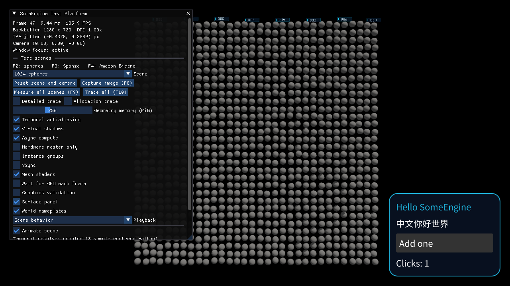

# Testing

## TextField 与外部重写验收（#46）

2026-10-04，Windows x64，.NET SDK `10.0.112`，执行环境 `.NET 10.0.12`。
派发基线为 `55cfda50379cedd4a0726bc627d260a8f3d9ee7f`，实现提交为
`646a66b5`，已合入集成提交 `975f5dcf97e8a3e8d81f9e17c452986cb680b106`。
消费者的最终回归基于合并提交 `9d6f129623c1f82a01163281474049aa7927f1da`。

TDD 的公开接缝为 TextField 的声明、`Edited(out string text)`、Keyboard / Gamepad
输入与帧推进后的 TextContent、ShapedText、Surface、LayoutRect。
编辑回传、光标与选区、占位文字、组合显示、单行输入和参数诊断分别先确认失败，
随后实现并运行同一组公共验收。外部重写位于独立的消费者程序集。

[TextFieldChecks](../../../tests/SomeEngine.Elements.Consumer.Tests/TextFieldChecks.cs)
与 [用户 TextField](../../../tests/SomeEngine.Elements.Consumer.Tests/Rewrites/TextField.cs)
验证输入消费、父视图回传、连续插入位置、正反选区、字距调整后的几何、占位文字、
输入法候选及确认、CR / LF 过滤与组合光标修正、自然宽度长文字、等值声明、参数替换
及主题变化。开发构建另外验证参数使用错误与作用域错误通过 DevelopmentCheck 报告。
本票新增 Debug 24 个、Release 14 个用例。

六个工程分别执行 `dotnet test <工程路径> -c Debug` 与 `-c Release`，附加参数为
`--nologo -v quiet -m:1 -nr:false -p:BuildInParallel=false -p:UseSharedCompilation=false`。
Release 以及最终消费者重跑使用 `--no-restore`。运行层依赖按仓库固定提交
`8d15f4e182f77df0c9af3aaf7ccd5dd8aeafc2a4` 初始化 Alimer.Bindings。

| 工程 | Debug | Release |
|---|---:|---:|
| SomeEngine.Elements.Consumer.Tests | 265 | 189 |
| SomeEngine.Layout.Tests | 95 | 75 |
| SomeEngine.Views.Tests | 305 | 273 |
| SomeEngine.Views.Generators.Tests | 162 | 162 |
| SomeEngine.Typography.Tests | 45 | 42 |
| SomeEngine.Runtime.Tests | 30 | 30 |

布局、Views、生成器、Typography 与运行层在合并提交 `67430495` 上完成验证；
后续集成增量增加消费者与原生入口检查，消费者在 `9d6f1296` 上重新执行。

`just views-aot win-x64` 在 `9d6f1296` 上完成原生重建与运行，退出码为 0。
原生入口执行两个 TextField 版本的全部共享检查，并完成既有跨进程存档写入、
类型映射读回、下一帧重建与依赖验收。发布的 IL2026 / IL3050 诊断来自
既有 TraceCapture，IL2070 来自 JobStorageTypeShape。

## Current design
- 只测试公开行为：创建 world，生成根视图，通过公开输入入口注入事件，推进若干帧，断言节点组件（例如 `Text`、`LayoutRect`）的值。不断言内部记录、缓存命中或执行次数。
- 每个内置控件在外部程序集中有一个只用公开 API 重写的等价版本，用同一组行为测试证明二者一致。
- 生成器测试编译并执行生成的 API，包括 `[Composable]` 拦截后的行为与分析器的错误诊断。
- NativeAOT 发布与启动沿用现有 `just ecs-aot` 方式。`just views-aot <rid>` 重建并执行界面冒烟与跨进程检查点；`just views-aot-matrix <rids> [evidence]` 复用 ECS 矩阵脚本，记录每个 RID 的执行结果与原生文件 SHA-256。

## 首次构建验收（#6）

2026-10-03，集成基线 `ab8a17d7d3305edf8a638835938901970ab5dde7`，
Windows x64，.NET SDK `10.0.112`，执行环境 `.NET 10.0.12`。
`HeadlessFrameDriver` 通过公开 World、视图与系统接口驱动帧。

`FirstBuildTests` 验证有序子节点与类型编号、表格与 sparse 参数、同帧三层构建、
构建前的参数修改、带父实体的根、独立 World、`Once` 的首次内容与跨帧保留、
同步完成的 await，以及开发构建中的作用域错误和真实挂起报告。
`FirstBuildChecks` 的共享行为同时由测试运行器和正式 ECS NativeAOT 入口执行。

| 命令 | 结果 |
|---|---|
| `dotnet test tests/SomeEngine.Views.Tests/SomeEngine.Views.Tests.csproj -c Debug` | 10 个行为用例通过 |
| `dotnet test tests/SomeEngine.Views.Tests/SomeEngine.Views.Tests.csproj -c Release --no-restore` | 8 个行为用例通过 |
| `dotnet test tests/SomeEngine.ECS.Tests/SomeEngine.ECS.Tests.csproj -c Release` | 552 个回归用例通过 |
| `dotnet test tests/SomeEngine.ECS.Systems.Tests/SomeEngine.ECS.Systems.Tests.csproj -c Release` | 288 个回归用例通过 |
| `just ecs-aot win-x64` | 原生发布与执行成功，退出码 0，`viewsVerified: true` 与 `managedReferencesVerified: true` |

Release 沿统一开发检查规则编译；两个开发检查专用用例在 Debug 中执行。
NativeAOT 构建输出的 IL2026、IL3050 和 IL2070 来自现有 `TraceCapture` 与
`JobStorageTypeShape` 诊断路径；本次原生结果覆盖视图首次构建与原有 ECS 冒烟行为。

## 依赖登记作用域验收（#15）

2026-10-04，实现提交 `496cd58afdd2933cbefac7aae65d91ced535092f`，
已对齐集成分支提交 `ece6c1f1f544139959271cba3ccd0a0367254a35`。
Windows x64，.NET SDK `10.0.112`，执行环境 `.NET 10.0.12`。

`UntrackTests` 通过视图写出的组件值验证表格与 sparse 的局部取值、块外依赖更新、
嵌套块、异常退出、父子构建模式与开发构建中的作用域使用错误。
`ReadDependencyTests` 继续验证 `Once` 读取后保留首次内容，
`ParameterBuildTests` 验证参数更新后的内容行为。
`FirstBuildChecks` 将表格与 sparse 的局部取值及块外依赖更新共享给原生冒烟入口。

| 命令 | 结果 |
|---|---|
| `dotnet test tests/SomeEngine.Views.Tests/SomeEngine.Views.Tests.csproj --no-restore --verbosity minimal` | 57 个公共行为用例通过 |
| `dotnet test tests/SomeEngine.Views.Tests/SomeEngine.Views.Tests.csproj -c Release --no-restore --verbosity minimal` | 50 个公共行为用例通过 |
| `just ecs-aot win-x64` | 原生发布与执行成功，退出码 0，`viewsVerified: true` 与 `managedReferencesVerified: true` |

原生构建输出的 IL2026、IL3050 与 IL2070 位于已有 `TraceCapture` 与
`JobStorageTypeShape` 诊断路径，本次执行覆盖新增的局部读取作用域与原有冒烟行为。

## 构建异常隔离验收（#18）

2026-10-04，基于集成提交 `07569891caad24fe22b403f7854be05440121128`
加本票实现，Windows x64，.NET SDK `10.0.112`。

`BuildErrorTests` 经公开 World、视图、帧驱动与 `Trace` listeners 验证兄弟继续构建、
失败声明的节点及后代恢复、相等参数中的回调恢复、原异常与帧号、首次失败、
后备内容、依赖修复、同步完成的异步构建与 `.Content()` 块内外的失败恢复。
`FirstBuildChecks` 将子声明恢复和祖先后备恢复一并用于测试运行器及 NativeAOT 冒烟。
Core 的公开检查验收通过参数求值的可观察效果验证开发报告的编译边界。

| 命令 | 结果 |
|---|---|
| `dotnet test tests/SomeEngine.Views.Tests/SomeEngine.Views.Tests.csproj -c Debug` | 112 通过 |
| `dotnet test tests/SomeEngine.Views.Tests/SomeEngine.Views.Tests.csproj -c Release` | 95 通过 |
| `dotnet test tests/SomeEngine.Core.Tests/SomeEngine.Core.Tests.csproj -c Debug` | 59 通过 |
| `dotnet test tests/SomeEngine.Core.Tests/SomeEngine.Core.Tests.csproj -c Release` | 59 通过 |
| `dotnet test tests/SomeEngine.ECS.Tests/SomeEngine.ECS.Tests.csproj -c Debug` | 633 通过 |
| `dotnet test tests/SomeEngine.ECS.Systems.Tests/SomeEngine.ECS.Systems.Tests.csproj -c Debug` | 298 通过 |
| `just ecs-aot win-x64` | 原生发布与执行成功，退出码 0，`viewsVerified: true` 与 `managedReferencesVerified: true` |

## 重建诊断验收（#65）

2026-10-04，实现提交 `58bbfe003b1bd1a186ee755d8ebab80370e9b937`，
已合入集成分支 `af3bd85e23b57804fd1c15ca85aa6e0fe7d16fb0`。
Windows x64，.NET SDK `10.0.112`，执行环境 `.NET 10.0.12`。

`RebuildDiagnosticsTests` 通过公开 World、视图、系统帧与 `LastFrame` 验证表格和 sparse 来源、
参数、存在性、查询成员、多个同时变化的来源、同步子构建、首次构建、失败构建、
World 隔离、逐帧替换、关闭与再次开启。开发构建通过公开诊断入口验证 World 使用错误。
类型区段通过公开 EngineTrace 采集与 Trace 文件读取 API 验证，并以真实 Tracy 采集导出复核。
采集关闭时的配对计时和分配数据见 [[architecture/someui/Performance|Performance]]。

| 命令 | 结果 |
|---|---|
| `dotnet test tests/SomeEngine.Views.Tests/SomeEngine.Views.Tests.csproj -c Debug --no-restore --verbosity minimal` | 129 个公共行为用例通过 |
| `dotnet test tests/SomeEngine.Views.Tests/SomeEngine.Views.Tests.csproj -c Release --no-restore --verbosity minimal` | 111 个公共行为用例通过 |
| `dotnet test tests/SomeEngine.ECS.Tests/SomeEngine.ECS.Tests.csproj -c Release --verbosity minimal` | 620 个回归用例通过 |
| `dotnet test tests/SomeEngine.ECS.Systems.Tests/SomeEngine.ECS.Systems.Tests.csproj -c Release --no-restore --verbosity minimal` | 298 个回归用例通过 |
| `dotnet test tests/SomeEngine.Core.Tests/SomeEngine.Core.Tests.csproj -c Debug --no-restore --verbosity minimal` | 59 个回归用例通过 |
| `dotnet test tests/SomeEngine.Core.Tests/SomeEngine.Core.Tests.csproj -c Release --verbosity minimal` | 59 个回归用例通过 |
| `dotnet test tests/SomeEngine.Diagnostics.Tests/SomeEngine.Diagnostics.Tests.csproj -c Debug --verbosity minimal` | 20 个回归用例通过 |
| `just ecs-aot win-x64` | 原生发布与执行成功，退出码 0，`viewsVerified: true` 与 `managedReferencesVerified: true` |

NativeAOT 构建的 IL2026、IL3050 与 IL2070 位于已有 `TraceCapture` 与
`JobStorageTypeShape` 路径，本次原生执行覆盖合入后的视图、组件字节访问与动画冒烟行为。

## 环境数据验收（#13）

2026-10-04，源码验收提交 `99ada7094a4103680d023b5e1f10b014913586e7`，
已对齐集成分支 `b259174a8f9f117bc5dedc2c3b69f5d494a248a5`。
Windows x64，.NET SDK `10.0.112`，执行环境 `.NET 10.0.12`。

[EnvironmentTests](../../../tests/SomeEngine.Views.Tests/EnvironmentTests.cs) 经公开 World、
视图、`Provide`、`ReadUp` 与系统帧验证表格和 sparse 的最近来源、自身提供、完整默认值、
祖先提供后的当帧更新、中间提供者、提供者增删、自身及祖先移动、相同值下的来源切换、
其它后代的内容与写版本保留，以及 `Once` 的首次取值。
绑定计算与 Memo 的验收验证所属视图移动、来源移除、恢复提供后的显示，
诊断验收通过公开 `LastFrame` 读取相同主题值下的来源切换记录。
环境组在 Debug 中包含 31 个用例，Release 中包含 29 个用例。

公开接口与父链移动的验收采用先红后绿流程；联合回归同时覆盖已集成的组件副本提交、
计算、状态、异常恢复、生成器与重建诊断。

| 命令 | 结果 |
|---|---|
| `dotnet test tests/SomeEngine.Views.Tests/SomeEngine.Views.Tests.csproj -c Debug --no-restore --verbosity minimal` | 246 个公共行为用例通过 |
| `dotnet test tests/SomeEngine.Views.Tests/SomeEngine.Views.Tests.csproj -c Release --no-restore --verbosity minimal` | 219 个公共行为用例通过 |
| `dotnet test tests/SomeEngine.Views.Generators.Tests/SomeEngine.Views.Generators.Tests.csproj -c Debug --no-build --no-restore --verbosity minimal` | 41 个生成器用例通过 |
| `dotnet test tests/SomeEngine.ECS.Tests/SomeEngine.ECS.Tests.csproj -c Release --no-restore --verbosity minimal` | 620 个回归用例通过 |
| `dotnet test tests/SomeEngine.ECS.Systems.Tests/SomeEngine.ECS.Systems.Tests.csproj -c Release --no-restore --verbosity minimal` | 298 个回归用例通过 |

API 与提交规则见 [[architecture/someui/Composition|Composition]]，
环境来源与版本检查见 [[architecture/someui/Dependencies|Dependencies]]。

## 布局协议验收（#24）

2026-10-04，代码验收提交 `f0894b6a41b718d667e5215209984426ff0e5a28`，
已合入集成提交 `bf0a73c511b166ffdc1049f52d5c97ee70cd9442`。
Windows x64，.NET SDK `10.0.112`。

`LayoutTests` 通过公开视图构建、修饰、World、系统组与 `LayoutRect` 验证
800×600 画布中的绝对定位、内边距的同帧更新、透明组合、用户稀疏环形布局与
Absolute 嵌套、最小/最大尺寸、单轴自动尺寸、零尺寸、非均匀内边距和多个画布。
`LayoutChecks` 由单元测试和 Views NativeAOT 入口共用，验证显式 `IView.Measure`、
稀疏参数、缩放画布、嵌套坐标及画布尺寸更新。
开发检查专用用例在 Debug 验证冲突的 Box 尺寸区间。

| 命令 | 结果 |
|---|---|
| `dotnet test tests/SomeEngine.Layout.Tests/SomeEngine.Layout.Tests.csproj -c Debug --no-restore --nologo -v quiet` | 14 通过 |
| `dotnet test tests/SomeEngine.Layout.Tests/SomeEngine.Layout.Tests.csproj -c Release --no-restore --nologo -v quiet` | 13 通过 |
| `dotnet test tests/SomeEngine.Views.Tests/SomeEngine.Views.Tests.csproj -c Debug --no-restore --nologo -v quiet` | 246 通过 |
| `dotnet test tests/SomeEngine.Views.Tests/SomeEngine.Views.Tests.csproj -c Release --no-restore --nologo -v quiet` | 219 通过 |
| `dotnet test tests/SomeEngine.Views.Generators.Tests/SomeEngine.Views.Generators.Tests.csproj -c Debug --no-restore --nologo -v quiet` | 41 通过 |
| `dotnet test tests/SomeEngine.Views.Generators.Tests/SomeEngine.Views.Generators.Tests.csproj -c Release --no-restore --nologo -v quiet` | 41 通过 |
| `dotnet test tests/SomeEngine.ECS.Tests/SomeEngine.ECS.Tests.csproj --nologo -v quiet` | 635 通过 |
| `dotnet test tests/SomeEngine.ECS.Systems.Tests/SomeEngine.ECS.Systems.Tests.csproj --nologo -v quiet` | 298 通过 |
| `just views-aot win-x64` | 原生发布、布局/Compose/视图检查、存档类型编号重映射和下一帧重建全部通过，退出码 0 |

## Surface 与外部对等验收（#28）

`SomeEngine.Elements.Consumer.Tests` 直接引用公开的 Views、Layout 与 Elements 项目。
架构用例同时引用公开的 Animation、Typography、Compose 与 SwiftUI 项目。
`Rewrites/SurfaceModifiers.cs` 提供用户的三个等价修饰，`SurfaceTests` 将同一组
节点数据、返回实体、布局结果与写版本用例应用于内置修饰和用户修饰。
尺寸变化后的重建保留相同 Surface 的节点写版本与类型写版本，填充色变化则推进两者。
开发构建中的三种修饰共用 Core 的作用域检查。

`SurfaceChecks` 与用户修饰示例源文件还由现有 Views NativeAOT 工程编译，
在 `Column` 节点上使用相同公开 API 验证布局尺寸变化、相等值的写版本保留和填充色更新。

`AssemblyBoundaryTests` 经编译程序集的公开属性读取访问边界。
向 Views 临时加入 `[assembly: InternalsVisibleTo("SomeEngine.Elements")]` 后，
架构用例报告该声明并以退出码 1 失败；移除该声明后的验收通过。
SDK 项目项形式分别向 `SomeEngine.Elements.Render` 与外部消费者授予内部访问时，
同一架构用例列出两个目标并以退出码 1 失败；项目内容随后恢复。
在 Animation 临时加入指向 Elements 的友元声明时，扩展后的架构用例报告来源与目标，
并以退出码 1 失败；临时声明随后清理。
访问边界规则由 [[architecture/someui/Assemblies|Assemblies]] 维护。

2026-10-04，验收基于集成提交
`220bca53e5941ae928d253d369c61f20e4c6837f`，其中包含 #25 的 Column 交付。
Windows x64，.NET SDK `10.0.112`。
以下测试命令均使用 `--nologo -v minimal -m:1 -nr:false -p:BuildInParallel=false -p:UseSharedCompilation=false`。

| 命令 | 结果 |
|---|---|
| `dotnet test tests/SomeEngine.Elements.Consumer.Tests/SomeEngine.Elements.Consumer.Tests.csproj -c Debug` | 13 通过 |
| `dotnet test tests/SomeEngine.Elements.Consumer.Tests/SomeEngine.Elements.Consumer.Tests.csproj -c Release` | 10 通过 |
| `dotnet test tests/SomeEngine.Layout.Tests/SomeEngine.Layout.Tests.csproj -c Debug` | 50 通过 |
| `dotnet test tests/SomeEngine.Layout.Tests/SomeEngine.Layout.Tests.csproj -c Release` | 48 通过 |
| `dotnet test tests/SomeEngine.Views.Tests/SomeEngine.Views.Tests.csproj -c Debug` | 253 通过 |
| `dotnet test tests/SomeEngine.Views.Tests/SomeEngine.Views.Tests.csproj -c Release` | 224 通过 |
| `dotnet test tests/SomeEngine.Views.Generators.Tests/SomeEngine.Views.Generators.Tests.csproj -c Debug` | 85 通过 |
| `dotnet test tests/SomeEngine.Views.Generators.Tests/SomeEngine.Views.Generators.Tests.csproj -c Release` | 85 通过 |
| `just views-aot win-x64` | 原生发布、Column Surface 与外部修饰、现有视图行为、存档写入与读回全部通过，退出码 0 |

原生发布输出的 IL2026、IL3050 与 IL2070 位于现有 `TraceCapture` 与
`JobStorageTypeShape` 路径。验收后的原生产物和临时友元声明已清理。

## 内容函数验收（#61）

2026-10-04，实现提交 `c8255fdd`，源码验收提交
`ac8086644c165fc53b34bf5695e8e6f47fcaedb1`，已对齐集成提交
`25f49a66061e7f19882f1d0f52303c7abf2bfb95`。
Windows x64，.NET SDK `10.0.112`。

`ContentFunctionTests` 的 16 个公开编译与行为用例通过生成视图、World、
`ElementTree`、`State<T>`、`BuildError` 和分析器诊断验收条件与循环调用、
内容引用变化、static lambda 的子内容保留、泛型跨程序集转交、各行独立依赖、
同步完成的 BuildTask 内容与错误恢复、自定义委托、命名与可选实参、局部及全局别名。
info 验收同时覆盖 Compose 与 SwiftUI，内容委托形状由编译诊断验收。
接口接入、引用刷新、捕获提示、声明错误和全局别名均按先红后绿流程完成。

| 命令 | 结果 |
|---|---|
| `dotnet test tests/SomeEngine.Views.Generators.Tests/SomeEngine.Views.Generators.Tests.csproj --verbosity minimal` | 57 个生成器用例通过 |
| `dotnet test tests/SomeEngine.Views.Tests/SomeEngine.Views.Tests.csproj --no-restore --verbosity minimal` | 246 个公共行为用例通过 |
| `dotnet publish tools/SomeEngine.Views.AotSmoke/SomeEngine.Views.AotSmoke.csproj -c Release -r win-x64 --self-contained --verbosity minimal` | NativeAOT 原生发布成功 |
| `tools/SomeEngine.Views.AotSmoke/bin/Release/net10.0/win-x64/publish/SomeEngine.Views.AotSmoke.exe` | 原生执行成功，退出码 0；覆盖内容函数、Compose、节点身份、sparse 存储和用户布局 |

原生内容验收从公共树读取多行结果，并验证父参数变化后相等行的保留与变化行的刷新。
原生验收产物在执行后清理。接口与节点规则见
[[architecture/someui/Compose-Frontend|Compose Frontend]]。

## 焦点与键盘、手柄导航验收（#39）

2026-10-04，实现提交 `8f36fdd4509faa095cc6cc787195a4143a104ae1`，源码验收提交
`cb50ddb56e5d902932e1fecc20ea938419b116dd`，已合入集成提交
`f72a355041cdecced3cb0778e50ed7fa08c987b3`。
Windows x64，.NET SDK `10.0.112`，执行环境 `.NET 10.0.12`。

`FocusTests` 通过公开输入、World、视图、布局与系统调度验证 3×3 网格、确认消费、焦点读取依赖、
祖先转移与清空、整枝释放、父链移动、焦点资格变化、布局透明组合、最近中心与上一帧布局、
画布内导航、World 隔离、输入顺序和捕获字段。内置与外部重写共用网格检查；
自定义系统通过调度禁用默认导航，从公开事件缓冲领取输入并执行自己的规则。
Debug 的 25 项焦点检查包含 9 项统一开发检查；Release 与原生入口共用 16 项行为检查。

各测试项目的路径为 `tests/<项目>/<项目>.csproj`，执行两种配置：

```text
dotnet test <项目路径> -c Debug --nologo -v quiet -m:1 -p:UseSharedCompilation=false
dotnet test <项目路径> -c Release --nologo -v quiet -m:1 -p:UseSharedCompilation=false
```

ECS、系统、存档与提取的 Release 回归加入 `-nr:false -p:BuildInParallel=false`。
系统 Release 完整验收使用以下命令完成：

```text
dotnet test tests/SomeEngine.ECS.Systems.Tests/SomeEngine.ECS.Systems.Tests.csproj -c Release --no-build --nologo -m:1 --logger "console;verbosity=normal" --blame-hang-timeout 60s --blame-hang-dump-type none --results-directory .focus-validation
```

| 项目 | Debug 通过 | Release 通过 |
|---|---:|---:|
| SomeEngine.Elements.Consumer.Tests | 72 | 47 |
| SomeEngine.Views.Tests | 259 | 230 |
| SomeEngine.Layout.Tests | 94 | 74 |
| SomeEngine.ECS.Tests | 635 | 620 |
| SomeEngine.ECS.Systems.Tests | 298 | 298 |
| SomeEngine.ECS.Serialization.Tests | 169 | 169 |
| SomeEngine.Elements.Render.Tests | 10 | 10 |

`just views-aot win-x64` 成功发布并执行原生入口，退出码 0，覆盖全部共享焦点检查与
已有视图、文本、指针、布局和检查点行为。检查点在独立进程中完成类型编号重映射、读回首帧
与后续依赖更新。诊断目录、检查点文件及原生验收产物在使用后清理。
行为与接口见 [[architecture/someui/Input-and-Behaviors|Input and Behaviors]]。

随后对齐 #38：源码验收提交 `a2d5d364961f6fdcddc1c22bb40f12f82ab33793`，
包含集成提交 `3da0051c0116fb962997fa40d3f3a0c12803c257`。
消费者工程重新执行 Debug 与 Release，均使用
`--nologo -v quiet -m:1 -nr:false -p:BuildInParallel=false -p:UseSharedCompilation=false`，
结果分别为 80 与 55 通过。新增组合检查验证指针点击和焦点确认共用节点上的 `Clicks`，
调用方消费计数后继续接收下一次键盘确认；当前焦点检查为 Debug 26 项、Release 17 项。
`just views-aot win-x64` 再次成功发布、执行全部 17 项共享焦点检查与指针冒泡检查，
并完成检查点写入与读回，退出码 0。原生验收产物在执行后清理。

最终源码验收提交 `f36b17ca54aada9b827751c014e782f0efde5b92`，包含集成提交
`e26a6d4bbcb0b5b3a544b7c5e06c216314dc4b85`，覆盖已合入的异步构建与 Button 交付。
按上一段命令参数重新执行消费者、Views 与 Layout 的 Debug / Release 回归：
消费者 101 / 73 通过，Views 279 / 250 通过，Layout 94 / 74 通过。
`just views-aot win-x64` 在该源码提交成功发布并执行共享焦点、指针路由、Button 与
现有视图检查，随后完成两个独立进程的检查点写入、类型编号重映射和读回，退出码 0。
焦点公共行为保持 Debug 26 项与 Release / NativeAOT 17 项；原生验收产物在使用后清理。

## Button 与外部控件对等验收（#43）

[ButtonTests](../../../tests/SomeEngine.Elements.Consumer.Tests/ButtonTests.cs)
对内置 Button、[用户 Button](../../../tests/SomeEngine.Elements.Consumer.Tests/Rewrites/Button.cs)
和[用户 IconButton](../../../tests/SomeEngine.Elements.Consumer.Tests/Rewrites/IconButton.cs)
运行同一组公开行为用例。验收通过视图函数声明节点，通过 `Pointer` 注入输入并推进系统帧，
读取公开的 Surface、Box、Text、ShapedText、Hover、Clicks 和调用方写出的点击显示数据。

用例覆盖默认样式、标签与图标间距、非均匀内边距、子树主题更新、最近主题的完整默认值、
显式透明颜色、零圆角与零内边距、悬停与按下颜色、按住后移出、区域外释放、连续读取点击、同帧多次
点击的消费，以及修改标签与主题后的按下和点击保留。开发构建通过 Core 作用域检查报告
构建使用错误。

[ButtonChecks](../../../tests/SomeEngine.Elements.Consumer.Tests/ButtonChecks.cs)
和两个用户控件源文件由 Views NativeAOT 工程编译，点击消费、标签更新、主题与输入状态
在测试运行器和原生入口执行同一份检查。API 与默认主题由
[[architecture/someui/Composition|Composition]] 维护。

2026-10-04，本票实现提交 `7d0e472f0e053b38ae2779eb1f3c8785d9bc11e9`，
完整回归源码提交 `09f57726f1987f569285577d1faa180ad160460e`，已合入集成分支提交
`f72a355041cdecced3cb0778e50ed7fa08c987b3`。Windows x64，.NET SDK `10.0.112`，
执行环境 `.NET 10.0.12`。

公开 API 接入、主题读取、悬停配色与外部控件声明采用先红后绿流程。
本票新增的行为组在 Debug 中包含 21 个用例，Release 中包含 18 个用例；
三个开发作用域用例经 Core 的统一开发检查执行。
下表各 `dotnet test` 命令同时使用
`--nologo -v quiet -m:1 -nr:false -p:BuildInParallel=false -p:UseSharedCompilation=false`。

| 命令 | 结果 |
|---|---|
| `dotnet test tests/SomeEngine.Elements.Consumer.Tests/SomeEngine.Elements.Consumer.Tests.csproj -c Debug` | 68 通过 |
| `dotnet test tests/SomeEngine.Elements.Consumer.Tests/SomeEngine.Elements.Consumer.Tests.csproj -c Release` | 49 通过 |
| `dotnet test tests/SomeEngine.Layout.Tests/SomeEngine.Layout.Tests.csproj -c Debug` | 94 通过 |
| `dotnet test tests/SomeEngine.Layout.Tests/SomeEngine.Layout.Tests.csproj -c Release` | 74 通过 |
| `dotnet test tests/SomeEngine.Views.Tests/SomeEngine.Views.Tests.csproj -c Debug` | 259 通过 |
| `dotnet test tests/SomeEngine.Views.Tests/SomeEngine.Views.Tests.csproj -c Release` | 230 通过 |
| `dotnet test tests/SomeEngine.Views.Generators.Tests/SomeEngine.Views.Generators.Tests.csproj -c Debug` | 95 通过 |
| `dotnet test tests/SomeEngine.Views.Generators.Tests/SomeEngine.Views.Generators.Tests.csproj -c Release` | 95 通过 |
| `just views-aot win-x64` | 原生发布、三种按钮共享检查、现有视图检查、存档写入与读回通过，退出码 0 |

NativeAOT 的 IL2026、IL3050 与 IL2070 诊断位于已有 `TraceCapture` 和
`JobStorageTypeShape` 路径。本次验收的构建、原生产物及测试临时数据已清理。

最终输入联合回归源码提交 `538bd1d5488137786b6fb133c63fd4e30f0e493f`，
包含集成提交 `3da0051c0116fb962997fa40d3f3a0c12803c257` 的点击冒泡与子树悬停。
三种按钮沿当前命中系统运行，原生入口同时执行指针路由和按钮检查。
公共 Views、Layout 与生成器的回归采用上表的完整回归结果；这些源码在输入合入时保持相同。

| 命令 | 最终输入联合回归结果 |
|---|---|
| `dotnet test tests/SomeEngine.Elements.Consumer.Tests/SomeEngine.Elements.Consumer.Tests.csproj -c Debug` | 75 通过 |
| `dotnet test tests/SomeEngine.Elements.Consumer.Tests/SomeEngine.Elements.Consumer.Tests.csproj -c Release` | 56 通过 |
| `just views-aot win-x64` | 三种按钮、指针路由、现有视图行为与存档读写通过，退出码 0 |

本轮字体原生依赖复用 #27 工作树的同版本产物；复用前以 SHA-256 核对
`CMakeLists.txt`、`GlyphBitmap.c` 与 Typography 项目文件三个构建输入一致。
本轮构建、原生产物与测试临时数据在验收后清理。

## 指针冒泡与子树悬停验收（#38）

2026-10-04，Windows x64，.NET SDK `10.0.112`。
实现提交 `ff3b3fa5044ac34e0058e3028d3c824c8945c34f`，
验收源码提交 `a60aeb638f55f114bf5d63a05c4d19ec5b69713d`，
包含集成提交 `f72a355041cdecced3cb0778e50ed7fa08c987b3`。

点击冒泡、停止边界与子树悬停三个行为切片均先运行红测，再完成实现并转绿。
`PointerTests` 从公开指针入口和节点组件验证父子点击计数、目标及祖先的停止边界、
仅带停止标记的中间节点、嵌套画布边界，以及上一帧布局对静止指针的影响。
`PointerRoutingChecks` 通过公开视图、布局与 World 帧推进验证子树进出、兄弟切换、
区域外的持续按下、停止标记增删、调用方的 `Clicked()` 输出与 `Hover` 依赖输出。
同一组检查应用于内置 `Pressable` 和外部公开 API 重写，并编入 Views NativeAOT 工程。

以下 `dotnet test` 与 `dotnet publish` 命令均附加
`--nologo -v minimal -m:1 -nr:false -p:BuildInParallel=false -p:UseSharedCompilation=false`。

| 命令 | 结果 |
|---|---|
| `dotnet test tests/SomeEngine.Elements.Consumer.Tests/SomeEngine.Elements.Consumer.Tests.csproj -c Debug` | 54 通过 |
| `dotnet test tests/SomeEngine.Elements.Consumer.Tests/SomeEngine.Elements.Consumer.Tests.csproj -c Release` | 38 通过 |
| `dotnet test tests/SomeEngine.Views.Tests/SomeEngine.Views.Tests.csproj -c Debug` | 259 通过 |
| `dotnet test tests/SomeEngine.Layout.Tests/SomeEngine.Layout.Tests.csproj -c Debug` | 94 通过 |
| `dotnet publish tools/SomeEngine.Views.AotSmoke/SomeEngine.Views.AotSmoke.csproj -c Release -r win-x64 --self-contained true -p:PublishAot=true -p:TrimmerSingleWarn=false` | NativeAOT 原生发布成功 |
| `tools/SomeEngine.Views.AotSmoke/bin/Release/net10.0/win-x64/publish/SomeEngine.Views.AotSmoke.exe` | 原生冒烟通过，退出码 0；包含内置与用户重写的冒泡、停止标记与子树悬停 |
| `pwsh -NoProfile -File tools/SomeEngine.Views.AotSmoke/Test-Checkpoint.ps1 -Executable ./tools/SomeEngine.Views.AotSmoke/bin/Release/net10.0/win-x64/publish/SomeEngine.Views.AotSmoke.exe` | 存档写入、类型编号重映射、读回和下一帧重建通过，退出码 0 |

原生发布输出的 IL2026、IL3050 与 IL2070 位于既有 `TraceCapture` 与
`JobStorageTypeShape` 路径。验收运行产物在执行后清理。
最终回归的字体原生依赖复用 #27 工作树的同版产物；复用前以 SHA-256 核对
`CMakeLists.txt`、`GlyphBitmap.c` 与 Typography 项目文件的构建输入一致。

路由行为与数据写入范围由
[[architecture/someui/Input-and-Behaviors|Input and Behaviors]] 维护。

## 拖动、滚动与选择验收（#40）

2026-10-04，Windows x64，.NET SDK `10.0.112`。
本票实现从 `98238b412da5532204744472a3da86f48888305f` 开始，
基础回归在合入布局缓存后的 `230c75a6409df68b4a0883044c2a854223099e29` 执行。
随后合入指针冒泡集成提交 `3da0051c0116fb962997fa40d3f3a0c12803c257`，
消费者完整回归与原生验收在行为提交 `78d1b341b873b1381bc95b89689d9734f37dc001` 执行。
交付前继续合入异步构建与 Button 集成提交
`e26a6d4bbcb0b5b3a544b7c5e06c216314dc4b85`，基础层完整回归在
`f0398e176a9d6b0f3a20c964565605f36ea0815a` 执行，最终消费者回归与原生入口
基于合并提交 `0d1dd5405f774c3f72944c3df1675b5b4d26c392`。

本票新增的 20 项公开行为用例通过 Pointer、行为声明、World、ElementTree、
系统组和组件读取验证 Drag 字段、静止帧、区域外释放、再次拖动、按钮配对、
目标退出交互树、选择依赖输出、同帧点击、冒泡停止边界、滚轮事件顺序、
透明组合视口、可点击内容、嵌套滚动、内边距、内容与视口收缩、重复布局、
范围边界的公开写版本以及真实文本的自然测量。
其中三项使用错误验收在 Debug 通过共用 Core 开发检查执行。
每个行为的外部用户重写使用相同公开组件与 Scope.Ensure，并与内置声明共用行为检查。

以下工程分别执行
`dotnet test tests/<项目>/<项目>.csproj -c Debug --nologo -v quiet -m:1 -nr:false -p:BuildInParallel=false -p:UseSharedCompilation=false`
及对应的 `-c Release` 命令。依赖还原完成后的重复验证加 `--no-restore`。

| 项目 | Debug 通过 | Release 通过 |
|---|---:|---:|
| SomeEngine.Elements.Consumer.Tests | 95 | 73 |
| SomeEngine.Layout.Tests | 94 | 74 |
| SomeEngine.Views.Tests | 279 | 250 |
| SomeEngine.Views.Generators.Tests | 95 | 95 |
| SomeEngine.Elements.Render.Tests | 10 | 10 |

`just views-aot win-x64` 完成原生发布、执行和两进程检查点验收，退出码 0。
原生入口同时执行内置与用户重写的拖动、滚动、选择，及已交付的指针冒泡、
StopsPointer、子树悬停、文本、布局、视图与各前端检查。
检查点第二进程将面板 ViewType.Id 从 1 映射为 5，读回后的重建与依赖更新通过。
发布中的既有 IL2026、IL3050、IL2070 诊断分别来自 TraceCapture 与 JobStorageTypeShape。
临时构建输出、原生产物与检查点验收文件随验证完成清理。

## 文本编辑与输入法组合验收（#41）

2026-10-04，Windows x64，.NET SDK `10.0.112`。
实现提交 `db9f3d08`，验收源码提交 `d841adf65db827d2e79158eea3de729e27b2d5f1`，
已合入集成提交 `5d3be07dc7e38c61783d85a5ad5d807d2c10f98b`。

输入、光标移动、选区替换、删除、组合输入、组合期间按键、焦点事件顺序、上下行移动、
文本元素连接、空输入与开发诊断逐次执行红绿循环。公开帧检查随后覆盖失焦输入、重复声明、
World 间的文本与 Shift 状态隔离，以及焦点资格移除后的组合显示。
全部 14 项行为对内置声明与外部 `Rewrites/TextEditingFunctions.cs` 重写分别执行，
共 28 项共享行为检查；Debug 另有 12 项开发诊断，通过 Core `DevelopmentCheck` 执行。
验收观察公开文本、选区、组合、焦点、点击与调用方写出的编辑显示数据。

下表各工程执行
`dotnet test tests/<项目>/<项目>.csproj -c Debug/Release --nologo -v quiet -m:1 -nr:false -p:BuildInParallel=false -p:UseSharedCompilation=false`。
专项红绿循环使用同一消费者工程并附加 `--filter FullyQualifiedName~TextEditingTests`；
依赖还原完成后的循环加 `--no-restore`。

| 工程 | Debug 通过 | Release 通过 |
|---|---:|---:|
| SomeEngine.Elements.Consumer.Tests | 185 | 134 |
| SomeEngine.Views.Tests | 290 | 260 |
| SomeEngine.Layout.Tests | 94 | 74 |
| SomeEngine.Views.Solid.Tests | 13 | 12 |
| SomeEngine.Elements.Render.Tests | 10 | 10 |

原生验收执行以下命令，均退出 0：

| 命令 | 结果 |
|---|---|
| `dotnet publish tools/SomeEngine.Views.AotSmoke/SomeEngine.Views.AotSmoke.csproj -c Release -r win-x64 --self-contained true -p:PublishAot=true -p:TrimmerSingleWarn=false --nologo -v minimal -m:1 -nr:false -p:BuildInParallel=false -p:UseSharedCompilation=false` | 原生发布成功 |
| `tools/SomeEngine.Views.AotSmoke/bin/Release/net10.0/win-x64/publish/SomeEngine.Views.AotSmoke.exe` | 28 项文本编辑共享行为及原有视图、前端、布局、指针、焦点、拖动滚动和 Button 检查通过 |
| `pwsh -NoProfile -File tools/SomeEngine.Views.AotSmoke/Test-Checkpoint.ps1 -Executable F:/.codex/worktrees/someui-ticket-41/SomeEngine.Next/tools/SomeEngine.Views.AotSmoke/bin/Release/net10.0/win-x64/publish/SomeEngine.Views.AotSmoke.exe` | 两进程检查点写入、ViewType.Id 重映射、读回、下一帧重建与依赖更新通过 |

原生发布的 IL2026、IL3050 与 IL2070 来自既有 `TraceCapture` 与 `JobStorageTypeShape`。

行为与数据写入规则由
[[architecture/someui/Input-and-Behaviors|Input and Behaviors]] 维护。

交付整合依次纳入集成提交 `30977b382e11b2d7a61380db17c40042173fcefa`
与 `a2586c1efbccd2b0b132be382bb63ccb6af3d176`。最终验收源码提交为
`4eb13d39a8d36e5c4edd7944e404bb533eb8c22a`，文本、值控件共用 `Edited` 时的
消费者示例使用 `out string _` 与 `out float _` 明确结果类型。

| 最终整合回归工程 | Debug 通过 | Release 通过 |
|---|---:|---:|
| SomeEngine.Elements.Consumer.Tests | 224 | 158 |
| SomeEngine.Views.Tests | 290 | 260 |
| SomeEngine.Views.Generators.Tests | 109 | 109 |
| SomeEngine.Views.Solid.Tests | 18 | 17 |

Layout 的 94／74 项与 Elements.Render 的 13／13 项在合并源码
`99707698766d05fa886f76936a74a3750580ad76` 通过；对应实现与测试在最终整合中保持相同。
上述原生发布、执行和两进程检查点命令在最终源码再次全部退出 0。
入口包含 28 项文本编辑行为，并联合执行值控件、列表控件和 Solid 组件导出的共享检查。

完成验证后清理本票工作树内 72 个已核对的 bin / obj 生成目录，包含原生发布和字体构建
产物；检查点临时文件由验收脚本清理。`git diff --check` 通过。

## Toggle、Slider、Knob 与音量贯穿场景验收（#44）

2026-10-04，Windows x64，.NET SDK `10.0.112`。
本票实现提交 `e767e985`，派发基线 `f7df93dc`；合入集成提交
`5d3be07d` 后形成 `8a5d4ce9`，首轮验收代码与取消用例修订为 `03fed94e`。

Toggle、数值键盘、累计拖动、范围端点、外部 Toggle 和同帧多个拖动手势
分别沿公开接缝完成红测与实现。既有能力继续通过新增的连续值、等值范围和半步量化用例核对。
本票新增 17 项行为用例和 9 项 Debug 开发检查；Slider 与用户圆形 Knob
共用键盘、拖动、量化、输入顺序与边界用例，内置与外部 Toggle 共用指针与焦点确认用例。
检查从 Pointer、Keyboard、Gamepad、视图函数、Toggled、Edited、World 和 ElementTree
进入，通过应用数据、节点参数、Surface、LayoutRect 与公开写版本观察结果。

音量贯穿检查由游戏系统在公开查询回调中用 `ref AudioSettings` 修改 Volume，
观察 Slider、Knob 的参数与可见位置及文本更新；随后接受 Slider 的拖动值写回同一组件，
再观察 Knob 与文本更新。Volume 从 `0.75` 变为 `0.754`，显示字符串仍为 `0.75` 时，
Text、TextContent、ShapedText 与 LayoutRect 的公开写版本均保留。
共享检查位于 [ValueChecks](../../../tests/SomeEngine.Elements.Consumer.Tests/ValueChecks.cs)、
[范围检查](../../../tests/SomeEngine.Elements.Consumer.Tests/ValueRangeChecks.cs) 与
[贯穿场景](../../../tests/SomeEngine.Elements.Consumer.Tests/ValueVolumeChecks.cs)。

集成回归中的异步取消用例按公开的 finally、using 清理结果和文本输出等待 Task.WaitAsync
回调就绪，再推进重建阶段；依据见 [[architecture/someui/Async-Build|Async Build]]。
这一验收修订提交为 `03fed94e`，Views Debug 的 290 项用例连续四轮通过。
Elements Debug 在 `8a5d4ce9` 执行，其余表中回归基于 `03fed94e`；两提交间的产品源码一致。

各工程执行
`dotnet test tests/<项目>/<项目>.csproj -c <Debug|Release> --nologo -v quiet -m:1 -nr:false -p:BuildInParallel=false -p:UseSharedCompilation=false`。
Views 的时序复核采用 `-v minimal`，编译后的重复验证另加 `--no-build --no-restore`。

| 项目 | Debug 通过 | Release 通过 |
|---|---:|---:|
| SomeEngine.Elements.Consumer.Tests | 171 | 123 |
| SomeEngine.Views.Tests | 290 | 260 |
| SomeEngine.Layout.Tests | 94 | 74 |
| SomeEngine.Views.Generators.Tests | 95 | 95 |
| SomeEngine.Elements.Render.Tests | 10 | 10 |

基于 `03fed94e`，以下三个命令均成功，退出码 0：

```powershell
dotnet publish tools/SomeEngine.Views.AotSmoke/SomeEngine.Views.AotSmoke.csproj -c Release -r win-x64 --self-contained true -p:PublishAot=true -p:TrimmerSingleWarn=false --nologo -v minimal -m:1 -nr:false -p:BuildInParallel=false -p:UseSharedCompilation=false
./tools/SomeEngine.Views.AotSmoke/bin/Release/net10.0/win-x64/publish/SomeEngine.Views.AotSmoke.exe
pwsh -NoProfile -File tools/SomeEngine.Views.AotSmoke/Test-Checkpoint.ps1 -Executable ./tools/SomeEngine.Views.AotSmoke/bin/Release/net10.0/win-x64/publish/SomeEngine.Views.AotSmoke.exe
```

原生入口执行本票全部 17 项共享行为检查，随后两进程检查点验收完成写入、
ViewType.Id 重映射、读回、下一帧重建和依赖更新。
发布中的既有 IL2026、IL3050 与 IL2070 诊断分别来自 TraceCapture 与 JobStorageTypeShape。
字体原生依赖复用 #27 的同版本产物，复用前以 SHA-256 核对 CMakeLists.txt、
GlyphBitmap.c 与 Typography 项目文件三个构建输入一致。

交付前继续合入集成提交 `b51b1cf1` 的 ScrollView、VirtualList 与滚动裁剪，
合并提交为 `258f0c87`。取消用例沿已验证的公开结果就绪等待完成合并。
基于该合并提交，消费者、渲染提取与 Views 再次执行相同命令的两种配置：

| 项目 | Debug 通过 | Release 通过 |
|---|---:|---:|
| SomeEngine.Elements.Consumer.Tests | 184 | 130 |
| SomeEngine.Elements.Render.Tests | 12 | 12 |
| SomeEngine.Views.Tests | 290 | 260 |

Views、Layout 与生成器产品源码相对于 `03fed94e` 保持一致，Layout 与生成器沿用
上表首轮完整回归结果。以最新合并源码再次执行上述原生发布、入口运行与检查点命令，
三者均退出码 0；入口同时包含列表控件与本票全部 17 项共享行为。
验证完成后清理本工作树内 69 个已核对的 bin / obj 构建输出目录，
包含原生发布产物与复用的字体依赖，检查点临时文件由验收脚本完成清理。

## 第三批公开行为修复验收（2026-10-04）

Windows x64，.NET SDK `10.0.112`，执行环境 `.NET 10.0.12`。
固定评审范围为 `6a6a759ccbc4f77bd1c77335487789a4f539645f` →
`f7df93dc59dcc629f57151f8a7c69da595f73849`。工作树从集成提交
`5d3be07dc7e38c61783d85a5ad5d807d2c10f98b` 创建，分支为
`codex/someui-review-fixes-3`，路径为
`F:\.codex\worktrees\someui-review-fixes-3\SomeEngine.Next`。

修复提交为 `72e63d013bbcb7aed4be7cdb65c58ae6406d6fbc`。
交付前两次合入集成分支：先形成 `642724cacd290d97a5d1f2e7275e0740ff470ebd`，
再合入 `f7f66815c02d0f46a577fe7f8ce06d4f8147e97a`，形成本轮完整验收代码提交
`118953eb17d50b9046fbdcb57c1cd7342ecd2704`。以下完整结果基于该代码提交。

| 修复 | 公开复现与结果 |
|---|---|
| 跨帧失败与取消恢复（#1、#20、#21） | 读者先显示已提交的表格与 sparse 值 2，恢复后源值与读者都为 1；子视图参数同样从 2 恢复为 1。两条恢复路径共用值比较入口，变化值推进写版本，相等结果保留版本；旧构建清理继续保留当前输出。 |
| 多次约束与连续局部布局（#27） | 用户布局先按松约束、再按固定约束测量同一子节点；先修改内部内容，再把容器宽度改为 60、140、45，相邻节点随宽度重新摆放，各节点矩形与清除公开 LayoutCache 后的全量结果相等。 |
| Solid 数字与日期语言（#53、#55） | Once 视图中的 decimal、整数及月份绑定随 en-US → de-DE 更新：1,234.50 → 1.234,50、1,234 → 1.234、October → Oktober；显式格式提供者保持其规则及相等结果版本。 |
| 相同数字声明分配（#31） | 公开声明入口采用 10,000 次预热、1,000 次采样。旧整数路径相对字符串声明额外分配 40,000 字节；修复后整数、decimal 与日期声明的分配量均与字符串声明相等，新增分配为 0 字节。 |
| Scope / World 文本来源（#31） | Once 构建先 DeclareText(1, 23, "D2")，再作用域 SetText(42, "D2")，Text.Value 与 TextContent.Value 均为 42；World 重载继续写入 99 后两者均为 99，相等后续写入保留版本。 |

每项公开失败用例先执行红测，再执行实现与回归。格式化数据复用继续通过六组公开变化验收：
decimal 精度、日期 Kind、DateTimeOffset 时区偏移，以及 double、float、Half 的零符号变化。
这些输入的参数字符串与实际显示共同更新。分配采样通过公开 GC API 直接统计声明调用，
各种数据采用同一预热、采样、JIT 和 GC 配置；采样前完成完整 GC 与终结器处理。
托管文本分配测试按序执行。托管回归统一设置 `DOTNET_TieredCompilation=0`。

七个完整测试工程采用以下命令，两种配置分别执行：

```powershell
dotnet test tests/<项目>/<项目>.csproj -c <Debug|Release> --nologo -v quiet -m:1 -nr:false -p:UseSharedCompilation=false
dotnet test tests/SomeEngine.Job.Tests/SomeEngine.Job.Tests.csproj -c <Debug|Release> --filter FullyQualifiedName~JobHandleAwaitTests --nologo -v quiet -m:1 -nr:false -p:UseSharedCompilation=false
dotnet test tests/SomeEngine.RenderGraph.Tests/SomeEngine.RenderGraph.Tests.csproj -c <Debug|Release> --filter 'FullyQualifiedName~CanvasDrawingTests|FullyQualifiedName~GlyphDrawingTests' --nologo -v quiet -m:1 -nr:false -p:UseSharedCompilation=false
```

| 项目 / 接缝 | Debug 通过 | Release 通过 |
|---|---:|---:|
| SomeEngine.Views.Tests | 305 | 273 |
| SomeEngine.Layout.Tests | 95 | 75 |
| SomeEngine.Elements.Consumer.Tests | 193 | 139 |
| SomeEngine.Views.Solid.Tests | 19 | 18 |
| SomeEngine.Views.Generators.Tests | 112 | 112 |
| SomeEngine.Elements.Render.Tests | 17 | 17 |
| SomeEngine.Typography.Tests | 45 | 42 |
| JobHandleAwaitTests | 6 | 6 |
| CanvasDrawingTests / GlyphDrawingTests | 11 | 11 |
| 合计 | 803 | 693 |

GPU 用例实际执行 D3D12 与 Vulkan，覆盖画布填充、边框、裁剪、世界空间投影与深度，
以及字形参考覆盖、颜色更新、图集新增区域与页、树序和裁剪。

Views 原生发布、运行与跨进程检查点命令均退出码 0：

```powershell
dotnet publish tools/SomeEngine.Views.AotSmoke/SomeEngine.Views.AotSmoke.csproj -c Release -r win-x64 --self-contained true -p:PublishAot=true -p:TrimmerSingleWarn=false --nologo -v minimal -m:1 -nr:false -p:BuildInParallel=false -p:UseSharedCompilation=false
./tools/SomeEngine.Views.AotSmoke/bin/Release/net10.0/win-x64/publish/SomeEngine.Views.AotSmoke.exe
pwsh -NoProfile -File tools/SomeEngine.Views.AotSmoke/Test-Checkpoint.ps1 -Executable ./tools/SomeEngine.Views.AotSmoke/bin/Release/net10.0/win-x64/publish/SomeEngine.Views.AotSmoke.exe
```

共享的 LayoutChecks、TextChecks 与 SolidChecks 实际验证本批布局、文本来源、
重复声明分配、格式化数据变化与 Locale 绑定。检查点在第一个进程写入面板类型编号 1，
第二个进程映射为 5，完成读回、下一帧重建和依赖更新。
该原生文件的 SHA-256 为
`26BC132891142000A91257121E4E2DC3B3577BE67169635D375CBFB38761CDD2`。

ECS 原生发布与启动命令均退出码 0：

```powershell
dotnet restore tools/SomeEngine.ECS.AotSmoke/SomeEngine.ECS.AotSmoke.csproj -r win-x64 -p:PublishAot=true -p:_IsPublishing=true --nologo -v minimal -m:1 -nr:false
dotnet publish tools/SomeEngine.ECS.AotSmoke/SomeEngine.ECS.AotSmoke.csproj -c Release -r win-x64 --self-contained true --no-restore -t:Rebuild -o tools/SomeEngine.ECS.AotSmoke/bin/Release/net10.0/win-x64/native-publish -p:PublishAot=true -p:SelfContained=true -p:TrimmerSingleWarn=false --nologo -v minimal -m:1 -nr:false -p:BuildInParallel=false -p:UseSharedCompilation=false
./tools/SomeEngine.ECS.AotSmoke/bin/Release/net10.0/win-x64/native-publish/SomeEngine.ECS.AotSmoke.exe
```

FirstBuildChecks 调用共享的跨帧组件与子参数恢复检查，实际执行失败、取消及旧清理行为。
结果为 `managedReferencesVerified: true`、`viewsVerified: true`，实体数 4，
持久存档 702 字节、generation 2，语义校验值 `-25362004713`。
该原生文件的 SHA-256 为
`65D9347A296E27598E4AD207F1B09D51AF2170FCE6D60595900E8DE62D927819`。
发布中的既有 IL2026、IL3050 诊断来自 TraceCapture，IL2070 来自 JobStorageTypeShape。
两次原生实际运行与共享行为结果由上述入口确认。
验证完成后核对并清理工作树内 88 个 bin / obj 输出目录，包含排版原生依赖、
两个原生发布目录与测试产物。跨进程检查点文件由验收脚本清理。
本节记录与测试文件的空行整理形成 `1ee15a5c015f9f7d948c13ade9d7b6fbff9dfb32`。

### 交付前 Solid 控制流集成

随后合入当时集成提交 `72d1409e23ea75102b5a247cd8cf757b44dd14d8`，
形成交付代码提交 `82f959cb7e38a0281319501c118bc6ea9c75d9c8`。
该次集成增加 Solid Show、Switch/Match 与 Dynamic；本批 Views、Layout、Elements、
Elements.Render、生成器、Typography、Job、ECS 及 ECS 原生入口源码与
`118953eb` 相同，对应完整回归与 ECS 原生结果继续关联同一份产品源码。

关联的两个工程按上文相同的两种配置命令执行完整回归：

| 工程 | Debug 通过 | Release 通过 |
|---|---:|---:|
| SomeEngine.Views.Solid.Tests | 35 | 32 |
| SomeEngine.Elements.Consumer.Tests | 193 | 139 |

其它七个接缝采用上表已确认的相同产品源码结果，交付覆盖计数为 Debug 819、Release 707。
字体原生依赖复用前核对 CMakeLists.txt、GlyphBitmap.c 和 Typography 项目文件的
SHA-256 与既有同版本构建相等。Views 原生发布、启动与跨进程检查点再按上文命令执行，
三个命令均退出码 0；共享检查同时覆盖本批全部相关行为与新增 Solid 控制流。
检查点继续在两个进程间将面板类型编号从 1 映射为 5，并完成重建与依赖更新。
该次 Views 原生文件的 SHA-256 为
`9C40CF3DA86BC1CB80CED683BC8FE0CAC66A6220C90C9AC0229E6F67F56993AF`。
最后一轮复核完成后清理 59 个已核对的生成目录，包含复用的字体依赖、测试和 Views 原生产物。
检查点临时文件由脚本清理，交付工作树保留源码与完整 Git 记录。

## 应用接入功能验收（#42，2026-10-04）

派发基线为 `f7f66815c02d0f46a577fe7f8ce06d4f8147e97a`。
实现提交为 `6301cf4c`，公开数据名称整理为 `fabc038d`；
交付前依次合入集成提交 `1fbce9ce094995af979e06b83da069d3f4e8cdde` 与
`55cfda50379cedd4a0726bc627d260a8f3d9ee7f`，后者包含 #35 画布绘制与 #41 文本编辑。
本节最终 Runtime、元素、画布及示例验证的源码提交为
`ebc3527b788cab70a3897b001528455068ecd75e`。

公开接缝为 `WindowInput`、`GameFrameSystems.Describe/UpdateInput/UpdateViews`、
`FrameStageDescription.SystemTypes`、`SurfacePanelExample.ClickCount/Resize`，
以及普通 World 的组件、层级和文本读取入口。TDD 按输入、调度和计数面板逐项推进。
按钮用例同时使用普通 World 和应用相同的 `WorldJobs(JobSystem.Default)` 配置。
带 Job 的用例复现了依赖缓冲借用期间跨存储读取的问题；依赖来源复制与版本比较
采用两个读取窗口后，两个配置均完成点击、显示更新与尺寸更新。

`GameFrameTests` 从实际注册的公开描述核对 Wiki 顺序，并以动画后矩形验证用户界面系统、
动画、布局与布局后扩展的执行关系。`WindowInputTests` 覆盖缩放画布上的主键、次键与中键，
导航与重复确认、窗口失焦后的释放、滚轮单位转换、屏幕与世界画布隔离及游戏输入阶段的捕获数据。
`CounterPanelTests` 通过可见文本验证点击后的计数与缩放后的保留。

采用 Wiki 的动画 → 文本测量 → 布局 → FLIP → 提取顺序。
`AddInterfaceSystem` 与 `AddFlipSystem` 提供对应位置的公开安装入口；#52 的 FLIP 实现
沿布局后入口接入。输入与提取继续使用引擎现有 ECS 和 Game world → Rendering world 边界。
窗口输入接入 #37、#39、#41 的公共入口；文本编辑在默认焦点系统的同一输入顺序中执行。

### 命令与结果

以下命令在本票工作树逐个工程执行。`Debug` 的四项视图相关回归及 `Release` 的
Views、系统回归采用 `f04382e8` 的源码；该范围内本票触及的产品源码与上述最终提交相同。
Runtime 的两种配置，以及元素、提取与画布像素专项在最后一次集成后重新执行。

```powershell
dotnet test tests/<工程>/<工程>.csproj -c <配置> --nologo -v quiet -m:1 -nr:false -p:UseSharedCompilation=false -p:BuildInParallel=false
```

| 工程 | Debug 通过 | Release 通过 |
|---|---:|---:|
| SomeEngine.Runtime.Tests | 30 | 30 |
| SomeEngine.Views.Tests | 305 | 273 |
| SomeEngine.Layout.Tests | 95 | — |
| SomeEngine.Elements.Consumer.Tests | 233 | — |
| SomeEngine.Elements.Render.Tests | 32 | — |
| SomeEngine.ECS.Systems.Tests | 298 | 298 |

画布像素专项通过 27 项，实际覆盖 D3D12 WARP 与 Vulkan 上的 Surface、Glyphs、Image
组合及世界画布绘制。执行命令为：

```powershell
dotnet test tests/SomeEngine.RenderGraph.Tests/SomeEngine.RenderGraph.Tests.csproj --filter 'FullyQualifiedName~CanvasDrawingTests|FullyQualifiedName~GlyphDrawingTests|FullyQualifiedName~CanvasCompositionTests|FullyQualifiedName~ImageDrawingTests|FullyQualifiedName~WorldCanvasDrawingTests' --nologo -v quiet -m:1 -nr:false -p:UseSharedCompilation=false -p:BuildInParallel=false
```

平台文本接缝覆盖普通 World 与 Job World 下的 Shift 选区、End、删除、
组合预览与确认，并验证跨帧 UTF-16 代理项组合及编辑控制字符的处理。
默认 FocusNavigationSystem 按输入顺序调用 TextEditingSystem，调度描述继续对应实际系统组。

系统工程的既有 CS4014 诊断位于 `LifecycleClosureTests.cs:585`；两种配置均完成系统回归。

```powershell
dotnet run --project templates/DefaultProject/Game.Build/Game.Build.csproj -c Release --no-launch-profile -v quiet -p:UseSharedCompilation=false -p:BuildInParallel=false -- --project templates/DefaultProject --engine .
dotnet build templates/DefaultProject/Game.App/Game.App.csproj -c Release --no-restore --nologo -v quiet -m:1 -nr:false -p:UseSharedCompilation=false -p:BuildInParallel=false
./templates/DefaultProject/Game.App/bin/Release/net10.0/Game.App.exe
git diff --check
```

内容构建从本项目源文件生成 67 项资产。最终示例构建退出码为 0，诊断为 0 个警告、0 个错误。
真实窗口功能验收使用 `ebc3527b788cab70a3897b001528455068ecd75e` 的 Release 示例，
分辨率为 1280×720、DPI 为 1，默认 1024 小球场景。
通过窗口消息注入鼠标移动、按下与释放，点击位置为 `(1100, 610)`，计数由 0 变为 1。
F1 关闭调试窗口后，Down 与 Enter 将按钮计数变为 2；再次 F1 打开 ImGui，
点击 `(41, 583)` 切换 `Animate scene` 复选框。窗口另接收 IME 开始、组合、结束与
确认消息，以及 UTF-16 代理项字符消息，运行路径完成处理。应用完成 393 帧后正常关闭，退出码为 0。
截图通过平台的 F8 捕获入口取得，转换为保留像素的 PNG；本节记录这些操作的功能结果。

### 界面证据

[初始计数 0 与 ImGui 共存](images/someui-42-before.png)。
鼠标点击后计数为 1：



[方向键与 Enter 确认后计数为 2，F1 已关闭调试窗口](images/someui-42-keyboard.png)。
[F1 重新打开 ImGui，Animate scene 已切换，计数保留为 2](images/someui-42-debug.png)。

截图文件与本节一同提交，供统一 PR 引用。
两轮验收后分别清理 98／94 个生成目录、各 67 个生成资产及原始 BMP 捕获文件；
源码、构建输入与上述四张 PNG 交付证据保留在工作树中。

## NativeAOT 界面冒烟验收（#67，2026-10-04）

集成基线为 `8c953fae65deb55d925043a1377ec48253744dc1`，实现提交为
`8ace4af5d6d73daad55187dab2078418941330e4`。
Windows x64，.NET SDK `10.0.112`，执行环境 `.NET 10.0.12`。

[InterfaceChecks](../../../tests/SomeEngine.Elements.Consumer.Tests/InterfaceChecks.cs)
由托管消费者测试和 [Views 原生入口](../../../tools/SomeEngine.Views.AotSmoke/CheckViews.cs)
编译同一份源码，每种写法分别运行普通 World 与 `WorldJobs(JobSystem.Default)`。

| 写法 | 小界面的公开 API |
|---|---|
| 普通 struct | `IView.Build`、`Scope.ReadWrite<CounterValue>`、Button、Column、Text |
| Compose | `[Composable]` 生成的根视图、`Remember`、`MutableStateOf` |
| SwiftUI | `[State]` partial 属性、生成的 `CountBinding`、子视图 `Binding<int>.Value` |
| Solid | `[Component]` 生成的 Once 根视图、`State<int>`、Effect 与 Text getter |

四种计数面板都通过 `Views.Spawn` 建立，使用 Pointer、Keyboard 与 Gamepad 注入输入。
帧工具通过公开系统组依次执行 HitTestSystem、FocusNavigationSystem、ViewRebuildSystem、
TextShapingSystem 与 LayoutSystem，顺序对应
[[architecture/someui/Rebuild-Schedule|Rebuild Schedule]]。

首帧显示 `Clicks: 0`；鼠标按住时保持 0，释放后显示 1；Down 与 Enter 后显示 2，
手柄确认后显示 3；空闲帧与画布尺寸从 320×240 变为 480×320 后继续显示 3。
验收读取公开的 Hover、Clicks、Focused、Text、TextContent 与 LayoutRect，
确认按下、焦点、输入计数、显示值和完成测量的矩形。
测试接缝和期望值先加入用例，经首次编译失败后逐项实现，最终共享 8 个公共行为场景。

`views-aot-build` 按 ECS 入口执行 RID restore 与 `-t:Rebuild` 原生发布，输出到
`tools/SomeEngine.Views.AotSmoke/bin/Release/net10.0/<rid>/native-publish`。
`views-aot` 执行该原生文件及原有的跨进程检查点。
`views-aot-matrix` 为现有 `Invoke-AotMatrix.ps1` 传入 `-Project Views`；
脚本的默认项目为 ECS，证据中的 `project` 标明本次选择。
项目参数使用目录中的固定拼写 `ECS` 与 `Views`，以对应大小写敏感文件系统中的工程和产物路径。
矩阵逐个执行请求的 RID，成功后记录 SDK、主机信息、`rid`、`executed`、
`exitCode` 与 `executableSha256`，通过同目录临时文件提交 JSON。
证据目标沿现有路径检查保护仓库中的跟踪文件。
本次命令进程设置 `$env:MSBUILDDISABLENODEREUSE = '1'`，使 CMake 子构建的节点随进程关闭。

| 命令 | 结果 |
|---|---|
| `dotnet test tests/SomeEngine.Elements.Consumer.Tests/SomeEngine.Elements.Consumer.Tests.csproj -c Debug --no-restore --filter FullyQualifiedName~InterfaceTests --nologo -v quiet -m:1 -nr:false -p:UseSharedCompilation=false -p:BuildInParallel=false` | 8 个界面公共行为用例通过 |
| `dotnet test tests/SomeEngine.Elements.Consumer.Tests/SomeEngine.Elements.Consumer.Tests.csproj -c Debug --no-build --no-restore --nologo -v quiet` | 完整消费者回归 241 项通过 |
| `dotnet test tests/SomeEngine.Elements.Consumer.Tests/SomeEngine.Elements.Consumer.Tests.csproj -c Release --no-restore --nologo -v quiet -m:1 -nr:false -p:UseSharedCompilation=false -p:BuildInParallel=false` | 完整消费者回归 175 项通过，包含同一组 8 个界面场景 |
| `just views-aot-matrix win-x64 artifacts/views-aot-evidence.json` | 内部执行 `just views-aot win-x64`，原生发布、8 个计数面板场景、原有共享检查与检查点通过，退出码 0；证据为 `project: Views`、`executed: true`、`exitCode: 0` |
| `just ecs-aot-matrix win-x64 artifacts/ecs-aot-evidence.json` | ECS 默认矩阵回归通过，退出码 0；证据为 `project: ECS`、`executed: true`、`exitCode: 0`，原生输出的 `managedReferencesVerified` 与 `viewsVerified` 均为 true |
| `just ecs-aot-matrix-script-test` | 跟踪文件、仓库内生成路径与外部证据路径检查通过 |

Views 原生文件的 SHA-256 为
`E50E66FA1AAAD1CDE39C289BE94A43B5ED3DAA8007F0CC5270737DACD04EC046`。
发布日志中的裁剪与 AOT 诊断集合与修改前的原生基线一致：TraceCapture 的 IL2026、
IL3050，以及 JobStorageTypeShape 的 IL2070，位置分别为
`src/SomeEngine.Diagnostics/TraceCapture.cs:54` 和
`src/SomeEngine.ECS/Registry/JobStorageTypeMetadata.cs:59`。
基线原生程序及检查点同样执行成功，SHA-256 为
`403B2503223346A3A44BFA1170BCF0F04F769CE362B577BF50BD0A8FA83C3854`。
ECS 矩阵的原生文件 SHA-256 为
`3FED4C29119728A3D08B95B779CDFE4A9409C1709EBDC82C71457E64810E2875`。
本次发布日志与矩阵 JSON 在结果读取后清理；跨进程检查点由验证脚本在结束时清理。
交付前按已核对的 30 个构建工程清理 60 个 bin / obj 生成目录，包含字体原生依赖、
两种配置的测试结果及两个 NativeAOT 发布目录，验收记录和源码保存在本页与 Git 中。

## Relations
[[architecture/someui/Composition|Composition]] · [[architecture/someui/Performance|Performance]]
